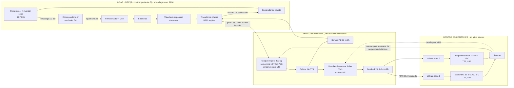

# 01 — Projeto térmico da câmara fria solar com banco de gelo

Autor: subagente engenheiro-refrigeracao. Data: 17/11/2026.
Base: `docs/00-premissas.md` (versão com a fruta definida: **manga e caju**).
Contas: `docs/_trabalho/termico.py`; saída completa em `docs/_trabalho/termico_saida.txt`. Todas as tabelas numéricas deste documento foram copiadas dessa saída.

Marcação usada: **[CALCULADO]** = sai de conta mostrada aqui ou no script; **[SUPOSTO]** = valor típico adotado sem fonte aberta ou sem dado de catálogo; **[VALIDAR]** = validar com profissional habilitado antes de comprar ou executar.

## Aviso sobre a pesquisa na web

Neste ambiente só a ferramenta de busca funcionou. A abertura direta de páginas falhou para todos os sites tentados (upneda.org.in, mnre/s3waas.gov.in, media.copeland.com, danfoss.com, embraco.com, ecozensolutions.com). Por isso:

- Cada número com fonte vem do **resumo que a busca devolveu** para o link citado. Eu não li os PDFs inteiros.
- Não consegui abrir: nenhum catálogo de compressor (BITZER, Embraco, Copeland, Danfoss), o texto de nenhuma norma (ABNT NBR ISO 5149, NBR 16069, IEC 60335-2-89, EN 378), a tabela do SunData/CRESESB para Petrolina, a especificação UPNEDA e a diretriz MNRE.
- Onde isso aconteceu o número está como [SUPOSTO] e a pendência está na seção 13.
- Quase nenhum preço em reais apareceu. Onde não apareceu está escrito "preço não encontrado".

## Resumo em uma página

| Item | Estimativa do dono | Resultado deste projeto |
|---|---|---|
| Frio necessário por dia | 55 a 60 kWh | **70 kWh (só manga a 10 °C) a 80 kWh (caju a 5 °C)** [CALCULADO] |
| Painéis | 5 kWp | **12 kWp** (mínimo que fecha a conta: 10 a 11 kWp) [CALCULADO] |
| Gelo | 200 kg | **800 kg** (mínimo: 700 kg sem regra de horário; 400 kg com fruta só de manhã) [CALCULADO] |
| Horas sem sol cobertas | 14 h | 14 h com folga no pior caso; **46 a 50 h** sem sol nenhum e sem fruta nova [CALCULADO] |
| Fruta | não definida | Manga a 12 °C e caju a 5 °C em **duas zonas** separadas por divisória |
| Gás | em aberto | **R290 (propano) só do lado de fora**, em 2 circuitos pequenos; dentro da câmara circula só água com propilenoglicol |
| Compressor | velocidade variável direto no painel | 2 compressores semi-herméticos trifásicos, cada um com seu inversor solar, 30 a 70 Hz. **Modelo exato não fechado: catálogo não abriu** |
| Frio à noite | — | Bomba pequena (50 W) circula glicol entre o tanque de gelo e a serpentina de ar; ventiladores a 50 W. Sem compressor |

Com 5 kWp e 200 kg o sistema produz 30,4 kWh de frio num dia de projeto e a câmara precisa de 69,8 a 79,5 kWh. Faltam 39 a 49 kWh por dia. **Não fecha, e não é por pouco** [CALCULADO, seção 5.2].

---

## 1. Invólucro: reefer usado x contêiner seco isolado x painéis isotérmicos

### 1.1 Dados encontrados

| Dado | Valor | Fonte |
|---|---|---|
| Perda de calor de reefer 20 pés novo | cerca de 20 W/K (parede a 20 °C); 23 a 24 W/K (máximo de fábrica Maersk); 25,6 W/K (Textainer, 22 kcal/h·°C) | [GCS Reefer](https://www.gcs-reefer.com/sites/default/files/201117_container_spec_20ft_css_2_0.pdf), [MCI](https://www.mcicontainers.com/wp-content/uploads/2022/07/MCI-Box-Fact-sheet.pdf), [Textainer](https://www.textainer.com/equipment/refrigerated) |
| Contêiner medido com isolamento envelhecido | U = 0,509 W/m²·K | [Wageningen](https://edepot.wur.nl/555539) |
| Painel PIR 100 mm, condutividade | 0,020 a 0,023 W/m·K | [AECweb](https://www.aecweb.com.br/produto/painel-isofachada-pur-pir/31644) |
| Reefer 20 pés usado, preço | R$ 20.000 (Arealva-SP, precisa revisar o motor) a R$ 30.000 (Santos, revisado) | [MF Rural](https://www.mfrural.com.br/busca/reefer-20-pes) — anúncios sem data, vistos em 17/11/2026 |
| Contêiner seco 20 pés usado | a partir de R$ 7.000 (Curitiba) | [MF Rural](https://www.mfrural.com.br/busca/venda-containers) — idem |
| Isolamento de câmara com painel de poliuretano 100 mm, instalado | R$ 894,32/m² (composição de referência ORSE 9438) | [Orçamentor](https://orcamentor.com/orse/composicoes/ORSE-9438/) |

### 1.2 Área e UA de cada opção

Medidas internas de reefer 20 pés: 5,44 × 2,29 × 2,26 m, volume 28 m³ [SUPOSTO, medidas típicas]. Área média do invólucro: cerca de 66 m² [CALCULADO].

| Opção | U (W/m²·K) | Área (m²) | UA adotado (W/K) | Como cheguei |
|---|---|---|---|---|
| Reefer usado | 0,50 | 66 | **33** | 22 W/K de fábrica × 1,5 de envelhecimento [SUPOSTO]; bate com 0,509 × 66 = 33,6 [CALCULADO] |
| Reefer novo | 0,33 | 66 | 22 | média dos valores de fábrica acima |
| Seco + 100 mm de PU por dentro | 0,27 + pontes térmicas | 67 | 22 | 0,27 × 67 = 18 W/K; +20 % de pontes térmicas pelas nervuras de aço [SUPOSTO] |
| Painel PIR 100 mm | 0,22 | 65,6 | 16,6 | U = 1/(0,17 + 0,100/0,023) = 0,22; 0,22 × 65,6 = 14,4; +15 % de porta e juntas [SUPOSTO] |

### 1.3 Efeito na carga térmica e custo

Carga diária total (kWh de frio por dia, dia de projeto) [CALCULADO]:

| Caso | Reefer usado | Reefer novo ou seco isolado | Painel PIR 100 mm |
|---|---|---|---|
| Só manga a 10 °C | 69,8 | 62,9 | 59,5 |
| Tudo a 5 °C (caju) | 79,5 | 71,1 | 67,0 |

O painel economiza 10 a 12,5 kWh/dia em relação ao reefer usado, o que equivale a cerca de 1,5 a 2 kWp de painel solar a menos.

| Opção | Custo encontrado | A favor | Contra |
|---|---|---|---|
| **Reefer usado** | R$ 20 a 30 mil | Já vem com piso, porta frigorífica com vedação, dreno e casca de aço. Transportável. Mais barato | Isolamento envelhecido (maior carga). A máquina original de bordo não serve para o sistema solar |
| Seco + isolamento | R$ 7 mil + isolamento (67 m² × R$ 894 = R$ 60 mil pela referência ORSE) | Casca barata | Perde 20 cm de largura e altura, pontes térmicas, precisa de porta frigorífica e piso novos. Sai mais caro que o reefer |
| Painéis PIR | 66 m² × R$ 894 = R$ 59 mil, sem porta, piso e cobertura [CALCULADO a partir da referência ORSE] | Menor carga térmica, tamanho livre | Mais caro, precisa de base e telhado, é frágil para carga e descarga |

**Decisão: reefer usado de 20 pés**, apenas a caixa. A diferença de preço (cerca de R$ 30 mil) paga com folga os 2 kWp extras de painel. Condições:

1. Na compra, fazer teste de perda de calor: aquecedor de potência conhecida dentro da caixa fechada por 12 h, medir a diferença de temperatura. Aceitar se UA ≤ 30 W/K [VALIDAR]. O projeto usa 33 W/K.
2. A cobertura dos painéis solares deve sombrear o teto do contêiner, com vão ventilado de pelo menos 30 cm. A conta de transmissão já supõe teto sombreado e paredes com acréscimo de 2 K durante o dia [SUPOSTO].
3. Cortina de tiras de PVC na porta.

Alternativa mais eficiente: painéis PIR de 100 mm, se o dono preferir pagar mais na caixa e menos em painel solar.

**Atenção à capacidade:** 5 t de fruta em caixas de 20 kg ocupam cerca de 18 m³ dos 28 m³ [CALCULADO, 250 caixas de 0,072 m³]. Cabe, mas quase sem corredor. Com duas zonas e divisória a capacidade prática cai para algo como 4 t [SUPOSTO]. Se as 5 t forem obrigatórias com duas frutas, considerar um reefer de 40 pés (pendência para o dono).

---

## 2. As duas frutas: manga e caju não querem a mesma câmara

### 2.1 Condições ideais

| | Manga | Caju (pedúnculo fresco) |
|---|---|---|
| Temperatura | 13 °C para manga verde-madura; 10 °C para parcialmente madura ou madura ([UC Davis](https://postharvest.ucdavis.edu/node/5351)). Faixa 10 a 13 °C ([WFLO](https://www.gcca.org/system/files/WFLO-Commodity-Storage-Manual-2018-Mangos.pdf)) | **5 °C** ([Embrapa/PAB 2007](https://seer.sct.embrapa.br/index.php/pab/article/download/7591/4510)); há estudo a 3 °C ([Embrapa](https://www.infoteca.cnptia.embrapa.br/infoteca/bitstream/doc/1098224/1/BPD18023.pdf)) |
| Umidade relativa | 85 a 90 % (WFLO) | 85 a 90 %; ensaio a 88 ± 3 % (Embrapa/PAB) |
| Vida útil | 2 a 4 semanas (WFLO) | 10 a 25 dias a 5 °C **com bandeja e filme de PVC**, conforme o clone: 10 dias (END 189), 15 (END 157), 25 (CCP 76 e END 183) ([Embrapa](https://www.alice.cnptia.embrapa.br/alice/bitstream/doc/580681/1/PC09007.pdf)) |
| Dano por frio | Abaixo de 10 a 13 °C. Estudo da Embrapa Semiárido: 8 a 10 °C favoreceu escurecimento da polpa; a 12,5 °C não houve sintoma; Tommy Atkins e Keitt chegaram perto de 100 % de incidência após 45 dias a 9 °C ([Movimento Econômico, 21/09/2026](https://movimentoeconomico.com.br/agronegocio/2026/09/21/pesquisa-evita-corte-negro-e-rejeicao-de-manga-exportada-do-vale-do-sao-francisco/), [Itatiaia](https://www.itatiaia.com.br/agro/pesquisa-identifica-causa-do-escurecimento-da-polpa-de-mangas-apos-refrigeracao/)) | Clones de pedúnculo mais vermelho perdem cor e sofrem a 5 °C (Embrapa, links acima). Perguntar o clone ao produtor |
| Calor de respiração | 12 a 16 ml CO₂/kg·h a 10 °C; 15 a 22 a 13 °C; 35 a 80 a 20 °C (UC Davis) → **66 a 88 W/t a 10 °C, adotado 77 W/t** [CALCULADO abaixo] | **Não encontrei dado medido.** Adotado 20 mg CO₂/kg·h a 5 °C = **60 W/t** [SUPOSTO] |

Conversão da respiração em calor: 1 mg CO₂/kg·h = 61,2 kcal/t·dia ([ARCC Journals](https://arccjournals.com/journal/asian-journal-of-dairy-and-food-research/DR-1843)) = 61,2 × 4186 / 86400 = 2,97 W/t. 14 ml CO₂/kg·h × 1,87 mg/ml = 26 mg/kg·h × 2,97 = 77 W/t [CALCULADO]. Variação com a temperatura: fator 2,5 a cada 10 °C [SUPOSTO].

Se a respiração real do caju for o dobro do que supus, a carga sobe 10,4 kWh/dia [CALCULADO]. A folga do projeto cobre isso (seção 5.4), mas é a maior incerteza de fruta. [VALIDAR com a Embrapa Agroindústria Tropical.]

**Mudança em relação à premissa:** o caso-base "manga a 10 °C" é arriscado para manga colhida verde-madura. Recomendo **12 °C** na zona da manga e 10 °C só para fruta já madura de giro rápido. Isso reduz a carga em 3 kWh/dia.

Frutas que **não servem** a 5 °C por dano por frio: manga, banana, mamão, abacaxi, goiaba, limão [SUPOSTO, conhecimento geral de pós-colheita; só a manga tem fonte acima].

### 2.2 As três saídas

| Saída | Carga (kWh/dia, reefer usado) | Equipamento a mais | Efeito na fruta |
|---|---|---|---|
| A. Temperatura de compromisso (8 °C) | 74,0 | Nenhum | **Ruim para as duas.** A manga fica dentro da faixa de 8 a 10 °C onde a Embrapa viu escurecimento da polpa. O caju perde cerca de 25 % da vida útil: 10 a 25 dias viram cerca de 8 a 19 dias [CALCULADO com fator 2,5 por 10 °C, SUPOSTO] |
| B. Operação alternada por safra | 66,6 (manga a 12 °C) ou 79,5 (caju a 5 °C) | Nenhum. O equipamento precisa atender 5 °C de qualquer forma | Ideal para cada fruta, **mas só funciona se as safras não se sobrepõem**. As duas colhem no segundo semestre no sertão [SUPOSTO; o agente de logística deve confirmar o calendário] |
| **C. Duas zonas com divisória** | 70,2 a 75,9 | Divisória isolada com porta, segunda serpentina de ar com sua válvula e seu sensor | Cada fruta na sua temperatura. A divisória removível permite voltar ao modo B |

### 2.3 Recomendação: duas zonas (saída C)

- **Zona do fundo (40 % do comprimento, cerca de 2,2 m): caju a 5 °C.**
- **Zona da porta (60 %, cerca de 3,2 m): manga a 12 °C.** Quem vai buscar caju passa pela zona da manga, que funciona como antecâmara e reduz a entrada de ar quente na zona fria.
- Divisória: painel PIR de 50 mm com porta de correr ou cortina de tiras dupla. Calor que passa pela divisória: 0,45 W/m²·K × 5,2 m² × 7 K ≈ 16 W, desprezível [CALCULADO].
- A arquitetura com glicol (seção 6) torna a segunda zona barata: é só mais uma serpentina de ar e uma válvula no mesmo circuito de líquido. Não há segundo circuito de gás.
- A manga produz etileno e o caju tem cheiro forte; a divisória também separa o ar [SUPOSTO].

**Caso de dimensionamento.** Dimensionei tudo para o caso mais exigente que a recomendação permite: **divisória aberta, câmara inteira a 5 °C, 1 t/dia de caju entrando a 30 °C** (79,5 kWh/dia). Esse caso cobre as duas zonas em qualquer proporção (70,2 a 75,9 kWh/dia) e a operação só com manga (66,6 a 69,8 kWh/dia).

---

## 3. Carga térmica

### 3.1 Dia de projeto e premissas

| Premissa | Valor | Marcação |
|---|---|---|
| Temperatura externa | 40 °C às 15 h, 26 °C às 3 h, curva senoidal | 40 °C é premissa do dono; mínima e forma [SUPOSTO]. Não achei a normal climatológica de Petrolina; uma estação local registrou 37,0 °C em 04/01/2025 ([UNIVASF](https://labmet.univasf.edu.br/dados_estacoes/analise_climatica_petrolina-2025.pdf)) |
| Fruta que entra | 1.000 kg a 30 °C, mais 50 caixas plásticas de 1,8 kg | premissa; caixas [SUPOSTO] |
| Calor específico da fruta | 3,77 kJ/kg·K (0,901 kcal/kg·°C, manga) | [Scribd, fonte secundária](https://www.scribd.com/presentation/612658629/COLD-STORAGE). Usado também para o caju [SUPOSTO] |
| Velocidade de resfriamento da fruta dentro da câmara | constante de tempo de 8 h (metade do calor sai em 5,5 h) | [SUPOSTO] |
| Aberturas de porta | 12 trocas do volume de ar por dia; ar externo a 37 °C e 30 % UR, pressão 97 kPa | [SUPOSTO] |
| Ventiladores da serpentina de ar | 150 W de dia, 50 W à noite | [SUPOSTO], seção 8.3 |
| Pessoas | 2 pessoas × 212 W durante a hora de carga; 1 pessoa por 1 h às 8 h e às 14 h | fórmula ASHRAE 272 − 6·T [SUPOSTO, de memória] |
| Iluminação | 40 W de LED quando há gente | [SUPOSTO] |
| Bomba do circuito da câmara e ganho do tanque de gelo | 50 W + 3,5 W/K × (T externa − 0 °C) | [CALCULADO], seção 6.4 |
| Folga | +10 % sobre tudo | [SUPOSTO] |

Calor de campo, conferência à mão para o caso 5 °C: (1000 × 3,77 + 90 × 1,9) kJ/K × (30 − 5) K = 98.500 kJ = 27,4 kWh [CALCULADO]. Para manga a 10 °C: 3.941 × 20 = 78.800 kJ = 21,9 kWh. A conta rápida do orquestrador (24 kWh) estava na ordem certa.

### 3.2 Hora a hora — caso de dimensionamento (tudo a 5 °C, fruta entra às 17 h, pior horário), em kW

| h | T ext. | transm. | infiltr. | campo | respir. | ventil. | pessoas+luz | bomba+tanque | TOTAL c/ folga |
|---|---|---|---|---|---|---|---|---|---|
| 00 | 27.4 | 0.74 | 0.00 | 1.41 | 0.39 | 0.05 | 0.00 | 0.15 | 3.01 |
| 01 | 26.5 | 0.71 | 0.00 | 1.24 | 0.38 | 0.05 | 0.00 | 0.14 | 2.78 |
| 02 | 26.1 | 0.69 | 0.00 | 1.10 | 0.36 | 0.05 | 0.00 | 0.14 | 2.58 |
| 03 | 26.1 | 0.69 | 0.00 | 0.97 | 0.35 | 0.05 | 0.00 | 0.14 | 2.43 |
| 04 | 26.5 | 0.71 | 0.00 | 0.86 | 0.35 | 0.05 | 0.00 | 0.14 | 2.31 |
| 05 | 27.4 | 0.74 | 0.00 | 0.76 | 0.34 | 0.05 | 0.00 | 0.15 | 2.23 |
| 06 | 28.7 | 0.78 | 0.22 | 0.67 | 0.33 | 0.15 | 0.00 | 0.15 | 2.53 |
| 07 | 30.3 | 0.90 | 0.22 | 0.59 | 0.33 | 0.15 | 0.00 | 0.16 | 2.58 |
| 08 | 32.1 | 0.96 | 0.22 | 0.52 | 0.32 | 0.15 | 0.25 | 0.16 | 2.84 |
| 09 | 33.9 | 1.02 | 0.22 | 0.46 | 0.32 | 0.15 | 0.00 | 0.17 | 2.57 |
| 10 | 35.7 | 1.08 | 0.22 | 0.40 | 0.32 | 0.15 | 0.00 | 0.17 | 2.58 |
| 11 | 37.3 | 1.13 | 0.22 | 0.36 | 0.32 | 0.15 | 0.00 | 0.18 | 2.59 |
| 12 | 38.6 | 1.17 | 0.22 | 0.31 | 0.31 | 0.15 | 0.00 | 0.18 | 2.59 |
| 13 | 39.5 | 1.20 | 0.22 | 0.28 | 0.31 | 0.15 | 0.00 | 0.19 | 2.58 |
| 14 | 39.9 | 1.22 | 0.22 | 0.25 | 0.31 | 0.15 | 0.25 | 0.19 | 2.84 |
| 15 | 39.9 | 1.22 | 0.22 | 0.22 | 0.31 | 0.15 | 0.00 | 0.19 | 2.53 |
| 16 | 39.5 | 1.20 | 0.22 | 0.19 | 0.31 | 0.15 | 0.00 | 0.19 | 2.49 |
| 17 | 38.6 | 1.11 | 1.53 | 3.38 | 0.77 | 0.15 | 0.46 | 0.18 | 8.34 |
| 18 | 37.3 | 1.06 | 1.31 | 2.99 | 0.65 | 0.05 | 0.00 | 0.18 | 6.87 |
| 19 | 35.7 | 1.01 | 0.00 | 2.64 | 0.57 | 0.05 | 0.00 | 0.17 | 4.88 |
| 20 | 33.9 | 0.95 | 0.00 | 2.33 | 0.51 | 0.05 | 0.00 | 0.17 | 4.41 |
| 21 | 32.1 | 0.89 | 0.00 | 2.05 | 0.47 | 0.05 | 0.00 | 0.16 | 3.99 |
| 22 | 30.3 | 0.84 | 0.00 | 1.81 | 0.43 | 0.05 | 0.00 | 0.16 | 3.62 |
| 23 | 28.7 | 0.78 | 0.00 | 1.60 | 0.41 | 0.05 | 0.00 | 0.15 | 3.29 |
| **kWh/dia** | | 22.8 | 5.2 | 27.4 | 9.5 | 2.4 | 1.0 | 4.0 | **79.5** |

As parcelas somam 72,3 kWh; com a folga de 10 % dá 79,5 kWh/dia [CALCULADO]. As linhas "campo" e "respiração" incluem a fruta que entrou nos dias anteriores e ainda está terminando de esfriar.

### 3.3 Resumo por caso (reefer usado) [CALCULADO]

| Caso | kWh/dia | Carga das 17 h às 7 h, fruta às 17 h | Idem, fruta às 7 h | Pico horário |
|---|---|---|---|---|
| Só manga a 10 °C | 69,8 | 45,8 kWh (494 kg de gelo) | 26,4 kWh | 7,1 kW |
| Só manga a 12,5 °C | 66,6 | 43,1 kWh | 25,9 kWh | — |
| Compromisso a 8 °C | 74,0 | 49,0 kWh | 27,7 kWh | — |
| Duas zonas, entra 1 t de caju | 75,9 | 50,6 kWh | 28,3 kWh | — |
| Duas zonas, entra 1 t de manga | 70,2 | 45,5 kWh | 27,1 kWh | — |
| **Tudo a 5 °C (dimensionamento)** | **79,5** | **53,3 kWh (574 kg de gelo)** | **29,3 kWh (315 kg)** | **8,3 kW** |

### 3.4 Horário de entrada da fruta: regra de operação

O total do dia é o mesmo, mas o que o gelo precisa cobrir à noite quase dobra quando a fruta entra no fim da tarde: 53,3 contra 29,3 kWh. Fruta que entra de manhã é resfriada com o sol do próprio dia.

**Regra recomendada: fruta nova entra até as 10 h.** Fruta colhida à tarde espera à sombra e entra na manhã seguinte, ou entra em meia carga (até 500 kg). O sistema foi dimensionado para aguentar o pior caso (17 h) em dia de sol, para a regra não ser uma condição de sobrevivência; ela vira folga para dias ruins.

---

## 4. Geração solar

### 4.1 Irradiação

**Não consegui obter a tabela mensal de Petrolina** (SunData/CRESESB não abre aqui). O que a busca trouxe:

- O semiárido tem médias anuais de irradiação global horizontal acima de 6 kWh/m²·dia ([CBENS](https://anaiscbens.emnuvens.com.br/cbens/article/download/717/717)); um estudo da UFPE dá 6,5 kWh/m²·dia para o Sertão ([UFPE](https://periodicos.ufpe.br/revistas/rbgfe/article/download/265793/52128/315516)).
- Um site de estimativa dá, para Petrolina, 5,85 kWh/dia por kW instalado no inverno e 7,03 na primavera ([ProfileSolar](https://profilesolar.com/locations/Brazil/Petrolina/)); fonte fraca.

Valores adotados, do lado conservador [SUPOSTO, conferir no [SunData](https://cresesb.cepel.br/sundata/index.php) com latitude 9,39° S e longitude 40,50° O]:

| Dia | Irradiação no plano dos painéis (kWh/m²·dia) | T externa (°C) |
|---|---|---|
| Projeto (época quente) | 5,8 | 26 a 40 |
| Junho médio | 4,7 | 20 a 32 |
| Dia ruim | 3,0 | 24 a 36 |
| Dia nublado | 2,0 | 24 a 34 |

Perfil horário: nascer às 5 h 30, pôr às 17 h 40, forma senoidal elevada a 1,3 [SUPOSTO]. Desempenho global do arranjo: 0,75 (calor nos módulos, sujeira, cabos, inversor) [SUPOSTO]. O integrador solar deve refazer com dados reais.

### 4.2 Regras do acionamento direto usadas no balanço

- Energia disponível para os compressores = geração − 560 W (ventiladores dos condensadores 300 W + bomba de carga 260 W).
- Potência elétrica máxima dos compressores = 0,62 × kWp (para 12 kWp: 7,4 kW).
- Potência mínima para um compressor partir = 21,5 % do total (1,6 kW): por isso **dois compressores**, e não um grande. Com um só compressor o mínimo seria 3,2 kW e num dia nublado (2,0 kWh/m²) ele não partiria nunca: a primeira rodada do script deu frio produzido igual a zero nesse dia.
- Tanque cheio: o compressor reduz a rotação e atende só a câmara.

---

## 5. Balanço diário e dimensionamento

### 5.1 COP usado

Calculado com as propriedades do R290 (biblioteca CoolProp 8.0.0), ciclo simples, superaquecimento de 8 K, sub-resfriamento de 3 K, condensação 10 K acima do ar [SUPOSTO], eficiência global de compressão (compressor + motor + inversor) de 0,60 [SUPOSTO — **não é dado de catálogo**, ver seção 7].

| Modo | T evap. (°C) | T ext. (°C) | T cond. (°C) | p evap. (bar abs) | p cond. (bar abs) | COP elétrico |
|---|---|---|---|---|---|---|
| gelo | −10 | 26 | 36 | 3,45 | 12,47 | 2,77 |
| gelo | −10 | 33 | 43 | 3,45 | 14,67 | 2,28 |
| gelo | −10 | 40 | 50 | 3,45 | 17,13 | 1,90 |
| gelo | −10 | 43 | 53 | 3,45 | 18,28 | 1,76 |
| câmara | −4 | 26 | 36 | 4,19 | 12,47 | 3,34 |
| câmara | −4 | 33 | 43 | 4,19 | 14,67 | 2,71 |
| câmara | −4 | 40 | 50 | 4,19 | 17,13 | 2,23 |
| câmara | −4 | 43 | 53 | 4,19 | 18,28 | 2,06 |

O balanço usa sempre o COP do modo gelo, que é o pior. O sistema passa quase o dia inteiro fazendo gelo e atendendo a câmara ao mesmo tempo.

### 5.2 Os números do dono (5 kWp, 200 kg) [CALCULADO]

| Caso | Carga | Geração FV | Frio produzido | Falta por dia |
|---|---|---|---|---|
| Manga a 10 °C | 69,8 kWh | 21,8 kWh | 30,4 kWh | **39,5 kWh** |
| Tudo a 5 °C | 79,5 kWh | 21,8 kWh | 30,4 kWh | **49,1 kWh** |

O limite aqui é o painel, não o gelo: 5 kWp não produzem nem metade do frio do dia. Sobre o gelo: 200 kg × 334 kJ/kg = 66.800 kJ = 18,6 kWh; a noite pede 26 a 53 kWh. Sem sol e sem fruta nova, 200 kg duram **12 a 13 h**, não 14 h.

### 5.3 Varredura: falta de frio (kWh/dia) em regime, caso tudo a 5 °C, reefer usado [CALCULADO]

Fruta entrando às 17 h (pior horário):

| kWp \ kg de gelo | 200 | 400 | 500 | 600 | 700 | 800 | 900 | 1000 | 1200 |
|---|---|---|---|---|---|---|---|---|---|
| 5 | 49.1 | 49.1 | 49.1 | 49.1 | 49.1 | 49.1 | 49.1 | 49.1 | 49.1 |
| 8 | 37.2 | 22.0 | 22.0 | 22.0 | 22.0 | 22.0 | 22.0 | 22.0 | 22.0 |
| 10 | 37.2 | 18.7 | 9.4 | 5.0 | 5.0 | 1.6 | 0.0 | 0.0 | 0.0 |
| 11 | 37.2 | 18.7 | 9.4 | 0.1 | 0.0 | 0.0 | 0.0 | 0.0 | 0.0 |
| 12 | 37.2 | 18.7 | 9.4 | 0.1 | 0.0 | 0.0 | 0.0 | 0.0 | 0.0 |
| 14 | 37.2 | 18.7 | 9.4 | 0.1 | 0.0 | 0.0 | 0.0 | 0.0 | 0.0 |

Fruta entrando às 7 h (regra da manhã):

| kWp \ kg de gelo | 200 | 400 | 500 | 600 | 700 | 800 | 900 | 1000 | 1200 |
|---|---|---|---|---|---|---|---|---|---|
| 5 | 49.1 | 49.1 | 49.1 | 49.1 | 49.1 | 49.1 | 49.1 | 49.1 | 49.1 |
| 8 | 22.0 | 22.0 | 22.0 | 22.0 | 22.0 | 22.0 | 22.0 | 22.0 | 20.9 |
| 10 | 17.8 | 5.0 | 5.0 | 0.8 | 0.0 | 0.0 | 0.0 | 0.0 | 0.0 |
| 11 | 17.3 | 0.0 | 0.0 | 0.0 | 0.0 | 0.0 | 0.0 | 0.0 | 0.0 |
| 12 | 16.7 | 0.0 | 0.0 | 0.0 | 0.0 | 0.0 | 0.0 | 0.0 | 0.0 |
| 14 | 15.5 | 0.0 | 0.0 | 0.0 | 0.0 | 0.0 | 0.0 | 0.0 | 0.0 |

Leitura:

- **Mínimo que fecha em dia de projeto: 11 kWp + 700 kg** (sem regra de horário) ou **11 kWp + 400 kg** (com fruta só de manhã).
- Só manga a 10 °C: 10 kWp + 600 kg, ou 10 kWp + 400 kg com a regra.
- Com painéis PIR em vez de reefer usado: 10 kWp + 600 kg, ou 10 kWp + 400 kg com a regra.
- Mais painel acima de 11 kWp não reduz o gelo necessário: o gelo é determinado pela noite.

### 5.4 Projeto escolhido: 12 kWp + 800 kg de gelo (74,2 kWh de frio)

É o mínimo mais uma folga de cerca de 10 % no painel e 15 % no gelo, justificada pela quantidade de valores [SUPOSTO] (irradiação, COP, respiração do caju).

Balanço hora a hora, dia de projeto em regime, fruta às 17 h [CALCULADO]:

| h | T ext. | FV (kW) | compressores (kW) | COP | frio produzido (kW) | carga (kW) | gelo no fim da hora (kWh) |
|---|---|---|---|---|---|---|---|
| 00 | 27.4 | 0.00 | 0.00 | — | 0.00 | 3.01 | 33.3 |
| 01 | 26.5 | 0.00 | 0.00 | — | 0.00 | 2.78 | 30.6 |
| 02 | 26.1 | 0.00 | 0.00 | — | 0.00 | 2.58 | 28.0 |
| 03 | 26.1 | 0.00 | 0.00 | — | 0.00 | 2.43 | 25.5 |
| 04 | 26.5 | 0.00 | 0.00 | — | 0.00 | 2.31 | 23.2 |
| 05 | 27.4 | 0.10 | 0.00 | — | 0.00 | 2.23 | 21.0 |
| 06 | 28.7 | 1.21 | 0.00 | — | 0.00 | 2.53 | 18.5 |
| 07 | 30.3 | 2.87 | 2.31 | 2.46 | 5.68 | 2.58 | 21.6 |
| 08 | 32.1 | 4.53 | 3.97 | 2.34 | 9.30 | 2.84 | 28.0 |
| 09 | 33.9 | 5.94 | 5.38 | 2.23 | 12.00 | 2.57 | 37.4 |
| 10 | 35.7 | 6.90 | 6.34 | 2.13 | 13.48 | 2.58 | 48.3 |
| 11 | 37.3 | 7.29 | 6.73 | 2.04 | 13.72 | 2.59 | 59.5 |
| 12 | 38.6 | 7.05 | 6.49 | 1.97 | 12.81 | 2.59 | 69.7 |
| 13 | 39.5 | 6.23 | 3.69 | 1.93 | 7.11 | 2.58 | 74.2 (cheio) |
| 14 | 39.9 | 4.92 | 1.49 | 1.91 | 2.84 | 2.84 | 74.2 |
| 15 | 39.9 | 3.30 | 1.33 | 1.91 | 2.53 | 2.53 | 74.2 |
| 16 | 39.5 | 1.61 | 0.00 | — | 0.00 | 2.49 | 71.7 |
| 17 | 38.6 | 0.26 | 0.00 | — | 0.00 | 8.34 | 63.4 |
| 18 | 37.3 | 0.00 | 0.00 | — | 0.00 | 6.87 | 56.5 |
| 19 | 35.7 | 0.00 | 0.00 | — | 0.00 | 4.88 | 51.6 |
| 20 | 33.9 | 0.00 | 0.00 | — | 0.00 | 4.41 | 47.2 |
| 21 | 32.1 | 0.00 | 0.00 | — | 0.00 | 3.99 | 43.2 |
| 22 | 30.3 | 0.00 | 0.00 | — | 0.00 | 3.62 | 39.6 |
| 23 | 28.7 | 0.00 | 0.00 | — | 0.00 | 3.29 | 36.3 |
| **dia** | | 52,2 kWh | 37,7 kWh | 2,11 | 79,5 kWh | 79,5 kWh | mínimo 18,5 (25 % do tanque) |

Geração não aproveitada: 8,0 kWh (tanque cheio a partir das 13 h, e começo e fim do dia abaixo do mínimo do compressor). Essa sobra é a folga do painel; pode alimentar a bateria pequena e a Starlink (assunto do integrador solar).

Com a fruta entrando às 7 h o estoque mínimo sobe para 39,0 kWh (53 % do tanque).

### 5.5 Cenários com 12 kWp + 800 kg (mesmo dia repetido até regime) [CALCULADO]

| Cenário | Caso | Irrad. | T máx. | Entrada | Carga (kWh) | Frio produzido (kWh) | Falta (kWh/dia) | Gelo mínimo (kWh) |
|---|---|---|---|---|---|---|---|---|
| Projeto, pior horário | tudo a 5 °C | 5,8 | 40 | 17 h | 79,5 | 79,5 | 0,0 | 18,5 |
| Projeto, melhor horário | tudo a 5 °C | 5,8 | 40 | 7 h | 79,5 | 79,5 | 0,0 | 39,0 |
| Duas zonas, entra caju | 2 zonas | 5,8 | 40 | 17 h | 75,9 | 75,9 | 0,0 | 21,2 |
| Duas zonas, entra manga | 2 zonas | 5,8 | 40 | 17 h | 70,2 | 70,2 | 0,0 | 26,3 |
| Só manga a 10 °C | manga | 5,8 | 40 | 17 h | 69,8 | 69,8 | 0,0 | 26,1 |
| Junho médio | tudo a 5 °C | 4,7 | 32 | 17 h | 70,5 | 70,5 | 0,0 | 23,9 |
| Irradiação 10 % menor (outro ponto do sertão) | tudo a 5 °C | 5,2 | 40 | 17 h | 79,5 | 79,5 | 0,0 | 18,5 |
| Dia ruim repetido | tudo a 5 °C | 3,0 | 36 | 7 h | 75,4 | 41,4 | **34,0** | 0 |
| Dia ruim repetido, meia carga (0,5 t) | tudo a 5 °C | 3,0 | 36 | 7 h | 59,0 | 41,4 | **17,6** | 0 |
| Dia ruim repetido, sem fruta nova | tudo a 5 °C | 3,0 | 36 | 7 h | 38,5 | 38,5 | 0,0 | 49,6 |

Sensibilidade ao local: com 10 % a menos de irradiação o sistema ainda fecha, porque a folga de 8 kWh de geração absorve a diferença. Abaixo de cerca de 5,0 kWh/m²·dia em época quente passa a faltar.

### 5.6 Sequência de dias nublados [CALCULADO]

Dois dias de projeto, três dias nublados (2,0 kWh/m²·dia), dois dias de projeto. Caso tudo a 5 °C.

Fruta entra às 7 h e **é suspensa** nos dias nublados:

| Dia | Irrad. | Carga (kWh) | Frio produzido (kWh) | Falta (kWh) | Gelo no fim (kWh) |
|---|---|---|---|---|---|
| 1 | 5,8 | 79,5 | 58,7 | 0,0 | 53,5 |
| 2 | 5,8 | 79,5 | 79,5 | 0,0 | 53,5 |
| 3 | 2,0 | 37,2 | 13,3 | 0,0 | 29,5 |
| 4 | 2,0 | 37,2 | 13,3 | 0,0 | 5,5 |
| 5 | 2,0 | 37,2 | 13,3 | 18,5 | 0,0 |
| 6 | 5,8 | 79,5 | 91,5 | 14,5 | 26,4 |
| 7 | 5,8 | 79,5 | 91,5 | 0,0 | 38,4 |

Fruta continua entrando nos dias nublados (às 7 h): falta 7,2 kWh já no primeiro dia nublado e 60,6 kWh em cada um dos seguintes.

Interpretação:

- A fruta guardada tem inércia: 5 t × 3,77 kJ/kg·K = 5,2 kWh por grau. Uma falta de 18,5 kWh significa a fruta subir cerca de 3,5 °C ao longo do terceiro dia nublado [CALCULADO]. É tolerável para a manga; para o caju encurta a vida útil.
- **Regra: dia nublado, não entra fruta quente.** O controle deve avisar quando o gelo estiver abaixo de 30 % às 15 h.
- Tanque cheio, sem sol nenhum e sem fruta nova: **46 h** (tudo a 5 °C), 49 h (duas zonas), 50 h (manga) [CALCULADO]. Com 200 kg seriam 12 a 13 h.
- Para garantir mais de três dias nublados seguidos com fruta dentro seria preciso gerador ou rede como apoio. A diretriz indiana admite rede para períodos nublados longos ([Saur Energy](https://www.saurenergy.com/ev-storage/mnre-sets-norms-for-solar-cold-storage-with-thermal-energy-backup)). Decisão do dono (seção 13).

### 5.7 Comparação com produtos parecidos

| Referência | O que a busca mostrou | Leitura |
|---|---|---|
| Ecozen Ecofrost (Índia), 5 a 6 t | 5 kWp no teto; armazenamento térmico de até 30 h; 4 a 10 °C; compressor Copeland ZBW de velocidade variável ([E4C](https://www.engineeringforchange.org/solutions/product/ecofrost-micro-cold-storage/), [Ecozen](https://www.ecozensolutions.com/?p=1066), [Copeland](https://www.copeland.com/en-my/products/refrigeration/integrated-solutions-for-refrigeration/zbw-zfw-variable-speed-integrated-solutions)) | É a origem provável dos "5 kWp". A busca não mostrou quanta fruta quente por dia o produto aceita nem a temperatura externa de projeto |
| Diretriz MNRE (Índia, 2025), 2 a 20 t | Armazenamento térmico para até **48 h** sem sol; pré-resfriamento diário de **10 % da capacidade** ([Saur Energy](https://www.saurenergy.com/ev-storage/mnre-sets-norms-for-solar-cold-storage-with-thermal-energy-backup), [Renewable Watch](https://renewablewatch.in/2025/02/14/mnre-releases-draft-guidelines-for-solar-cold-storage-with-tes-backup/)) | Para 5 t seriam 0,5 t/dia de fruta nova. **O dono pede 1 t/dia (20 %)**: o dobro. As 46 a 50 h deste projeto ficam na mesma ordem das 48 h indianas |
| UPNEDA 6 t | 100 mm de poliuretano, 40 kg/m³ ([UPNEDA](https://www.upneda.org.in/MediaGallery/Documents/6_MTSolarPoweredColdStorage.pdf)) | **Não consegui confirmar** os 6,9 kWp e 200 MJ citados nas premissas: o PDF não abriu e a busca não trouxe esses números |
| ColdHubs (Nigéria) | Câmara de 3 × 3 × 2,2 m, cerca de 2 t, 5,5 kWp, painéis de 120 mm, com baterias ([GIZ/RENAC](https://www.renac.de/fileadmin/renac/media/Projects/Soaring/Soaring_Fact_sheet_Solar_cooling_watermark.pdf), [E4C](https://www.engineeringforchange.org/solutions/product/cold-hubs/)) | 5,5 kWp para 2 t. Proporcionalmente, 5 t pediriam cerca de 14 kWp |

Os 12 kWp deste projeto são coerentes com o ColdHubs e explicados pela exigência de 1 t/dia a 30 °C com 40 °C fora.

---

## 6. Armazenamento térmico

### 6.1 Gelo x PCM x bateria

Necessidade: cobrir até 53 kWh de frio numa noite e dar cerca de dois dias de autonomia: 74 kWh de frio.

| Opção | Como seria | Custo encontrado | Complexidade | Veredito |
|---|---|---|---|---|
| **Gelo sobre serpentina, com glicol (fusão interna)** | Tanque isolado de 1,7 m³ com tubos de plástico mergulhados em água; o glicol frio passa por dentro e congela a água em volta; à noite o mesmo glicol volta morno e derrete | Preço não encontrado para tanque pronto no Brasil. Materiais comuns (tanque, tubo PEX/PE-RT, isolante) | Média. Sem gás dentro do tanque. Construção sob medida | **Escolhido** |
| Gelo com expansão direta (banco de gelo de laticínio) | O gás evapora dentro de serpentina de cobre mergulhada no tanque | Preço não encontrado | Tecnologia conhecida dos frigoristas. Evapora uns 3 K mais quente (COP cerca de 10 % melhor) | Descartado com R290: a serpentina longa leva a carga de propano para vários kg. Vira a melhor opção se o gás for R513A (seção 7.3) |
| PCM (material de mudança de fase a 2 a 8 °C) | Placas ou tubos com sal hidratado ou parafina | Preço não encontrado; não achei fornecedor no Brasil | Evaporaria perto de 0 °C (COP cerca de 25 % melhor), mas guarda menos por kg e depende de importação | Não recomendado agora |
| Bateria de lítio (LiFePO₄) | Compressor roda à noite | Preço em reais não encontrado. Referência europeia: módulo Deye de 5,1 kWh por 829 EUR ([Leroy Merlin PT](https://www.leroymerlin.pt/produtos/bateria-deye-48v-se-g5-1-pro-b-5-1kwh-89341219.html)). Modelos à venda no Brasil: [Elgin 48 V 5 kWh](https://content.elgin.com.br/assets/arquivos/ELGIN-Datasheet-Elgin-BAT-48V-5KWH.pdf), [Intelbras EBL 4800](https://backend.intelbras.com/pt-br/bateria-recarregavel-li-ion-48-v-100-ah-ebl-4800) | 53 kWh de frio ÷ COP 3 (noite fresca) = 18 kWh por noite → cerca de 25 kWh nominais = 5 módulos = 4.145 EUR na Europa, mais inversor [CALCULADO]. Vida limitada por ciclos; calor do sertão degrada | Não como armazenamento principal. Só a bateria pequena das premissas |

### 6.2 Tanque de gelo dimensionado

| Item | Valor | Origem |
|---|---|---|
| Massa de gelo útil | **800 kg** = 800 × 334 kJ/kg = 267.200 kJ = 74,2 kWh | [CALCULADO] |
| Volume do gelo | 800 / 917 = 0,87 m³ | [CALCULADO] |
| Tubo | PE-RT ou PEX 16 × 2 mm, **1.070 m**, em 22 circuitos paralelos de 49 m | [CALCULADO] |
| Espessura de gelo no fim da carga | 10 mm em volta de cada tubo | [CALCULADO] |
| Distância entre tubos | 40 mm | [CALCULADO] |
| Volume do feixe / de água | 1,71 m³ / cerca de 1,5 m³ | [CALCULADO] |
| Tanque interno | cerca de 1,9 × 1,0 × 1,0 m, aberto para a atmosfera, com tampa | [CALCULADO] |
| Isolamento | 100 mm de poliuretano ou PIR em todas as faces e na tampa; UA do tanque mais tubos 3,5 W/K → 120 W com 35 °C fora = 2,9 kWh/dia (4 % da capacidade) | [CALCULADO] |
| Potência de carga no fim do congelamento | 13,5 kW com glicol a −4,5 °C em média | [CALCULADO] |
| Perda de pressão na serpentina | 32 kPa | [CALCULADO] |
| Medição da quantidade de gelo | A água sobe 79 L ao congelar tudo (9 %): em 1,9 m² de superfície são cerca de 4 cm. **Sensor de nível = medidor de gelo** | [CALCULADO] |

Por que 1.070 m e não menos: o escoamento do glicol nos tubos é laminar (Reynolds cerca de 540), o que limita a troca. Com gelo mais grosso (15 mm, 600 m de tubo) a potência no fim da carga cai para 7,2 kW e o tanque não enche até as 13 h. Linhas completas na seção 5 da saída do script.

Propriedades do glicol usadas na conta: viscosidade 8 × 10⁻⁶ m²/s, condutividade 0,40 W/m·K [SUPOSTO, valores típicos de propilenoglicol a 35 % a −5 °C].

[VALIDAR] Este tanque é a peça mais artesanal do projeto. Antes de construir, cotar um banco de gelo comercial de fusão interna (fabricantes como CALMAC e BAC vendem unidades grandes; a menor da BAC que a busca mostrou tem 647 kWh, [BAC](https://www.BaltimoreAircoil.eu/sites/default/files/uploads/media/document/TSU-M%20compilation%20pdf%20%28EN%29.pdf), grande demais) e pedir a um frigorista com experiência em banco de gelo de laticínio que revise o feixe de tubos.

### 6.3 Como o frio do gelo chega à câmara à noite

Sem compressor. Funcionam só:

1. **Bomba P2** (circuladora eletrônica, cerca de 50 W [SUPOSTO]): empurra o glicol pela serpentina do tanque, onde ele esfria para +1 a +3 °C, e pelas serpentinas de ar das duas zonas.
2. **Ventiladores EC** das serpentinas de ar, em rotação reduzida: cerca de 50 W no total [SUPOSTO].
3. Válvulas de zona e controle: cerca de 15 W [SUPOSTO].

Consumo elétrico à noite da parte térmica: **cerca de 115 W → 1,6 kWh em 14 h; 1,8 kWh em 16 h** [CALCULADO]. Vazão noturna: 3 kW ÷ (3,8 kJ/kg·K × 3 K) = 0,26 kg/s ≈ 0,9 m³/h [CALCULADO].

Limite a conhecer: o glicol sai do tanque a +1 a +3 °C. Para a zona a 5 °C isso dá diferença pequena, e a serpentina dessa zona entrega cerca de 3 kW à noite (seção 8.3). Se 1 t de caju quente entrar às 17 h, a zona fria fica algumas horas acima de 5 °C (até 7 ou 8 °C [SUPOSTO]) enquanto a fruta esfria. É mais um motivo para a regra da manhã.

### 6.4 "O frio vai primeiro para a câmara; a sobra vira gelo"

Isso acontece sozinho: o glicol que volta morno da câmara reduz o congelamento; só congela o que sobra. Uma válvula misturadora garante que a câmara receba glicol a no mínimo 0 °C mesmo quando o resfriador está produzindo a −6 °C.

---

## 7. Gás refrigerante

### 7.1 Comparação

Classes de segurança e GWP citados de memória, sem fonte aberta [SUPOSTO — conferir em tabela oficial].

| Gás | Classe | GWP aprox. | Para este projeto |
|---|---|---|---|
| **R290 (propano)** | A3, inflamável | 3 | Eficiente, barato, sem restrição ambiental futura. Exige carga pequena e gás longe de espaço fechado. **Escolhido, só do lado de fora** |
| R600a (isobutano) | A3 | 3 | Capacidade por volume muito baixa; só serve para geladeira doméstica. Descartado |
| R134a | A1 | 1.430 | Seguro e conhecido, mas em redução gradual. Descartado para projeto novo |
| R513A | A1 | 630 | Substituto não inflamável do R134a. **Plano B** |
| R404A | A1 | 3.920 | GWP muito alto. Descartado |
| R448A / R449A | A1 | 1.390 | Bons para congelados; aqui não trazem vantagem sobre o R513A |
| R452A | A1 | 2.140 | Idem, GWP maior |
| R744 (CO₂) | A1, alta pressão | 1 | Com 40 °C fora opera transcrítico, acima de 90 bar, com COP ruim e mão de obra rara. Descartado |

### 7.2 Limites de carga de gás inflamável — o ponto central

O que a busca confirmou:

- A IEC 60335-2-89 (edição de 2019) permite até cerca de **500 g de R290 por circuito** (regra de 13 × LFL, teto de 1,2 kg para outros inflamáveis) em equipamento comercial **autônomo de fábrica**; material da Embraco diz que isso já vale no Brasil ([Embraco](https://www.embraco.com/wp-content/uploads/2022/03/en-presentation-refrigerants-trends-for-sea-region-2022.pdf), [Danfoss](https://www.danfoss.com/en/about-danfoss/our-businesses/cooling/refrigerants-and-energy-efficiency/refrigerant-faq-iec/)).
- Acima de 150 g a norma exige projeto contra vibração da tubulação (Danfoss, mesmo link).
- O limite inferior de inflamabilidade (LFL) do R290 é 0,039 kg/m³ ([Purdue](https://engineering.purdue.edu/Herrick/about/news/Conferences/2024/Thursday%20Plenary%20-%20Bachir%20Bella.pdf)).
- Câmara montada no local não é "aparelho autônomo": vale a série **ABNT NBR ISO 5149** (parte 1 de 04/2020; parte 4 com nova edição em 03/2026) e a **ABNT NBR 16069** ([normas.com.br](https://www.normas.com.br/visualizar/abnt-nbr-nm/12655/abnt-nbriso5149-1-sistemas-de-refrigeracao-e-bombas-de-calor-seguranca-e-requisitos-ambientais-parte-1-definicoes-classificacao-e-criterios-de-selecao)). **Não consegui ler o texto de nenhuma delas.**
- A Danfoss lista o que restringe a carga: qualquer parte do sistema em ambiente interno, acesso de pessoas, sala sem saída de emergência ("uma câmara fria normal") e sala subterrânea ([Danfoss](https://assets.danfoss.com/documents/90957/AC285962316590en-000301.pdf)).

Conta para evaporador de R290 **dentro** do contêiner:

- Volume interno de 28 m³; com 5 t de fruta sobram cerca de 10 m³ de ar [CALCULADO: 28 − 18].
- Quantidade de propano que deixa esse ar no limite de inflamabilidade: 0,039 kg/m³ × 10 m³ = **390 g** [CALCULADO].
- Com o critério usual de 20 % do LFL: 0,2 × 0,039 × 10 = **78 g** [CALCULADO; o fator de 20 % é de memória da EN 378 e da ISO 5149, SUPOSTO].
- Um evaporador de expansão direta para 8 a 14 kW precisa de 1 a 3 kg de propano [SUPOSTO].

> ⚠ **SEGURANÇA — gás inflamável em espaço fechado.** Um vazamento de um evaporador de propano dentro do contêiner fechado colocaria o ar interno na faixa explosiva, com pessoas entrando e com ventiladores e lâmpadas ligados. **Não instalar nenhum componente com propano dentro da câmara.** Esta é a decisão de projeto mais importante deste documento.

### 7.3 Decisão

**Sistema indireto.** O propano fica confinado em dois resfriadores de líquido compactos, **ao ar livre**, ao lado do contêiner. Para dentro da câmara vai apenas água com **propilenoglicol** (anticongelante atóxico, de grau alimentício), em tubos de plástico.

- Carga estimada: 0,8 a 1,0 kg de R290 por circuito, dois circuitos independentes [SUPOSTO; depende do trocador de placas e do condensador escolhidos]. Meta de projeto: **≤ 1,0 kg por circuito**.
- [VALIDAR] O limite exato de carga para equipamento com A3 ao ar livre, com acesso só de pessoas autorizadas, deve ser lido na ABNT NBR ISO 5149-1 por profissional habilitado. Minha lembrança é que ao ar livre o limite é de vários kg, bem acima de 1 kg, mas não pude conferir.
- Custo da escolha: evaporar cerca de 4 a 6 K mais frio do que com expansão direta, ou seja, cerca de 10 a 15 % a mais de energia. Já está embutido nos 12 kWp.

> ⚠ **SEGURANÇA — instalação com R290.**
> - Resfriadores a pelo menos 3 m da porta da câmara e de qualquer ralo, fossa ou canaleta (o propano é mais pesado que o ar e escorre para pontos baixos) [SUPOSTO; distância a VALIDAR].
> - Nenhuma faísca perto: contatores, relés e inversores em quadro separado, a mais de 1 m e acima dos circuitos de gás, ou componentes próprios para atmosfera inflamável [VALIDAR].
> - Ventiladores dos condensadores com motor sem escovas.
> - Solda e carga só por frigorista treinado em hidrocarbonetos, com detector de vazamento para HC e sem chama enquanto houver gás no circuito.
> - Etiqueta de gás inflamável nos equipamentos; extintor de pó no local.
> - Válvula de segurança ou pressostato de alta com rearme manual em cada circuito (pressão de condensação de 17 a 18 bar com 40 a 43 °C fora; ver tabela 5.1).

**Plano B — R513A.** Se não houver frigorista habilitado em propano na região, ou se os compressores para R290 com inversor não forem cotáveis no Brasil, usar R513A (não inflamável). Nesse caso pode-se inclusive trocar o tanque de glicol por banco de gelo de expansão direta. Não calculei o ciclo com R513A; refazer a seção 5.1 [VALIDAR].

---

## 8. Ciclo e equipamentos

### 8.1 Pontos de operação

| | Modo gelo (o normal de dia) | Modo câmara (tanque cheio) |
|---|---|---|
| Glicol na saída do resfriador | −6 °C | +1 °C |
| Glicol no retorno | −2 °C | +4 °C |
| Evaporação | **−10 °C** (3,45 bar abs) | **−4 °C** (4,19 bar abs) |
| Condensação com 40 °C fora | **50 °C** (17,13 bar abs) | 50 °C |
| COP elétrico a 40 °C | 1,90 | 2,23 |
| COP elétrico a 33 °C | 2,28 | 2,71 |
| Frio total (2 circuitos) a 40 °C, potência máxima de 7,4 kW | 14,1 kW | 16,5 kW |

Tudo [CALCULADO] com CoolProp e eficiência [SUPOSTA] de 0,60. **Não são dados de catálogo de compressor**: nenhum catálogo abriu. O frigorista ou o fornecedor deve rodar o programa de seleção do fabricante nos pontos −10/+50 °C e −4/+50 °C, em 30, 50 e 70 Hz, e comparar com esta tabela. Se o COP de catálogo for menor que 1,9 a −10/+50 °C, os 12 kWp precisam subir na mesma proporção.

### 8.2 Compressores e acionamento

Cada circuito, a −10/+50 °C [CALCULADO]: frio de 7 kW; vazão de 7 / 249 kJ/kg = 0,028 kg/s = 101 kg/h; volume aspirado de 101 / 7,34 = 13,8 m³/h; com rendimento volumétrico de 0,75 [SUPOSTO], deslocamento de **18,4 m³/h na rotação máxima**, ou seja, cerca de **13 m³/h a 50 Hz** se a máxima for 70 Hz; potência de até 3,7 kW.

**O que existe no Brasil, pelo que a busca mostrou:**

| Opção | O que encontrei | Serve? |
|---|---|---|
| **BITZER ECOLINE semi-hermético trifásico + inversor de frequência** | A BITZER anunciou fabricação da linha ECOLINE no Brasil (5 a 267 m³/h a 60 Hz) e a linha aceita R290 ([Pressebox, 2013](https://www.pressebox.com/pressrelease/bitzer-kuehlmaschinenbau-gmbh/The-NEW-ECOLINE-series-will-be-launched-at-the-18th-Febrava/boxid/625246)). O manual KT-420 lista 30 a 70 Hz para os modelos 2KES a 2FES e 25 a 70 Hz para os de 4 cilindros ([ManualsHive](https://manualshive.com/en/manual/bitzer/kt-420-4/2759027?page=38)). O 2CES-3Y desloca 16,24 m³/h a 50 Hz ([Okmarts](https://okmarts.com/bitzer-compressor-2ces-3y.html)) | **Candidato principal.** Faixa de modelo: 2DES / 2CES (2 cilindros), versão para propano. Modelo e motor exatos: **não fechados** — dependem do programa da BITZER. Preço no Brasil: **não encontrado** (referência externa: 2DES-3Y por 8.954,70 RON na Romênia, [Compari](https://www.compari.ro/compresor-c3765/bitzer/2des-3y-p1281727207/)) |
| Copeland ZBW (scroll de velocidade variável) + inversor EVM | É o que a Ecozen usa. Catálogo mostra dados em R404A; não achei aprovação para R290 nem venda no Brasil | Só com R404A/R448A; não recomendado |
| Embraco FMF / FMFT / VEM (herméticos de velocidade variável, R290) | Vendidos no Brasil; 6 a 15 cm³; exemplo VEMT403U: 59 a 214 W de frio ([Embraco](https://www.embraco.com/wp-content/uploads/2022/09/vcc.pdf), [série FMF](https://www.embraco.com/en/products/fmf-series)) | **Pequenos demais** (centenas de watts). Seriam mais de dez unidades. E o inversor deles entra em 115/220 V alternados, não em corrente contínua de painel |
| Compressores de corrente contínua para solar (tipo 12/24/48 V) | Não achei nenhum nesta faixa de potência à venda no Brasil | Não |
| Unidade condensadora com inversor pronta | A busca não achou nenhuma para refrigeração comercial no Brasil | Não encontrada |

**Conclusão honesta sobre "compressor de velocidade variável acionado direto pelo painel":** não encontrei no Brasil um produto pronto desse tipo na faixa de 3 a 4 kW. O caminho viável é **compressor trifásico comum, aprovado pelo fabricante para uso com inversor, mais um inversor solar do tipo usado em bombeamento**, que recebe corrente contínua dos painéis e não precisa de bateria. Exemplo: WEG CFW500 com aplicação "Solar Pump Drive", com rastreamento de máxima potência, operação fora da rede e faixa de 0,25 a 22 kW no catálogo brasileiro ([WEG](https://static.weg.net/medias/downloadcenter/h46/hbb/WEG-solar-pump-drives-50078696-en.pdf), [manual](https://static.weg.net/medias/downloadcenter/h5a/h00/WEG-CFW500-manual-de-aplicacion-solar-pump-drive-10005254285-es.pdf)). Faixa de tensão contínua de entrada e preço: não encontrados.

[VALIDAR] Esse inversor foi feito para bomba, cujo esforço cai com a rotação. Compressor exige torque constante e rotação mínima para lubrificar. O integrador solar e o fabricante do inversor precisam confirmar que a aplicação aceita: torque constante, frequência mínima de 30 Hz, rampa rápida até a mínima, e os tempos de espera da seção 11.

Por que dois circuitos: (1) partem com pouca luz (1,6 kW em vez de 3,2 kW); (2) cada um tem carga pequena de propano; (3) se um quebrar, o outro mantém a câmara sem fruta nova (carga de 38 kWh/dia contra cerca de 40 kWh/dia de meio sistema).

### 8.3 Demais componentes (por circuito, salvo indicação)

Para todos os itens abaixo: **modelo e preço não encontrados nas buscas; especificação para cotação.**

| Componente | Especificação | Origem |
|---|---|---|
| Evaporador | Trocador de placas brasadas, R290 × propilenoglicol 35 %; 7 kW com evaporação a −10 °C e glicol de −2 para −6 °C; aprovado para propano | [CALCULADO] |
| Condensador a ar | Rejeição de 7 + 3,7 = 10,7 kW com ar a 40 °C e condensação a 50 °C; tubos de pequeno diâmetro para reduzir a carga; ventilador EC de cerca de 150 W | [CALCULADO]; ventilador [SUPOSTO] |
| Expansão | Válvula de expansão eletrônica para R290, 2 a 8 kW; preferível à termostática porque a capacidade varia de 43 a 100 % | [SUPOSTO] |
| Solenoide de líquido | Para R290, antes da válvula de expansão; recolhe o gás ao parar | — |
| Filtro secador e visor de líquido | Linha de líquido de 1/2", compatíveis com R290 | — |
| Pressostatos | Alta com rearme manual, desarme em cerca de 22 bar; baixa em cerca de 2,0 bar (evaporação de −25 °C). Ajustes [VALIDAR] com os limites do compressor | [SUPOSTO] |
| Transdutores de pressão | Sucção e descarga, 4 a 20 mA | — |
| Separador de óleo | Não previsto: circuito compacto de menos de 3 m [VALIDAR com o fabricante] | — |
| Separador de líquido na sucção | Sim, pequeno: protege o compressor nas partidas repetidas em dia de nuvens | [SUPOSTO] |
| Tanque de líquido | Não usar, para manter a carga baixa | — |
| Resistência de cárter | Conforme o fabricante; estimativa de 50 W por compressor, ligada só com o compressor parado | [SUPOSTO] |

Serpentinas de ar a glicol (dentro da câmara), [CALCULADO]:

| | Zona do caju (5 °C) | Zona da manga (12 °C) |
|---|---|---|
| Capacidade de projeto | 5 kW de dia, com glicol de −1 para +2 °C e ar de 5 para 2,5 °C | 4 kW, com glicol de +2 para +6 °C e ar de 12 para 9 °C |
| Diferença média de temperatura | 3,2 K | 6,5 K |
| UA necessário | 1.540 W/K (cerca de 62 m² de área aletada a 25 W/m²·K [SUPOSTO]) | 615 W/K (cerca de 25 m²) |
| Capacidade à noite, com glicol de +1 para +3 °C | 2 K × 1.540 = 3,1 kW | 9 K × 615 = 5,5 kW |
| Ventiladores | 2 EC de cerca de 350 mm, total 90 W de dia e 30 W à noite [SUPOSTO] | 1 EC, 60 W de dia e 20 W à noite [SUPOSTO] |
| Espaçamento de aletas | 6 mm ou mais | 4 mm ou mais |

Com a divisória aberta (tudo a 5 °C) as duas serpentinas trabalham juntas; o pico de 8,3 kW às 17 h não é atendido inteiro na hora, e a fruta nova esfria um pouco mais devagar.

Não achei "resfriador de ar a glicol" em catálogo brasileiro; a busca só mostrou evaporadores de expansão direta da Mipal ([manual Mipal](https://d2u2qhufg0q9tn.cloudfront.net/assets/arquivos/manual_adab4adf-7a56-4e70-94d7-9534d2d34c76_Evaporador%20FL%20junho%202023.pdf)). Será item sob encomenda.

Bombas e glicol, [CALCULADO]:

| Item | Especificação |
|---|---|
| Bomba P1 (carga; só com compressor ligado) | 14 kW ÷ (3,8 kJ/kg·K × 4 K) = 0,92 kg/s = 3,2 m³/h; altura de cerca de 12 m de coluna (placas 3 + tanque 3,3 + tubos e válvulas 5 [SUPOSTO]); potência hidráulica de 105 W, elétrica de cerca de 260 W; própria para glicol a −10 °C |
| Bomba P2 (câmara; 24 h) | 0,9 a 2,4 m³/h, 4 m de coluna, circuladora eletrônica de velocidade variável, cerca de 50 W em média [SUPOSTO] |
| Fluido | Propilenoglicol inibido a 35 % em volume (congela perto de −16 °C [SUPOSTO]); volume de cerca de 220 L (serpentina do tanque 121 L, tubos, trocadores e vaso) → cerca de 80 L de glicol puro |
| Vaso de expansão | 12 L, fechado |

Não usar etilenoglicol: é tóxico e o local guarda alimento.

---

## 9. Diagrama de tubulação e instrumentação

Sentidos de fluxo:

- **Dia (carga):** P1 → trocadores de placas A e B em paralelo → serpentina do tanque → coletor frio → P1. Ao mesmo tempo P2 tira glicol do coletor frio, mistura com retorno na VM1 para não entrar abaixo de 0 °C, manda às serpentinas de ar e devolve na entrada da serpentina do tanque.
- **Noite (descarga):** P1 parada. P2 → serpentinas de ar → retorno → serpentina do tanque (derrete o gelo de dentro para fora) → coletor frio → VM1 → P2. Válvula de retenção na linha da P1 impede circulação ao contrário pelos trocadores.

Lista de linhas [CALCULADO; diâmetros a VALIDAR]:

| Linha | Fluido | Vazão | Diâmetro | Velocidade | Isolamento |
|---|---|---|---|---|---|
| Sucção (cada circuito) | R290 vapor, −2 °C | 13,8 m³/h | cobre 7/8" (interno 19,9 mm) | 12,3 m/s | espuma elastomérica de 19 mm |
| Descarga | R290 vapor quente, até 90 °C | cerca de 2,9 m³/h | cobre 1/2" (interno 10,9 mm) | 8,6 m/s | sem isolamento; proteção contra toque |
| Líquido | R290 líquido, 47 °C | 0,22 m³/h | cobre 1/2" | 0,67 m/s | sem |
| Glicol de carga (P1, tanque, trocadores) | glicol de −6 a −2 °C | 3,2 m³/h | PPR 40 mm (interno cerca de 29 mm) | 1,35 m/s | espuma elastomérica de 25 mm, com barreira de vapor |
| Ramal de cada trocador | glicol | 1,6 m³/h | PPR 32 mm (interno cerca de 23 mm) | 1,1 m/s | 25 mm |
| Glicol da câmara (P2) | glicol de 0 a +6 °C | até 2,4 m³/h | PPR 32 mm | 1,6 m/s | 19 mm |
| Ramal de cada serpentina de ar | glicol | até 1,4 m³/h | PPR 25 mm (interno cerca de 18 mm) | 1,5 m/s | 19 mm |
| Dreno de condensado (2) | água | — | PVC 25 mm com sifão | — | 9 mm dentro da câmara |

Cada circuito de gás é montado em quadro único, com tubulação de menos de 3 m e o mínimo de juntas soldadas.

> ⚠ **SEGURANÇA — alta pressão.** O lado de alta trabalha a 17 a 18 bar e pode passar de 20 bar com o condensador sujo. Teste de estanqueidade com nitrogênio seco antes da carga, na pressão indicada pelo fabricante dos componentes [VALIDAR]. Nunca usar oxigênio nem ar comprimido.

---

## 10. Umidade, condensado e degelo

- Alvo: 85 a 90 % de umidade relativa nas duas zonas (seção 2.1).
- As serpentinas de ar trabalham com diferença pequena entre o ar e o glicol (3 a 6,5 K), o que retira pouca umidade. Câmara a 12 °C e 88 % tem ponto de orvalho de cerca de 10 °C: a serpentina com superfície a 4 a 8 °C condensa um pouco de água, que sai pelo dreno.
- **Zona da manga:** superfície sempre acima de 0 °C. **Sem degelo.**
- **Zona do caju:** glicol limitado a −1 °C; a superfície fica perto de 0 °C e pode formar geada leve. Degelo simples **por ar**: uma ou duas vezes por dia, fechar a válvula da zona por 20 min com os ventiladores ligados. Sem resistência elétrica [VALIDAR em campo].
- Se a umidade ficar abaixo de 85 %: reduzir a rotação dos ventiladores e subir a temperatura do glicol pela VM1. O caju em bandeja com filme de PVC (como nos ensaios da Embrapa) já protege contra perda de água.
- Condensado esperado: poucos litros por dia [SUPOSTO]. Dreno com sifão para fora, para não entrar ar quente nem inseto.
- O tanque de gelo e todos os tubos frios precisam de barreira de vapor contínua sobre o isolamento, senão pingam e encharcam o isolante.

> ⚠ **SEGURANÇA — espaço fechado.** Com a porta fechada, a respiração da fruta consome oxigênio e acumula CO₂. Porta com abertura por dentro, luz interna e alarme de pessoa presa. A rotina normal de abertura renova o ar; se a câmara ficar dias fechada e cheia, abrir e ventilar por alguns minutos antes de entrar [VALIDAR].

---

## 11. Tabela de interface para elétrica e controle

### 11.1 Cargas elétricas

| Carga | Qtde | Potência | Tensão / tipo | Quando | Observação |
|---|---|---|---|---|---|
| Compressor semi-hermético | 2 | até 3,7 kW cada; mínimo de 1,6 kW para partir | Trifásico por inversor, 30 a 70 Hz; 220 ou 380 V conforme o motor cotado | Só com sol | **Sem pico de partida** (rampa do inversor). Corrente nominal estimada: 3,7 kW ÷ (1,73 × 220 V × 0,85) = 11,4 A em 220 V; 6,6 A em 380 V [CALCULADO] |
| Ventilador de condensador | 2 | 150 W cada | EC, monofásico | Com o compressor | Sinal de 0 a 10 V |
| Bomba P1 | 1 | 260 W | Monofásica ou trifásica pequena | Com qualquer compressor | Ligar 30 s antes do compressor |
| Bomba P2 | 1 | 50 W em média, 120 W no máximo | Circuladora eletrônica | **24 h** | Barramento da bateria |
| Ventiladores das serpentinas de ar | 3 | 150 W de dia, 50 W à noite, no total | EC | **24 h** | Barramento da bateria |
| Válvulas (VM1, 2 de zona, 2 solenoides, 2 de expansão) | 7 | cerca de 15 W em média | 24 V | 24 h | |
| Resistências de cárter | 2 | 50 W cada [SUPOSTO] | Monofásica | Compressor parado | Avaliar ligar só 1 h antes do nascer do sol |
| Iluminação interna | 2 | 20 W cada | LED | Com gente | |
| **Starlink** | 1 | 75 a 100 W (padrão Gen 3) ou 25 a 40 W (Mini) | Conforme o kit | **24 h** | Fora do meu escopo; registrada a pedido. Fontes: [DishyTech](https://www.dishytech.com/how-much-power-does-starlink-use/), [SlashGear](https://www.slashgear.com/1768335/starlink-battery-power-needs-while-camping). São 1,8 a 2,4 kWh/dia (Gen 3) ou 0,6 a 1,0 kWh/dia (Mini) [CALCULADO] |

Energia noturna da parte térmica (das 17 h às 7 h): cerca de 115 W × 14 h = **1,6 kWh**, mais as resistências de cárter se ficarem ligadas (até 1,4 kWh) [CALCULADO].

Arranjo solar pedido pelo térmico: **12 kWp**, dividido em dois grupos de 6 kWp, um por inversor de compressor (redundância). O integrador pode propor outra divisão.

### 11.2 Sensores exigidos

| Sinal | Onde | Tipo | Para quê |
|---|---|---|---|
| TT1, TT2 | Ar de retorno de cada zona | Sonda de temperatura | Controle das zonas |
| TT1b, TT2b | No meio da pilha de fruta, cada zona | Sonda de temperatura | Alarme e registro |
| UR1, UR2 | Cada zona | Umidade relativa | Supervisão |
| TT3, TT4 | Glicol na saída e na entrada do tanque | Sonda de temperatura | Carga e descarga |
| TT5 | Glicol que vai para a câmara, depois da VM1 | Sonda de temperatura | Limite mínimo |
| LT1 | Nível de água do tanque | Nível, faixa de 0 a 10 cm, resolução de 1 mm | **Quantidade de gelo** (0 a 100 %) |
| TT6 | Ar externo, à sombra | Sonda de temperatura | Registro |
| PT1, PT2 (por circuito) | Sucção e descarga | Pressão, 4 a 20 mA | Válvula de expansão e proteção |
| TT7, TT8 (por circuito) | Sucção e descarga | Sonda de temperatura | Superaquecimento; descarga alta |
| PSH, PSL (por circuito) | Pressostatos | Contato seco | Intertravamento direto no inversor, sem passar pelo controlador |
| FS1 | Fluxo de glicol nos trocadores | Chave de fluxo | Não partir compressor sem fluxo (risco de congelar o trocador) |
| Porta | Porta do contêiner e porta da divisória | Fim de curso | Alarme de porta aberta; parar ventiladores |
| Detector de propano | No abrigo, a 20 cm do chão | Detector de hidrocarboneto | Alarme e bloqueio dos compressores [VALIDAR] |
| Potência disponível | Dos inversores | Comunicação ou sinal analógico | Decidir quantos compressores rodam |

### 11.3 Setpoints e regras iniciais [SUPOSTO; ajustar no comissionamento]

| Parâmetro | Valor |
|---|---|
| Zona do caju | 5,0 °C; liga a 5,5 e desliga a 4,5 °C; alarme alto a 8 °C por 2 h; alarme baixo a 3 °C |
| Zona da manga | 12,0 °C; liga a 12,5 e desliga a 11,5 °C; alarme alto a 15 °C por 2 h; **alarme baixo a 10 °C** (dano por frio) |
| Glicol para a câmara (TT5) | mínimo de 0 °C (VM1); −1 °C permitido só para a zona do caju |
| Glicol na saída do resfriador em carga | −6 °C; mínimo absoluto de −8 °C |
| Fim de carga | LT1 = 100 % ou glicol voltando do tanque abaixo de −4 °C |
| Tanque cheio | Compressores passam a seguir só a carga da câmara; saída de glicol a +1 °C |
| Aviso "não colocar fruta quente" | LT1 abaixo de 30 % às 15 h |
| Partida do 1º compressor | Potência disponível acima de 1,8 kW por 2 min |
| Partida do 2º compressor | Potência disponível acima de 4,0 kW por 2 min |
| Tempo mínimo ligado / desligado | 3 min / 5 min; no máximo 6 partidas por hora por compressor [VALIDAR com o fabricante] |
| Frequência | 30 a 70 Hz; chegar à mínima em menos de 3 s [VALIDAR] |
| Parada | Fechar a solenoide e recolher o gás até 2,5 bar antes de desligar |
| Degelo por ar, zona do caju | 20 min, duas vezes por dia |
| Ventiladores das serpentinas | 100 % com fruta nova ou porta recém-fechada; 40 % em manutenção |
| Rodízio | Alternar todo dia qual compressor parte primeiro |

---

## 12. Lista de compras da parte térmica

Preço e prazo: só onde a busca mostrou. Datas dos anúncios não informadas; consulta em 17/11/2026.

| # | Item | Modelo / fabricante | Qtde | Preço | Link | Prazo |
|---|---|---|---|---|---|---|
| 1 | Contêiner reefer 20 pés usado (só a caixa) | qualquer, com teste de UA ≤ 30 W/K | 1 | R$ 20.000 a 30.000 | [MF Rural](https://www.mfrural.com.br/busca/reefer-20-pes) | não encontrado |
| 2 | Divisória de painel PIR 50 mm com porta | Kingspan Isoeste Frigo PIR ou Dânica FrigoPainel | cerca de 5,2 m² | preço não encontrado | [Isoeste](https://www.aecweb.com.br/produto/painel-termico-frigo-pir/18780), [Dânica](https://www.aecweb.com.br/produto/frigopainel/138899) | não encontrado |
| 3 | Cortina de tiras de PVC para a porta | — | 1 | preço não encontrado | — | — |
| 4 | Compressor semi-hermético para R290, apto a inversor, cerca de 13 m³/h a 50 Hz | BITZER ECOLINE, faixa 2DES/2CES, versão para propano — **modelo a confirmar** | 2 | preço não encontrado no Brasil | [BITZER, nota de fabricação no Brasil](https://www.pressebox.com/pressrelease/bitzer-kuehlmaschinenbau-gmbh/The-NEW-ECOLINE-series-will-be-launched-at-the-18th-Febrava/boxid/625246) | não encontrado |
| 5 | Inversor solar para o compressor, 4 a 5,5 kW, entrada em corrente contínua | WEG CFW500 Solar Pump Drive — **aplicação em compressor a validar** | 2 | preço não encontrado | [WEG](https://static.weg.net/medias/downloadcenter/h46/hbb/WEG-solar-pump-drives-50078696-en.pdf) | não encontrado |
| 6 | Condensador a ar de 10,7 kW com ventilador EC | modelo não encontrado | 2 | preço não encontrado | — | — |
| 7 | Trocador de placas R290 × glicol, 7 kW | modelo não encontrado | 2 | preço não encontrado | — | — |
| 8 | Válvula de expansão eletrônica com controlador, R290 | modelo não encontrado | 2 | preço não encontrado | — | — |
| 9 | Solenoide, filtro secador, visor, separador de líquido, pressostatos de alta e baixa, transdutores | compatíveis com R290 | 2 jogos | preço não encontrado | — | — |
| 10 | R290 de grau refrigeração | — | cerca de 2 kg mais reserva | preço não encontrado | — | — |
| 11 | Tanque de gelo isolado, 1,9 × 1,0 × 1,0 m internos, 100 mm de isolante, com tampa | sob medida | 1 | preço não encontrado | — | — |
| 12 | Tubo PE-RT ou PEX 16 × 2 mm | — | 1.100 m | preço não encontrado | — | — |
| 13 | Coletores de 22 saídas e suportes do feixe | sob medida | 2 | preço não encontrado | — | — |
| 14 | Serpentina de ar a glicol, zona do caju, 5 kW, com 2 ventiladores EC | sob encomenda | 1 | preço não encontrado | — | — |
| 15 | Serpentina de ar a glicol, zona da manga, 4 kW, com 1 ventilador EC | sob encomenda | 1 | preço não encontrado | — | — |
| 16 | Bomba P1, 3,2 m³/h a 12 m, para glicol a −10 °C | modelo não encontrado | 1 (mais 1 reserva) | preço não encontrado | — | — |
| 17 | Bomba P2, circuladora eletrônica, 2,4 m³/h a 4 m | modelo não encontrado | 1 (mais 1 reserva) | preço não encontrado | — | — |
| 18 | Válvula misturadora de 3 vias com atuador; 2 válvulas de zona; válvula de retenção | — | 1 + 2 + 1 | preço não encontrado | — | — |
| 19 | Propilenoglicol inibido, grau alimentício | — | 80 L | preço não encontrado | — | — |
| 20 | Tubos e conexões PPR 25, 32 e 40 mm; vaso de expansão de 12 L; purgadores; registros | — | 1 lote | preço não encontrado | — | — |
| 21 | Isolamento elastomérico de 19 e 25 mm com barreira de vapor | — | 1 lote | preço não encontrado | — | — |
| 22 | Sensores da seção 11.2 e detector de propano | — | 1 lote | preço não encontrado | — | — |
| 23 | Bandejas e filme de PVC para o caju | — | consumível | preço não encontrado | — | — |

**Alternativas mais baratas**, em ordem de economia:

1. Impor a regra "fruta só de manhã" e reduzir o gelo para 500 kg (cerca de 670 m de tubo a menos e tanque menor). Mantém os 12 kWp.
2. Limitar a entrada a 0,5 t/dia: a carga cai cerca de 16 kWh/dia e 9 a 10 kWp bastam [CALCULADO pela diferença entre os cenários de 1 t e 0,5 t da seção 5.5].
3. Só manga (sem zona de 5 °C): 10 kWp, 600 kg, uma serpentina de ar, sem divisória.
4. R513A com banco de gelo de expansão direta no lugar do glicol: menos trocadores e uma bomba a menos; perde a vantagem ambiental.

---

## 13. Fechamento

### 13.1 Decisões tomadas

1. Invólucro: reefer usado de 20 pés, só a caixa, sombreado pela cobertura dos painéis; UA de projeto de 33 W/K.
2. Fruta: duas zonas com divisória — caju a 5 °C no fundo, manga a 12 °C junto à porta. Dimensionado para a câmara inteira a 5 °C.
3. Carga de projeto: 79,5 kWh de frio por dia; pico de 8,3 kW.
4. Gás: R290 em dois circuitos compactos ao ar livre, meta de 1,0 kg ou menos cada. **Nenhum gás dentro da câmara.** Plano B: R513A.
5. Sistema indireto com propilenoglicol a 35 %.
6. Armazenamento: 800 kg de gelo sobre 1.070 m de tubo plástico, fusão interna, tanque de cerca de 1,9 m³ com 100 mm de isolante; nível da água como medidor de gelo.
7. Descarga noturna: bomba de 50 W mais ventiladores a 50 W; cerca de 1,6 kWh por noite.
8. Compressão: dois compressores semi-herméticos trifásicos de cerca de 13 m³/h a 50 Hz, 30 a 70 Hz, até 3,7 kW cada, cada um com seu inversor solar sem bateria.
9. Solar pedido: 12 kWp.
10. Regras de operação: fruta nova até as 10 h; em dia nublado não entra fruta quente.

### 13.2 O que mudou em relação às estimativas do dono

| Estimativa | Era | Passa a ser | Motivo |
|---|---|---|---|
| Painéis | 5 kWp | 12 kWp | 5 kWp produzem 30 kWh de frio; a câmara pede 70 a 80 |
| Gelo | 200 kg | 800 kg | 200 kg cobrem 12 a 13 h sem fruta nova, e nenhuma noite com fruta entrando à tarde |
| Frio diário | 55 a 60 kWh | 70 a 80 kWh | Reefer usado perde mais calor; fruta nova ainda respira forte; caju a 5 °C; bomba, tanque e folga de 10 % |
| Manga a 10 °C | caso-base | 12 °C | Embrapa viu dano entre 8 e 10 °C |
| Um compressor | implícito | dois | Partida com pouca luz, carga de gás menor, redundância |
| Gás no evaporador da câmara | implícito | proibido | 28 m³ fechados com pessoas: 390 g já tornam o ar explosivo |

### 13.3 Pendências para humanos

1. **Conferir a irradiação de Petrolina no SunData/CRESESB**, mês a mês, e refazer a seção 5 se a época quente tiver menos de 5,2 kWh/m²·dia no plano dos painéis.
2. **Rodar o programa de seleção da BITZER** (ou de outro fabricante) para R290 a −10/+50 °C e −4/+50 °C, em 30, 50 e 70 Hz: confirmar modelo, motor, limites de aplicação, faixa de frequência com propano e COP. Pedir preço e prazo no Brasil.
3. **Confirmar com a WEG ou o integrador** se o inversor solar de bombeamento aceita compressor (torque constante, mínima de 30 Hz, tempos de espera). Se não aceitar, o integrador propõe outro acionamento.
4. **Profissional habilitado deve ler a ABNT NBR ISO 5149-1 e a NBR 16069** e confirmar limite de carga de R290 ao ar livre, distâncias, detector, classificação de área elétrica e ajustes de segurança.
5. **Frigorista com experiência em propano** disponível na região? Se não, adotar o plano B (R513A) e refazer o ciclo.
6. **Respiração do caju**: pedir à Embrapa Agroindústria Tropical um valor medido; perguntar o clone (pedúnculo vermelho sofre a 5 °C).
7. **Calendário das safras** de manga e caju no local escolhido (agente de logística): define a posição da divisória.
8. **5 t com duas zonas não cabem com folga em 20 pés.** O dono decide: aceitar cerca de 4 t, ou reefer de 40 pés (refazer transmissão e painel).
9. **Apoio para sequência longa de dias nublados**: aceitar a fruta subir alguns graus, ou prever tomada para gerador.
10. **Teste de UA do reefer** na compra.
11. **Revisão do tanque de gelo** por quem já construiu banco de gelo; alternativa de produto pronto.
12. **Cotar todos os itens marcados "preço não encontrado"** (quase a lista toda).
13. Conferir GWP e classes de segurança da seção 7.1 e as medidas internas do reefer comprado.

### 13.4 Dados de interface para as outras disciplinas

| Para quem | Dado |
|---|---|
| Integrador solar | 12 kWp em dois grupos de 6 kWp; dois inversores de 4 a 5,5 kW para motor trifásico, 30 a 70 Hz, torque constante; auxiliares diurnos de 560 W (condensadores e P1) mais 200 W (P2 e ventiladores); carga térmica noturna de 115 W (1,6 kWh por noite) mais resistências de cárter de até 100 W; Starlink de 25 a 100 W durante 24 h; sobra típica de 8 kWh/dia de geração em dia de projeto; área de sombra: teto do contêiner mais abrigo de máquinas de cerca de 3 × 2,5 m |
| Programador de controle | Seções 11.2 e 11.3 inteiras; lógica de dois modos (gelo e câmara); escalonamento dos dois compressores pela potência disponível; LT1 como estado de carga; avisos "não colocar fruta quente" e "gelo baixo"; alarme baixo de 10 °C na zona da manga |
| Frigorista | Seções 7.3, 8, 9 e 10; dois circuitos de R290 de até 1,0 kg; teste de estanqueidade; recolhimento do gás na parada; glicol a 35 % |
| Logística | Duas zonas, capacidade prática de cerca de 4 t em 20 pés; fruta entra até as 10 h; caju em bandeja com filme; irradiação mínima aceitável de cerca de 5,2 kWh/m²·dia na época quente; espaço ao ar livre para os resfriadores a 3 m da porta |
| Revisor | Todos os [SUPOSTO] estão listados no cabeçalho de `docs/_trabalho/termico.py`; os que mais pesam são eficiência de compressão de 0,60, desempenho do arranjo de 0,75, irradiação de 5,8, UA de 33 W/K, respiração do caju de 60 W/t e constante de tempo da fruta de 8 h |

### 13.5 Fontes citadas e não abertas por inteiro

Todas as fontes deste documento foram vistas apenas pelo resumo da busca. As que mais pesam e precisam ser abertas por um humano: [SunData/CRESESB](https://cresesb.cepel.br/sundata/index.php), [UPNEDA 6 t](https://www.upneda.org.in/MediaGallery/Documents/6_MTSolarPoweredColdStorage.pdf), [diretriz MNRE](https://mnre.gov.in/en/notice/guidelines-on-design-specifications-performance-guidelines-and-testing-procedure-for-solar-cold-storage-with-thermal-energy-storage-backup/), [catálogo Copeland ZBW](https://media.copeland.com/9db55fa5-9174-48fc-87e8-b16b01098c94/Product%20Catalog%20-%20Copeland%E2%84%A2%20Scroll%20ZBWZFW%20Variable%20Speed%20Integrated%20Solutions%20for%20Refrigeration%20Applications.pdf), [linha de velocidade variável Embraco](https://www.embraco.com/wp-content/uploads/2025/04/leaflet-vcc.pdf), [perguntas e respostas Danfoss sobre a IEC 60335-2-89](https://www.danfoss.com/en/about-danfoss/our-businesses/cooling/refrigerants-and-energy-efficiency/refrigerant-faq-iec/), [Embrapa caju](https://www.alice.cnptia.embrapa.br/alice/bitstream/doc/580681/1/PC09007.pdf).
