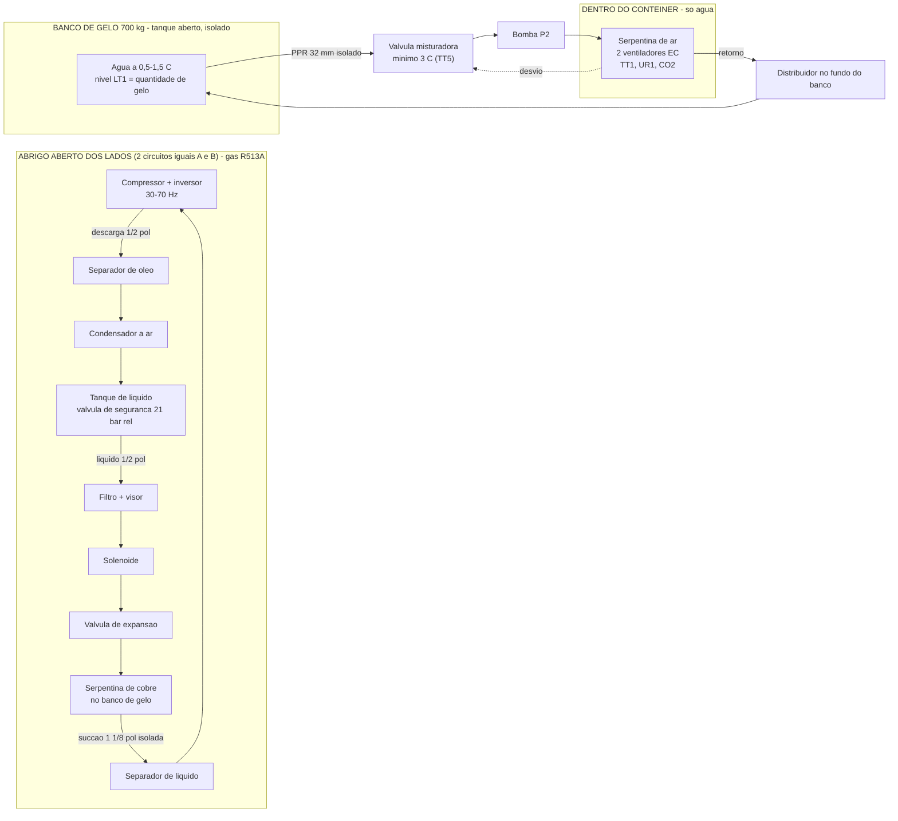

# 01 — Projeto térmico da câmara fria solar com banco de gelo (ANTEPROJETO, versão 2)

Autor: subagente engenheiro-refrigeracao. Data: 17/11/2026.
Base: `docs/00-premissas.md` com as decisões do dono D1 a D6. Revisão respondida: `docs/_trabalho/revisao-01-termico.md`.
Contas: `docs/_trabalho/termico.py`; saída completa em `docs/_trabalho/termico_saida.txt`. As tabelas numéricas deste documento foram copiadas dessa saída.

**Situação do documento: anteprojeto de dimensionamento. Ainda não serve para contratar a execução**, porque faltam dado de catálogo do compressor, modelo e preço da maioria dos itens (seção 15.6). A seção 14 diz o que falta e o que contratar.

Marcação: **[CALCULADO]** = conta sobre dado com fonte; **[CALCULADO sobre SUPOSTO]** = conta certa feita sobre valor adotado sem fonte (o resultado herda a incerteza); **[SUPOSTO]** = valor típico adotado; **[VALIDAR]** = validar com profissional habilitado.

## Base única desta versão (decisões do dono)

| Decisão | Efeito aqui |
|---|---|
| D1 — só manga | Uma zona a 12 °C, sem divisória, 5 t. Caju fora (um parágrafo de estudo futuro na seção 2.4) |
| D2 — recepção das 7 h às 14 h | Dimensionado para 1 t de manga a 35 °C entrando entre 10 h e 14 h, com dia de 41 °C |
| D3 — sem propano montado no local | Comparadas duas arquiteturas: (a) resfriador selado de fábrica; (b) circuito montado no local com gás não inflamável (R513A) |
| D4 — bateria de apoio no lugar de gerador | Comparação gelo x bateria x painel para 1, 2 e 3 dias nublados (seção 6) |
| D5 — um protótipo, sem CNPJ | Opção brasileira primeiro; especificação para cotação de importado mantida |
| D6 — outras frutas a 12 °C podem completar a carga | Verificação na seção 2.3 e uma linha na interface |

## Aviso sobre a pesquisa na web

- Rodada 1: só a busca funcionava. Todo número com link vem do resumo da busca, não da leitura da página.
- Rodada 2 (17/11/2026), com os sites liberados pelo dono, testados por `curl`:

| Site | Resultado |
|---|---|
| www.cresesb.cepel.br (SunData) | **Não abriu.** O certificado de segurança do próprio site não confere com o endereço; não contornei. **Irradiação de Petrolina continua [SUPOSTA]** |
| www.bitzer.de | Página inicial abre. O programa de seleção depende de outro servidor, não liberado. Os catálogos em PDF que tentei (endereços citados pela busca) deram "não encontrado". **Sem COP de catálogo** |
| www.embraco.com | Página inicial abre; os folhetos citados pela busca deram "não encontrado"; o seletor de produtos fica em outro endereço, bloqueado |
| www.weg.net e www.danfoss.com | Recusaram a conexão (erro 403) |
| www.elgin.com.br | **Abriu.** Li as páginas de resfriadores de líquido, unidades condensadoras, monoblocos e compressores (seção 9.2). As fichas técnicas ficam em outro endereço (portal de apoio), bloqueado. Preços não são publicados |
| www.embrapa.br e www.infoteca.cnptia.embrapa.br | Abrem, mas a busca interna recusou. O único PDF que baixei (BPD18023) **não trata de caju fresco** (é sobre extrato de carotenoides): a citação que fiz dele na versão 1 estava errada e foi retirada |

---

## Resumo

| Item | Estimativa do dono | Este anteprojeto |
|---|---|---|
| Frio por dia | 55 a 60 kWh | **87 kWh** no dia de projeto (41 °C, fruta a 35 °C até 14 h); 71 a 76 kWh em dia comum [CALCULADO sobre SUPOSTO] |
| Painéis | 5 kWp | **11 kWp é o mínimo (arquitetura (b)); 12 kWp é o valor de referência** (em aberto para o dono, seção 5.5). Faixa de incerteza: 10 a 13 kWp |
| Gelo | 200 kg | **500 kg é o mínimo; 700 kg é o valor com folga.** Faixa de incerteza: 400 a 800 kg |
| Sem sol | 14 h | Noite inteira com folga (o gelo nunca desce de 30 % no dia de projeto). 1 dia nublado com recepção normal só com a bateria de apoio; 3 dias nublados sem fruta nova |
| Bateria de apoio | "o que compensa" | **Só a mínima: 5 kWh úteis**, com a regra "dia nublado, meia carga". Mais painel rende mais que mais bateria (seção 6) |
| Fruta | — | Manga a 12 °C, 85 a 90 % de umidade, uma zona |
| Gás | em aberto | Sem propano montado no local. Duas arquiteturas com números (seção 7) |
| Máquina | "velocidade variável direto no painel" | **Não existe pronta no Brasil.** Três rotas comparadas na seção seguinte |
| Frio à noite | — | Bomba de água gelada e ventiladores, com água a 6 °C à noite: 82 a 173 W, **1,5 kWh por noite** pelo modelo; passar **150 W médios e 300 W de pico** à elétrica |

Com 5 kWp e 200 kg o sistema produz cerca de 37 kWh de frio no dia de projeto e a câmara pede 87. **Não fecha**; a fruta esquentaria dia após dia [CALCULADO sobre SUPOSTO]. O revisor chegou à mesma conclusão por conta independente.

---

## O que existe pronto e o que é desenvolvimento

Resposta direta à pergunta do dono: **a máquina de frio de velocidade variável "pronta para ligar no painel", nesta potência, eu não encontrei à venda no Brasil. Mas ela não precisa ser inventada.** Há três rotas, e só uma delas exige integração não homologada.

### As três categorias

| Categoria | O que é | Exemplos neste projeto |
|---|---|---|
| **1. Prateleira** — compra e instala | Peça de catálogo usada como o fabricante previu | Reefer usado; módulos solares; inversor híbrido e bateria; unidade condensadora ou resfriador de líquido comum de rede; serpentina de ar; bombas; válvulas; sensores; tubos; controlador |
| **2. Integração não homologada** — peças de prateleira numa combinação que o fabricante não testou | Funciona em outros lugares, mas ninguém dá garantia do conjunto | Compressor trifásico comum + inversor solar de bombeamento, sem bateria. Unidade condensadora ligada a um banco de gelo em vez do evaporador de catálogo |
| **3. Desenvolvimento próprio** — não se compra | Tem de ser projetado, construído e testado | Lógica de controle (quantos compressores ligar conforme o sol, proteção contra liga-desliga com nuvem, aviso de gelo baixo); banco de gelo artesanal, se for essa a escolha; programa do controlador |

O que confirmar **por escrito** na categoria 2, e com quem:

| Pergunta | A quem | O que acontece com a garantia |
|---|---|---|
| O compressor pode trabalhar de 30 a 70 Hz com este gás, nesta faixa de pressões? Quantas partidas por hora? Tempo mínimo ligado? | Fabricante do compressor (por exemplo BITZER Brasil) | Fora da faixa aprovada o fabricante costuma negar garantia [SUPOSTO; pedir a condição por escrito] |
| O inversor solar de bombeamento aceita carga de **torque constante** (compressor), frequência mínima de 30 Hz, religamento com atraso de 5 min e alimentação só pelos painéis? | Fabricante do inversor (por exemplo WEG) | O produto é vendido para bomba; uso em compressor pode ficar sem garantia [SUPOSTO; pedir por escrito] |
| A unidade condensadora pode alimentar uma serpentina de banco de gelo (carga de gás maior, retorno de óleo)? | Fabricante da unidade | Idem |

### As três rotas

| | **Rota A** — máquina comum de rede + inversor fora da rede (híbrido) + bateria | **Rota B** — compressor trifásico + inversor de frequência direto nos painéis | **Rota C** — unidade condensadora solar de corrente contínua, de fábrica (importada) |
|---|---|---|---|
| O que é | Os painéis alimentam um inversor híbrido com bateria, que faz uma "rede" local. Nela se liga um resfriador de líquido ou unidade condensadora comum, de catálogo | O que a versão 1 propunha: o inversor solar de bombeamento varia a rotação do compressor conforme o sol | Máquina chinesa anunciada como "solar" ou "full DC inverter" |
| Exemplo encontrado | Resfriador **Elgin Chiller EcoTherm Duo** (compressor, bomba e ventiladores com inversor; fluido até −10 °C; código ELG-CHCW5040JTH2AC1M) — [página](https://www.elgin.com.br/chiller-ecotherm-duo/p), aberta em 17/11/2026; **capacidade, gás, tensão e preço não publicados**. Ou unidades condensadoras fixas: Danfoss OP-HJZ019 por R$ 5.069,90 e HJZ064 por R$ 9.882,72 (`docs/11-importacao.md`, 4.2) | Compressor BITZER ECOLINE (modelo a confirmar) + WEG CFW500 Solar Drive ou equivalente. Kits de bombeamento solar com inversor: R$ 2.814 a 3.569 (`docs/11-importacao.md`, 4.3) | Unidade inverter de 5 HP a US$ 1.250 a 1.380 FOB, **gás não confirmado, anúncio não verificado**; custo posto no Brasil R$ 15.941 (`docs/11-importacao.md`, 2.5 e 4.2) |
| Categoria | Tudo 1, mais a lógica de controle (3) | Compressor e inversor na categoria 2; controle e banco na 3 | Máquina na categoria 1 **se** a ficha técnica confirmar; controle na 3 |
| Risco de desenvolvimento | **Baixo.** Cada peça trabalha como o fabricante previu. O controle fica simples: liga a máquina quando a bateria está acima de um nível | **Médio.** Depende de duas confirmações por escrito. Risco: partidas repetidas em dia de nuvem, falta de torque em baixa rotação, garantia negada | **Alto para um protótipo sem CNPJ** (D5): importação por terceiros, assistência inexistente, ficha técnica incerta |
| Bateria que exige | **Maior.** O inversor híbrido precisa de bateria para funcionar e para segurar nuvens: 10 a 15 kWh [SUPOSTO] | **Menor.** Só a das cargas de 24 h (bomba, ventiladores, controle, Starlink) mais o apoio da seção 6 (5 kWh) | Depende da máquina; os anúncios "solar cold room" usam bateria ou não dizem (`docs/11-importacao.md`) |
| Custo relativo | **Maior**: 2 a 3 módulos de bateria a mais (R$ 8.331 cada um de 5,12 kWh, custo posto calculado pela importação; preço no Brasil não encontrado), inversor híbrido de 8 a 10 kW (preço não encontrado) e cerca de 1 kWp a mais de painel pelas perdas de conversão (6 % [SUPOSTO]) | **Menor**: dois inversores de R$ 3 mil a 3,6 mil e os compressores (preço não encontrado no Brasil) | Preço de vitrine baixo, mas com custos fixos de importação de R$ 7.714,50 por embarque (`docs/11-importacao.md`) |
| Respeita D3? | Sim, se o resfriador for selado de fábrica (com o gás que tiver) ou a unidade condensadora usar gás não inflamável | Sim, com R513A | **Só com gás não inflamável.** Unidade condensadora não é selada: liga-se ao evaporador no local. Se vier com R290, vira propano montado no local |
| Arquitetura térmica (seção 7) | (a) com resfriador de glicol, ou (b) com unidade condensadora e banco de expansão direta | (b) | (b) |

**Rota de menor risco para um protótipo feito por leigos com frigorista e eletricista contratados: Rota A.** Tudo é de catálogo, cada peça tem garantia do fabricante, e inversor híbrido com bateria é serviço comum para eletricista de energia solar.

**Rota de menor custo: Rota B**, pelo que consegui apurar (sem preço de compressor e de inversor híbrido, a diferença não está quantificada).

As duas são diferentes, então **a escolha fica para o dono** (seção 15.3, conflito R). O dimensionamento térmico deste documento vale para as três: muda o COP e a perda de conversão, e isso está nas tabelas como arquitetura (a) e (b).

---

## 1. Invólucro

### 1.1 Dados encontrados (resumos de busca; não abri as páginas)

| Dado | Valor | Fonte |
|---|---|---|
| Perda de calor de reefer de 20 pés novo | cerca de 20 W/K; 23 a 24 W/K (máximo Maersk); 25,6 W/K (Textainer) | [GCS Reefer](https://www.gcs-reefer.com/sites/default/files/201117_container_spec_20ft_css_2_0.pdf), [MCI](https://www.mcicontainers.com/wp-content/uploads/2022/07/MCI-Box-Fact-sheet.pdf), [Textainer](https://www.textainer.com/equipment/refrigerated) |
| Contêiner medido com isolamento envelhecido | U = 0,509 W/m²·K | [Wageningen](https://edepot.wur.nl/555539) |
| Painel PIR 100 mm, condutividade | 0,020 a 0,023 W/m·K | [AECweb](https://www.aecweb.com.br/produto/painel-isofachada-pur-pir/31644) |
| Reefer de 20 pés usado | R$ 20.000 (Arealva-SP, motor a revisar) a R$ 30.000 (Santos, revisado) | [MF Rural](https://www.mfrural.com.br/busca/reefer-20-pes), anúncios sem data, vistos em 17/11/2026 |
| Contêiner seco de 20 pés usado | a partir de R$ 7.000 | [MF Rural](https://www.mfrural.com.br/busca/venda-containers) |
| Isolamento com painel de poliuretano de 100 mm, instalado | R$ 894,32/m² (composição de obra pública ORSE 9438) | [Orçamentor](https://orcamentor.com/orse/composicoes/ORSE-9438/) |

Estes são os únicos preços em reais do invólucro e nenhum foi conferido na página. **Antes de fechar a decisão: duas cotações de reefer usado com frete até o local e uma de câmara de painéis** (pendência).

### 1.2 Área e UA

Medidas internas típicas de reefer de 20 pés: 5,44 × 2,29 × 2,26 m, 28 m³ [SUPOSTO]. Área média de 66 m².

| Opção | UA adotado (W/K) | Conta |
|---|---|---|
| **Reefer usado** | **33** | 22 W/K de fábrica × 1,5 de envelhecimento [SUPOSTO]; confere com 0,509 × 66 = 33,6 [CALCULADO sobre SUPOSTO] |
| Reefer novo, ou seco com 100 mm de poliuretano | 22 | 0,27 × 67 m² + 20 % de pontes térmicas [CALCULADO sobre SUPOSTO] |
| Painéis PIR de 100 mm | 16,6 | U = 1/(0,17 + 0,100/0,023) = 0,22; × 65,6 m²; + 15 % de porta e juntas [CALCULADO sobre SUPOSTO] |

### 1.3 Comparação e escolha

| Opção | Custo | Frio a mais por dia | A favor | Contra |
|---|---|---|---|---|
| **Reefer usado** | R$ 20 a 30 mil | referência (87,3 kWh/dia) | Piso, porta, vedação e dreno prontos; transportável | Isolamento envelhecido |
| Seco + isolamento | R$ 7 mil + cerca de R$ 60 mil (67 m² × R$ 894) | −6,8 kWh/dia | Casca barata | Perde espaço interno; porta e piso novos; sai mais caro |
| Painéis PIR | cerca de R$ 59 mil, sem porta, piso e cobertura | cerca de −9 kWh/dia | Menor carga | Mais caro; precisa de base e telhado |

Efeito do UA no frio diário (dia de projeto) [CALCULADO sobre SUPOSTO]: 22 W/K → 80,5 kWh; 33 W/K → 87,3 kWh; 40 W/K → 91,7 kWh.

**Decisão: reefer usado de 20 pés, só a caixa.** A diferença de preço paga com folga 1 a 2 kWp de painel. Condições: teste de perda de calor na compra, aceitando UA ≤ 30 W/K [VALIDAR] (método na seção 14.3); teto sombreado pela cobertura dos painéis, com vão ventilado de 30 cm; cortina de tiras na porta.

**Ocupação.** A logística informa caixa de 22 a 27 kg, cerca de 40 por tonelada; a associação pode usar caixa de 20 kg, 50 por tonelada. Para 5 t: 200 a 250 caixas. Com caixa de 0,072 m³ [SUPOSTO] são 14 a 18 m³ dos 28 m³. **5 t cabem, com corredor estreito** [CALCULADO sobre SUPOSTO]; conferir com a caixa real.

---

## 2. Fruta

### 2.1 Manga (fruta de dimensionamento)

| Item | Valor | Fonte |
|---|---|---|
| Temperatura | 13 °C para verde-madura; 10 °C para parcialmente madura e madura | [UC Davis](https://postharvest.ucdavis.edu/node/5351) |
| Dano por frio | 8 a 10 °C favoreceu escurecimento da polpa; a 12,5 °C não houve sintoma (Embrapa Semiárido) | [Movimento Econômico, 21/09/2026](https://movimentoeconomico.com.br/agronegocio/2026/09/21/pesquisa-evita-corte-negro-e-rejeicao-de-manga-exportada-do-vale-do-sao-francisco/) |
| Umidade relativa | 85 a 90 % | [WFLO](https://www.gcca.org/system/files/WFLO-Commodity-Storage-Manual-2018-Mangos.pdf) |
| Vida útil | 2 a 4 semanas | WFLO |
| Respiração | 12 a 16 ml CO₂/kg·h a 10 °C; 15 a 22 a 13 °C; 35 a 80 a 20 °C | UC Davis |
| **Setpoint adotado** | **12 °C** (D1), alarme baixo a 10 °C | — |

Calor de respiração, corrigido conforme o revisor (achado 21): 14 ml CO₂/kg·h × 122 kcal/t·dia por ml (fator da própria UC Davis, citado pelo revisor) = 1.708 kcal/t·dia = 1.708 × 4.186 / 86.400 = **83 W/t a 10 °C** [CALCULADO]. A 12 °C, com fator de 2,5 por 10 °C [SUPOSTO]: 83 × 2,5^0,2 = 100 W/t. O revisor cita a faixa do USDA de 68 a 137 W/t a 10 °C; usei as duas pontas como sensibilidade (seção 5.4).

### 2.2 Condição de entrada (D2)

1 t por dia, a **35 °C**, em quatro entregas de 250 kg às 10 h, 11 h, 12 h e 13 h (logística: manga chega das 10 h às 15 h, a 30 a 35 °C). Também calculei recepção cedo (7 h a 9 h, a 30 °C) e o pior caso de 1 t de uma vez às 13 h.

### 2.3 Outras frutas a 12 °C (D6): alguma aumenta a carga de projeto?

Valores de memória, sem fonte aberta, exceto a goiaba [SUPOSTO; VALIDAR com o analista de frutas]:

| Fruta | Temperatura que prefere | Respiração comparada à manga | Observação a 12 °C |
|---|---|---|---|
| Mamão | 7 a 13 °C | menor | Compatível |
| Acerola | cerca de 8 °C | maior | A 12 °C dura pouco; só giro de 1 a 2 dias |
| Goiaba | 8 a 10 °C (verde-madura); respiração de 4 a 30 ml CO₂/kg·h a 10 °C ([UC Davis](https://postharvest.ucdavis.edu/node/5281)) | até o dobro | Giro rápido |
| Maracujá | 7 a 10 °C | maior | Giro rápido |

Conclusão para o projeto térmico:

- **Carga:** a sensibilidade "respiração de 137 W/t em todas as 5 t" (o teto do USDA, 65 % acima do valor adotado) leva o frio diário de 87,3 para 103,6 kWh e **ainda fecha com 12 kWp + 700 kg, mas no limite** (gelo mínimo de 0,3 kWh). Com o conjunto mínimo (11 kWp + 500 kg) não fecharia. Ocupação parcial com essas frutas fica abaixo desse teto [SUPOSTO].
- **Umidade:** todas pedem 85 a 95 %. Sem mudança.
- **Etileno e ar novo por modo** (dado do analista de frutas, `docs/10-frutas-e-demanda.md`, seção 2.6; banana saiu dos complementos):

| Modo | Ar novo pedido pelo etileno | Ar novo pedido pelo CO₂ | **Vazão adotada (a maior)** | Carga térmica do ar novo, dia de 41 °C |
|---|---|---|---|---|
| Só manga | 1 a 2 m³/h (etileno abaixo de 1 ppm) | 30 m³/h (CO₂ a 0,32 %) | **30 m³/h** | **6,6 kWh/dia** (já no frio de 87,3) |
| Manga + acerola, mamão, goiaba, maracujá | cerca de 25 m³/h (uma troca por hora) | 30 m³/h, até 60 se a respiração da mistura for maior | **30 m³/h; 60 m³/h pelo sensor** | 6,6 a 13,2 kWh/dia (+6,6 no pior caso, coberto pela sensibilidade de respiração alta da seção 5.5 só em parte; com 60 m³/h contínuos, pedir 13 kWp) |

  O CO₂ manda nos dois modos; nenhuma exaustão dedicada ao etileno é necessária. Regra: não guardar fruta madura junto de fruta verde por mais de 2 dias [SUPOSTO].
- **Renovação de ar:** se a respiração dobrar, o CO₂ de equilíbrio com 30 m³/h sobe para cerca de 0,6 %; o ventilador de ar novo foi especificado para 60 m³/h no máximo, comandado pelo sensor (cada 30 m³/h a mais custa cerca de 4,4 kWh/dia de frio no dia de 41 °C).

### 2.4 Estudo futuro: caju

O caju (pedúnculo) pede 5 °C e 85 a 90 % de umidade ([Embrapa/PAB 2007](https://seer.sct.embrapa.br/index.php/pab/article/download/7591/4510)); a 12 °C dura pouco. Documento técnico da Embrapa citado pela busca dá respiração de 62 a 72 ml CO₂/kg·h a 20 °C, bem acima da manga ([Embrapa Dc017](https://www.infoteca.cnptia.embrapa.br/infoteca/bitstream/doc/419675/1/Dc017.pdf)). A versão 1 deste documento estimou que uma câmara inteira a 5 °C pediria cerca de 15 % mais frio e uma serpentina de ar maior. Não foi refeito nesta base; fica fora do protótipo por decisão D1.

---

## 3. Carga térmica

### 3.1 Dia de projeto e premissas

| Premissa | Valor | Marcação |
|---|---|---|
| Temperatura externa | **41 °C às 15 h**, 27 °C às 3 h, curva senoidal | 41,0 °C foi a maior temperatura encontrada pela logística (22/09/2021); mínima e forma [SUPOSTO] |
| Dia quente típico | 23 a 34 °C | 34 °C é a máxima média dos meses mais quentes (logística) |
| Fruta que entra | 1.000 kg a 35 °C entre 10 h e 14 h; 50 caixas de 1,8 kg por tonelada | D2; caixas [SUPOSTO] |
| Estoque | 4 t já frias + 1 t do dia | D1 |
| Calor específico da manga | 3,77 kJ/kg·K | [fonte secundária](https://www.scribd.com/presentation/612658629/COLD-STORAGE) |
| Resfriamento da fruta dentro da câmara | constante de tempo de 8 h | [SUPOSTO]; sensibilidade com 6 h |
| Respiração | 83 W/t a 10 °C, fator 2,5 por 10 °C, teto a 38 °C | seção 2.1; fator e teto [SUPOSTO] |
| Porta | 12 trocas de ar por dia, 60 % delas nas horas de recepção; ar externo na temperatura da hora, 30 % de umidade | [SUPOSTO] |
| **Ar novo por causa do CO₂** | **30 m³/h contínuos** (CO₂ estabiliza em 0,32 %, abaixo do limite de 0,39 %) + 45 m³ de ventilação às 6 h | seção 11.2 [CALCULADO sobre SUPOSTO] |
| Ventiladores da serpentina | 17 a 250 W conforme a carga (lei cúbica) | seção 9.3 [CALCULADO sobre SUPOSTO] |
| Água que chega à serpentina | 3 °C das 7 h às 17 h; **6 °C das 17 h às 7 h** (para secar menos o ar) | seção 11.1 [SUPOSTO] |
| Pessoas e luz | 2 pessoas × 200 W + 40 W nas horas de recepção | 272 − 6 × 12 = 200 W [SUPOSTO, fórmula de memória] |
| Bomba e banco de gelo | bomba de 25 a 110 W; banco com UA de 3,5 W/K | [CALCULADO sobre SUPOSTO] |
| Folga | +10 % sobre o frio tirado do banco | [SUPOSTO] |

Conferência à mão do calor de campo: (1.000 kg × 3,77 + 90 kg × 1,9) kJ/K × (35 − 12) K = 90.600 kJ = 25,2 kWh [CALCULADO]. O modelo dá 24,2 kWh no dia (o resto sai no dia seguinte).

### 3.2 Carga diária em regime (kWh/dia) [CALCULADO sobre SUPOSTO]

| Dia | Recepção | Invólucro | Porta | Ar novo | Calor de campo | Respiração | Ventiladores | Pessoas e luz | Bomba e banco | Soma | **Com folga de 10 %** | Pico na serpentina (kW) |
|---|---|---|---|---|---|---|---|---|---|---|---|---|
| **Recorde 27–41 °C** | **até 14 h, 35 °C** | 18,1 | 4,1 | 6,6 | 24,2 | 19,2 | 1,0 | 2,0 | 4,2 | 79,4 | **87,3** | 6,3 |
| Recorde | até 10 h, 30 °C | 18,1 | 3,2 | 6,6 | 18,8 | 18,0 | 0,7 | 1,4 | 4,1 | 70,9 | 78,0 | 5,1 |
| Recorde | 1 t de uma vez às 13 h | 18,0 | 4,4 | 6,6 | 24,3 | 25,7 | 1,4 | 0,7 | 4,3 | 85,4 | 94,0 | 8,6 |
| Quente típico 23–34 °C | até 14 h | 13,7 | 2,4 | 3,6 | 24,2 | 19,2 | 0,8 | 2,0 | 3,7 | 69,4 | 76,4 | 5,5 |
| Junho 20–31 °C | até 14 h | 11,3 | 1,7 | 2,1 | 24,2 | 19,1 | 0,7 | 2,0 | 3,4 | 64,5 | 70,9 | 5,2 |
| Recorde | sem fruta nova | 18,1 | 2,0 | 6,6 | 0,0 | 12,9 | 0,4 | 0,2 | 3,9 | 44,1 | 48,5 | 2,4 |

A respiração pesa mais do que na versão 1 porque o valor subiu para 83 W/t, a câmara está a 12 °C e a fruta nova, ainda quente, respira muito nas primeiras horas.

### 3.3 Horário de recepção (D2)

Receber até 14 h a 35 °C custa 9 kWh/dia a mais que receber até 10 h a 30 °C (87,3 contra 78,0), e gasta 38,3 kWh de gelo das 17 h às 7 h, contra 30,9 kWh. **O projeto foi dimensionado para a recepção até 14 h.** Depois das 14 h: só meia carga (até 500 kg), porque a fruta passa a ser resfriada só com gelo.

---

## 4. Geração solar

**A tabela mensal de Petrolina não foi obtida** (o SunData não abriu nas duas rodadas, nem para o agente de logística). O que a busca trouxe: médias anuais acima de 6 kWh/m²·dia no semiárido ([CBENS](https://anaiscbens.emnuvens.com.br/cbens/article/download/717/717)) e 6,5 no Sertão ([UFPE](https://periodicos.ufpe.br/revistas/rbgfe/article/download/265793/52128/315516)).

Valores adotados, todos [SUPOSTO], a conferir no [SunData](https://cresesb.cepel.br/sundata/index.php) com as coordenadas do terreno:

| Dia | Irradiação no plano dos painéis (kWh/m²·dia) |
|---|---|
| Projeto e quente típico | 5,8 |
| Junho médio | 4,7 |
| Dia ruim | 3,0 |
| Dia nublado | 2,0 |

Nascer às 5 h 30 e pôr às 17 h 40, forma senoidal elevada a 1,3; desempenho global do arranjo de 0,75 [SUPOSTO].

Regras do acionamento usadas no balanço: os compressores recebem a geração menos os auxiliares de dia (360 W na arquitetura (b), 560 W na (a)); potência elétrica máxima dos dois compressores = 0,62 × kWp (7,4 kW para 12 kWp); **um compressor só parte com 1,6 kW disponíveis mais os auxiliares, ou seja, com cerca de 2,0 kW de geração** (valor único, usado também na seção 12.3); com o banco cheio, um compressor fica em liga-desliga na rotação mínima e a tabela mostra a potência média da hora.

---

## 5. Balanço diário e dimensionamento

### 5.1 COP usado — não é dado de catálogo

Ciclo simples calculado com as propriedades do R134a (CoolProp 8.0.0), superaquecimento de 8 K, sub-resfriamento de 3 K, condensação 10 K acima do ar, **eficiência global de compressão de 0,60 [SUPOSTO]**. Para o R513A multipliquei o COP por 0,97 [SUPOSTO, de memória]. O revisor obteve 1,99 por conta própria num ponto parecido. **Nenhum catálogo de compressor abriu**; pendência 2.

| Arquitetura | T evap. (°C) | T ext. (°C) | T cond. (°C) | p evap. (bar abs / bar relativo) | p cond. (bar abs / bar relativo) | COP elétrico |
|---|---|---|---|---|---|---|
| (b) expansão direta no banco de gelo | −7 | 27 | 37 | 2,25 / 1,28 | 9,37 / 8,40 | 2,90 |
| (b) | −7 | 34 | 44 | 2,25 / 1,28 | 11,30 / 10,33 | 2,38 |
| (b) | −7 | 41 | 51 | 2,25 / 1,28 | 13,51 / 12,54 | 1,98 |
| (b) | −7 | 43 | 53 | 2,25 / 1,28 | 14,20 / 13,23 | 1,88 |
| (a) resfriador de glicol, com 6 % de perda no inversor de rede | −10,5 | 27 | 37 | 1,97 / 1,00 | 9,37 / 8,40 | 2,45 |
| (a) | −10,5 | 34 | 44 | 1,97 / 1,00 | 11,30 / 10,33 | 2,03 |
| (a) | −10,5 | 41 | 51 | 1,97 / 1,00 | 13,51 / 12,54 | 1,70 |
| (a) | −10,5 | 43 | 53 | 1,97 / 1,00 | 14,20 / 13,23 | 1,62 |

Pressão relativa (a que o manômetro do frigorista mostra) = absoluta − 0,97 bar (pressão atmosférica a cerca de 380 m de altitude). Valores para R134a; **com R513A as pressões são um pouco maiores: ajustar pela temperatura de saturação na tabela do gás** [VALIDAR].

### 5.2 Os números do dono (5 kWp + 200 kg) [CALCULADO sobre SUPOSTO]

| Arquitetura | Geração | Frio produzido | Frio necessário | Resultado |
|---|---|---|---|---|
| (b) | 21,8 kWh | 37,3 kWh | 87 kWh | Não fecha: falta mais da metade; a fruta esquenta a cada dia |
| (a) | 21,8 kWh | 27,2 kWh | 87 kWh | Idem |

O limite é o painel. E 200 kg de gelo (18,6 kWh) não cobrem os 38,3 kWh gastos das 17 h às 7 h.

### 5.3 Tabela única das variantes: menor conjunto que fecha no dia de projeto [CALCULADO sobre SUPOSTO]

"Fecha" = todo o frio pedido é entregue, em regime, repetindo o dia recorde.

| Arquitetura | Recepção | Frio tirado do banco (kWh/dia) | Gelo gasto das 17 h às 7 h (kWh) | **Mínimo de painel** (com o gelo que ele pede) | **Mínimo equilibrado** | Menor gelo com 12 kWp |
|---|---|---|---|---|---|---|
| (b) R513A, expansão direta | até 10 h, 30 °C | 78,0 | 30,9 | 8 kWp + 1.000 kg | 10 kWp + 400 kg | 400 kg |
| **(b)** | **até 14 h, 35 °C (D2)** | **87,3** | **38,3** | 9 kWp + 1.000 kg | **11 kWp + 500 kg** (ou 10 kWp + 700 kg) | **500 kg** |
| (b) | 1 t de uma vez às 13 h | 94,0 | 45,6 | 10 kWp + 800 kg | — | 600 kg |
| (a) resfriador de glicol | até 10 h, 30 °C | 78,0 | 30,9 | 10 kWp + 800 kg | 12 kWp + 400 kg | 400 kg |
| **(a)** | **até 14 h, 35 °C (D2)** | **87,3** | **38,3** | 11 kWp + 1.000 kg | **12 kWp + 700 kg** (ou 13 kWp + 500 kg) | **700 kg** |
| (a) | 1 t de uma vez às 13 h | 94,0 | 45,6 | 11 kWp + 1.000 kg | — | 800 kg |

Varredura completa (frio não atendido em kWh/dia para cada par kWp × kg) na seção 3 da saída do script. Trecho para a recepção até 14 h, arquitetura (b):

| kWp \ kg de gelo | 300 | 400 | 500 | 600 | 700 | 800 | 1000 |
|---|---|---|---|---|---|---|---|
| 8 | 182,7 | 161,0 | 142,3 | 126,4 | 109,5 | 90,3 | 52,5 |
| 9 | 115,0 | 95,0 | 76,6 | 57,4 | 39,1 | 20,4 | 0,0 |
| 10 | 54,1 | 28,0 | 12,2 | 2,8 | 0,0 | 0,0 | 0,0 |
| 11 | 36,8 | 13,6 | 0,0 | 0,0 | 0,0 | 0,0 | 0,0 |
| 12 | 35,2 | 12,7 | 0,0 | 0,0 | 0,0 | 0,0 | 0,0 |
| 14 | 33,9 | 12,7 | 0,0 | 0,0 | 0,0 | 0,0 | 0,0 |

(Valores altos com 8 kWp: quando falta frio todo dia, a fruta esquenta e respira mais, e a falta cresce.)

O revisor estimou, para só manga, cerca de 10 kWp e 400 a 600 kg (390 kg com 85 % de fração útil, na 2ª revisão). Com o ar novo corrigido para 30 m³/h o mínimo da arquitetura (b) subiu para **11 kWp + 500 kg**.

**Fração útil do gelo (achado N8).** O modelo deixa derreter o banco até zero. No mínimo de 11 kWp + 500 kg a noite gasta 38,3 kWh dos 46,4 kWh do banco: **83 %**. Com fusão externa a fração útil costuma ser de 80 a 90 % [SUPOSTO, de memória do revisor]: esse mínimo está no limite. No conjunto de referência (700 kg) o banco nunca desce de 30 % (usa 70 %), com folga.

### 5.4 Conjunto de referência: 12 kWp + 700 kg (64,9 kWh de frio)

É o mínimo da arquitetura (a), ou o mínimo da (b) com 1 kWp e 200 kg de folga. Usei-o para todas as tabelas seguintes. **O tamanho final é decisão do dono (seção 5.5).**

Hora a hora, dia recorde, recepção até 14 h, arquitetura (b), em regime [CALCULADO sobre SUPOSTO]:

| h | T ext. | FV (kW) | Compressores (kW) | Frio produzido (kW) | Serpentina de ar (kW) | Ar da câmara (°C) | Polpa do lote mais quente (°C) | Polpa do estoque (°C) | Gelo (kWh) | Auxiliares internos (W) |
|---|---|---|---|---|---|---|---|---|---|---|
| 00 | 28,5 | 0,00 | 0,00 | 0,00 | 2,17 | 12,0 | 18,9 | 12,8 | 32,8 | 92 |
| 01 | 27,6 | 0,00 | 0,00 | 0,00 | 2,03 | 12,0 | 18,2 | 12,8 | 30,5 | 88 |
| 02 | 27,1 | 0,00 | 0,00 | 0,00 | 1,92 | 12,0 | 17,7 | 12,8 | 28,2 | 85 |
| 03 | 27,1 | 0,00 | 0,00 | 0,00 | 1,85 | 12,0 | 17,1 | 12,8 | 26,0 | 83 |
| 04 | 27,5 | 0,00 | 0,00 | 0,00 | 1,81 | 12,0 | 16,7 | 12,8 | 23,8 | 82 |
| 05 | 28,4 | 0,10 | 0,00 | 0,00 | 1,80 | 12,0 | 16,2 | 12,8 | 21,7 | 82 |
| 06 | 29,7 | 1,21 | 0,00 | 0,00 | 2,07 | 12,0 | 15,9 | 12,8 | 19,3 | 89 |
| 07 | 31,2 | 2,87 | 2,51 | 6,45 | 2,14 | 12,0 | 15,5 | 12,8 | 23,2 | 83 |
| 08 | 33,0 | 4,53 | 4,17 | 10,22 | 2,10 | 12,0 | 15,2 | 12,8 | 30,9 | 82 |
| 09 | 34,8 | 5,94 | 5,58 | 13,02 | 2,18 | 12,0 | 15,0 | 12,8 | 41,4 | 83 |
| 10 | 36,6 | 6,90 | 6,54 | 14,54 | 3,88 | 12,0 | 32,9 | 12,8 | 51,4 | 120 |
| 11 | 38,2 | 7,29 | 6,93 | 14,77 | 4,73 | 12,0 | 32,9 | 12,8 | 60,8 | 150 |
| 12 | 39,5 | 7,05 | 5,06 | 10,47 | 5,50 | 12,1 | 32,9 | 12,8 | 64,9 (cheio) | 184 |
| 13 | 40,4 | 6,23 | 3,49 | 7,04 | 6,17 | 12,1 | 32,9 | 12,8 | 64,9 | 221 |
| 14 | 40,9 | 4,92 | 2,76 | 5,48 | 4,77 | 12,0 | 31,0 | 12,8 | 64,9 | 151 |
| 15 | 40,9 | 3,30 | 2,70 | 5,35 | 4,65 | 12,0 | 29,2 | 12,8 | 64,9 | 147 |
| 16 | 40,5 | 1,61 | 0,00 | 0,00 | 4,27 | 12,0 | 27,6 | 12,8 | 60,0 | 133 |
| 17 | 39,6 | 0,26 | 0,00 | 0,00 | 3,78 | 12,1 | 26,1 | 12,8 | 55,6 | 173 |
| 18 | 38,3 | 0,00 | 0,00 | 0,00 | 3,51 | 12,1 | 24,7 | 12,8 | 51,6 | 155 |
| 19 | 36,8 | 0,00 | 0,00 | 0,00 | 3,25 | 12,0 | 23,5 | 12,8 | 47,8 | 139 |
| 20 | 35,0 | 0,00 | 0,00 | 0,00 | 2,99 | 12,0 | 22,4 | 12,8 | 44,3 | 126 |
| 21 | 33,2 | 0,00 | 0,00 | 0,00 | 2,75 | 12,0 | 21,4 | 12,8 | 41,1 | 114 |
| 22 | 31,4 | 0,00 | 0,00 | 0,00 | 2,53 | 12,0 | 20,5 | 12,8 | 38,1 | 105 |
| 23 | 29,8 | 0,00 | 0,00 | 0,00 | 2,34 | 12,0 | 19,6 | 12,8 | 35,4 | 98 |
| **dia** | | 52,2 kWh | 39,7 kWh | 87,3 kWh | 79,4 kWh | máx. 12,1 | | máx. 12,8 | mín. 19,3 (30 %) | 1,51 kWh das 17 h às 7 h |

COP médio do dia: 2,20. Geração não aproveitada: 9,2 kWh (banco cheio a partir das 12 h; começo e fim do dia abaixo do limiar de partida). Essa sobra é a folga do painel e pode carregar a bateria.

Leitura para o leigo:

- **A potência de descarga foi conferida, não só a energia** (achado 4 do revisor). A serpentina de ar entrega até 8,5 kW com água a 3 °C e cerca de 5,7 kW com água a 6 °C (à noite); o pico pedido é 6,3 kW de dia e 3,8 kW às 17 h. O ar não passa de 12,1 °C. Mesmo com a serpentina rendendo a metade, o ar chega a 14,2 °C e nada fica sem atender.
- A manga nova demora: entra a 35 °C às 13 h, está a 19 °C à meia-noite e a 15 °C às 9 h do dia seguinte. É resfriamento lento de câmara, não pré-resfriamento rápido. **Se o comprador exigir polpa a 12 °C em 24 h, é outro equipamento** (ar forçado através das caixas) e outra carga de pico (pendência 9).
- A polpa do estoque fica 0,8 °C acima do ar por causa do calor da própria respiração.

### 5.5 Cenários e sensibilidades com o conjunto de referência [CALCULADO sobre SUPOSTO]

| Dia | Recepção | Arq. | Frio tirado (kWh) | Não atendido (kWh) | Gelo mínimo (kWh) | Ar máx. (°C) | FV sobrando (kWh) |
|---|---|---|---|---|---|---|---|
| Recorde | até 14 h | (b) | 87,3 | 0,0 | 19,3 | 12,1 | 9,2 |
| Recorde | até 10 h | (b) | 78,0 | 0,0 | 27,8 | 12,0 | 13,8 |
| Recorde | 1 t às 13 h | (b) | 94,0 | 0,0 | 11,8 | 12,6 | 6,5 |
| Quente típico | até 14 h | (b) | 76,4 | 0,0 | 24,5 | 12,1 | 20,0 |
| Junho | até 14 h | (b) | 70,9 | 0,0 | 27,4 | 12,0 | 14,2 |
| Recorde, irradiação 10 % menor | até 14 h | (b) | 87,3 | 0,0 | 19,1 | 12,1 | 3,4 |
| Dia ruim repetido | até 14 h | (b) | — | 116,4 | 0 | 22,1 | — |
| Dia ruim repetido | meia carga | (b) | 56,9 | 0,0 | 14,8 | 12,0 | 4,8 |
| Dia ruim repetido | sem fruta nova | (b) | 37,9 | 0,0 | 39,9 | 12,0 | 10,3 |
| Recorde | até 14 h | (a) | 87,3 | 0,0 | **6,2 (no limite)** | 12,1 | 3,2 |
| Junho | até 14 h | (a) | 70,9 | 0,0 | 27,4 | 12,0 | 7,6 |

Sensibilidades (dia recorde, até 14 h, arquitetura (b)); em todas o não atendido é zero:

| Mudança | Frio tirado (kWh/dia) | Gelo mínimo (kWh) |
|---|---|---|
| Base | 87,3 | 19,3 |
| UA de 22 W/K | 80,5 | 23,1 |
| UA de 40 W/K | 91,7 | 16,8 |
| Respiração de 137 W/t (teto do USDA) | 103,6 | **0,3 (no limite)** |
| Respiração de 68 W/t | 83,3 | 21,9 |
| Constante de tempo da fruta de 6 h | 86,2 | 21,9 |
| Desempenho do arranjo de 0,70; eficiência de compressão de 0,55 | 87,3 | 19,3 (cabem na sobra de geração) |
| Serpentina de ar com metade do desempenho | 92,3 | 13,2 (ar até 14,2 °C) |

**Tamanho do arranjo — em aberto para o dono (conflito C4, seção 15.3).** As duas opções:

| | 11 kWp + 500 kg | 12 kWp + 700 kg |
|---|---|---|
| Dia recorde, até 14 h, arquitetura (b) | Fecha sem folga (usa 83 % do gelo) | Fecha com 9,2 kWh de geração sobrando e gelo mínimo de 30 % |
| Arquitetura (a) | **Não fecha** (pede 12 kWp + 700 kg) | Fecha, no limite (gelo mínimo de 6,2 kWh) |
| Respiração no teto, ou fruta de D6 | Não fecha | Fecha, no limite |
| 1 dia nublado com recepção normal | Não atende | Só com a bateria de apoio de 5 kWh |
| Diferença de custo | referência | 2 módulos de 550 W a R$ 869,99 = R$ 1.740 (preço de `docs/11-importacao.md`), mais estrutura e cabos (não cotados), mais 200 kg de gelo |

Com a arquitetura (a) e as frutas de D6, 13 kWp dariam a mesma folga que a (b) tem com 12.

---

## 6. Dias nublados: mais gelo x mais bateria x mais painel (D4)

Cenário: depois de dias quentes típicos, vêm 1, 2 ou 3 dias com 2,0 kWh/m²·dia [SUPOSTO], 22 a 32 °C. Critério de "atende": polpa do estoque até 14 °C e ar até 15 °C (2 a 3 °C acima do setpoint, tolerável para a manga).

### 6.1 O que o conjunto de referência (12 kWp + 700 kg, sem bateria de apoio) aguenta [CALCULADO sobre SUPOSTO]

| Dias nublados | Recepção normal (1 t até 14 h) | Meia carga (0,5 t) | Sem fruta nova |
|---|---|---|---|
| 1 | **Não** por pouco (polpa a 13,9 °C, ar a 15,4 °C) | Atende | Atende |
| 2 | **Não** (polpa a 20,5 °C) | **Não** (16,2 °C) | Atende |
| 3 | **Não** (29,0 °C) | **Não** (21,2 °C) | Atende (13,9 °C) |

### 6.2 Quanto falta para atender com recepção normal em todos os dias [CALCULADO sobre SUPOSTO]

| Dias nublados | Só mais gelo | Só mais bateria | Só mais painel | +2 kWp e bateria | +300 kg e bateria |
|---|---|---|---|---|---|
| 1 | 800 kg (+100) | 5 kWh úteis | 14 kWp (+2) | nada | nada |
| 2 | 1.300 kg (+600) | 15 kWh úteis | 17 kWp (+5) | 14 kWp + 10 kWh | 1.000 kg + 10 kWh |
| 3 | 1.800 kg (+1.100) | 25 kWh úteis | 20 kWp (+8) | 14 kWp + 15 kWh | 1.000 kg + 20 kWh |

Combinações conferidas uma a uma:

| kWp | kg de gelo | Bateria de apoio (kWh úteis) | Recepção nos dias nublados | 1 dia | 2 dias | 3 dias |
|---|---|---|---|---|---|---|
| 10 | 500 | 0 ou 5 | normal | não | não | não |
| 12 | 700 | 0 | normal | não | não | não |
| 12 | 700 | 5 | normal | sim | não | não |
| 12 | 700 | 10 | normal | sim | não | não |
| 12 | 700 | 0 | meia carga | sim | não | não |
| **12** | **700** | **5** | **meia carga** | **sim** | **sim** | **não (polpa a 14,9 °C)** |
| 12 | 700 | 10 | meia carga | sim | sim | sim |
| 12 | 700 | 0 | sem fruta nova | sim | sim | sim |
| 14 | 700 | 0 | normal | sim | não | não |
| 14 | 700 | 5 | normal | sim | não | não |
| 14 | 700 | 15 | normal | sim | sim | sim |
| 14 | 700 | 0 | meia carga | sim | sim | não |
| 14 | 700 | 5 | meia carga | sim | sim | sim |
| 14 | 1.000 | 5 | normal | sim | sim | não |

### 6.3 Custo e vida útil

Quanto frio cada recurso entrega em dia nublado [CALCULADO sobre SUPOSTO]:

| Recurso | Frio entregue | Custo encontrado | Custo por kWh de frio de reserva | Vida útil |
|---|---|---|---|---|
| +100 kg de gelo | 9,3 kWh, **uma vez por sequência** de dias nublados | **Preço não encontrado.** Ordem de grandeza R$ 1.000 a 2.000 por 100 kg (tubo, tanque, isolante) **[SUPOSTO, sem fonte — a conclusão sobre o gelo depende disso; refazer com cotação, pendência 4]** | R$ 110 a 215 por kWh de reserva [SUPOSTO] | 15 a 20 anos [SUPOSTO]; não se desgasta com o uso |
| +1 módulo de bateria de 5,12 kWh (4,6 úteis) | 12,7 kWh por descarga (COP de 2,90 a 27 °C), **uma vez por sequência**; depois precisa de sol para recarregar | R$ 8.331 (custo posto de importado, `docs/11-importacao.md`); preço no Brasil não encontrado | **R$ 656 por kWh de reserva** | Cerca de 10 anos ou alguns milhares de ciclos [SUPOSTO]; o calor do sertão reduz |
| +1 kWp de painel | 4,3 kWh de frio **em cada dia nublado**, sem limite de sequência; 10,4 kWh em dia de sol | 2 módulos de 550 W a R$ 869,99 = R$ 1.740, mais estrutura e cabos (não cotados) | R$ 405 por kWh de frio por dia nublado (só módulos), **e o benefício se repete todo dia** | 25 anos [SUPOSTO] |

Custo por kWh de frio efetivamente entregue ao longo da vida, supondo 15 dias nublados de uso por ano [SUPOSTO]:

- Gelo: R$ 1.500 ÷ (9,3 kWh × 15 × 20 anos) = **R$ 0,54/kWh** [CALCULADO sobre SUPOSTO].
- Painel: R$ 1.740 ÷ (4,3 kWh × 15 × 25 anos) = **R$ 1,08/kWh**, contando só os dias nublados; nos outros dias vira folga.
- Bateria: R$ 8.331 ÷ (12,7 kWh × 15 × 10 anos) = **R$ 4,37/kWh**.

### 6.4 Recomendação de bateria (a decisão é do dono)

1. **Bateria de apoio: só a mínima — 1 módulo de cerca de 5 kWh (4,6 úteis)**, além da bateria das cargas de 24 h que o integrador dimensiona. Com ela o conjunto 12 kWp + 700 kg atravessa **1 dia nublado com recepção normal**; com a regra "dia nublado, meia carga", atravessa **2 dias**; no terceiro, sem fruta nova. (Como a energia da bateria chega ao compressor na Rota B é assunto do integrador solar.)
2. **Para atender recepção normal em 2 dias nublados:** 14 kWp + 10 kWh ou 12 kWp + 15 kWh; o primeiro custa menos (2 kWp de módulos ≈ R$ 1.740 contra 1 módulo de bateria ≈ R$ 8.331).
3. **3 dias nublados com recepção normal:** 14 kWp + 15 kWh (3 módulos, cerca de R$ 25 mil). Não recomendo: a regra "no terceiro dia nublado não entra fruta nova" custa zero.
4. Bateria grande só se justifica se o dono escolher a **Rota A**, que precisa dela para funcionar (10 a 15 kWh). Nesse caso ela já cobre o item 2.
5. Mais gelo parece a reserva mais barata por kWh, mas o custo é suposto, só serve uma vez por sequência, e o gelo extra só enche se houver painel sobrando.

O integrador solar deve refazer esta comparação com preços reais de bateria e inversor no Brasil.

---

## 7. Gás e arquitetura (D3)

### 7.1 Gases

Classes e GWP de memória [SUPOSTO; conferir em tabela oficial].

| Gás | Classe | GWP aprox. | Situação neste projeto |
|---|---|---|---|
| R290 (propano) | A3, inflamável | 3 | **Só dentro de equipamento selado de fábrica, ao ar livre** (D3). Nunca montado no local nem dentro da câmara |
| R600a | A3 | 3 | Só para geladeira doméstica. Descartado |
| R513A | A1, não inflamável | 630 | Gás da arquitetura (b) |
| R134a | A1 | 1.430 | Serve tecnicamente no lugar do R513A; GWP maior; em redução gradual |
| R404A | A1 | 3.920 | Descartado pelo GWP |
| R448A / R449A | A1 | 1.390 | Alternativa se a unidade condensadora de catálogo só os aceitar (a Elgin lista R-404A, R-507A, R-134a, R-448A e R-449A nas suas unidades — [página](https://www.elgin.com.br/refrigeracao/unidade-condensadora), aberta em 17/11/2026) |
| R744 (CO₂) | A1, alta pressão | 1 | Com 41 °C fora trabalha acima de 90 bar, com COP ruim. Descartado |

Por que não propano dentro do contêiner (mantido da versão 1, endossado pelo revisor): o ar livre da câmara cheia tem 10 a 19 m³; o limite inferior de inflamabilidade do propano é 0,038 kg/m³ (valor de norma citado pelo revisor, de memória; a apresentação que achei dava 0,039). Bastam 390 a 730 g para tornar o ar explosivo; um evaporador desse porte leva mais de 1 kg.

### 7.2 As duas arquiteturas permitidas por D3

| | **(a) Resfriador de líquido selado de fábrica + glicol** | **(b) Circuito montado no local com R513A + banco de gelo de expansão direta + água gelada** |
|---|---|---|
| Onde fica o gás | Todo dentro do resfriador, ao ar livre | Nas unidades externas e na serpentina de cobre dentro do tanque de gelo, ao ar livre |
| O que entra na câmara | Água com propilenoglicol a 35 % | **Só água** (a 3 °C ou mais; não congela) |
| Gás | O que o fabricante usar (inclusive R290 de fábrica) | R513A, não inflamável |
| Carga de gás | 1 a 3 kg [SUPOSTO] | **12 a 20 kg no total** [SUPOSTO]: a serpentina do banco tem 25 a 38 L de volume interno [CALCULADO] |
| Impacto se vazar tudo | Com R290: quase nenhum no clima; risco de fogo junto à máquina | 12 a 20 kg × 630 = 8 a 13 t de CO₂ equivalente [CALCULADO sobre SUPOSTO]; sem risco de fogo |
| Evaporação | −10,5 °C (glicol de −6 a −2 °C) | −7 °C em média (−4 °C no começo, −8 °C no fim da carga) |
| COP a 41 °C | 1,70 (com 6 % de perda do inversor de rede) | 1,98 |
| Mínimo que fecha (D2) | **12 kWp + 700 kg** | **11 kWp + 500 kg** |
| Trocadores e bombas | Trocador de placas dentro do resfriador; 2 bombas; válvula misturadora | Sem trocador de placas; 1 bomba; válvula misturadora |
| Banco de gelo | A glicol, fusão interna (tubo plástico) | Serpentina de cobre com gás dentro; fusão externa; água a 0,5 a 1,5 °C |
| Trabalho de frigorista no local | Nenhuma solda de gás. Só hidráulica | Solda, vácuo e carga de gás em dois circuitos, com serpentina longa: exige frigorista experiente em banco de gelo |
| Ensaio de fábrica | Sim | Não |
| Disponibilidade no Brasil | Um candidato visto (Elgin EcoTherm Duo), **sem ficha técnica aberta**; outros só importados | Peças comuns: compressor semi-hermético, unidades condensadoras de 1,5 a 6 HP (Elgin UCMB/UCM0, SLIM, ES+; Danfoss Optyma) |
| Rota de acionamento | A | B (ou A, com unidade condensadora de rede) |
| Riscos próprios | Ver seção 7.3 | Retorno de óleo e distribuição de gás em serpentina longa com rotação variável; carga grande de gás |

**Recomendação (as duas ficam com números para o dono):**

- Pela decisão D3 e pelo menor risco de execução, **a arquitetura (a) com a Rota A é a mais segura para o protótipo — desde que a ficha técnica do resfriador confirme** pelo menos 7 kW de frio com glicol saindo a −6 °C e ar a 41 °C (ou dois aparelhos menores), faixa de modulação, tensão e gás. Sem essa ficha eu não posso afirmar que o aparelho serve.
- **Se a ficha não confirmar, a arquitetura (b)** é a alternativa executável com peças brasileiras, e é a mais eficiente e barata em painel.
- Ação: pedir a ficha do resfriador e a cotação dos compressores **ao mesmo tempo** (pendências 2 e 3) e decidir com os dois na mão.

### 7.3 Proteções obrigatórias

> ⚠ **SEGURANÇA — caminho gás → líquido → câmara (achado 1 do revisor).** Na arquitetura (a), o gás e o glicol são separados só pelas placas do trocador. Se uma placa romper, o gás entra no glicol e pode sair dentro da câmara. A causa mais provável de rompimento é o trocador congelar.
> 1. **Nenhum purgador automático, válvula de alívio ou vaso aberto do circuito de glicol dentro do contêiner.** Purgador, separador de ar e alívio ficam ao ar livre, no ponto mais alto, antes de o tubo entrar na câmara. Dentro da câmara, só purga manual fechada com tampão.
> 2. Proteção contra congelamento por pressão: desligar com evaporação abaixo de **−13 °C** (saturação), isto é, 3 °C acima do ponto de congelamento do glicol a 35 % (cerca de −16 °C [SUPOSTO]). O valor de pressão depende do gás do aparelho.
> 3. Chave de fluxo no glicol: compressor só liga com fluxo; termostato de segurança com glicol abaixo de −8 °C.
> 4. Medir a concentração do glicol com refratômetro na partida e a cada 6 meses.
> 5. Se o aparelho for a R290: detector de hidrocarboneto **dentro da câmara, junto ao piso**, com alarme na porta, e trocador de parede dupla se o fabricante oferecer [VALIDAR com a ABNT NBR ISO 5149].
>
> Na arquitetura (b) esse caminho não existe com gás inflamável: se a serpentina do banco furar, o R513A borbulha no tanque aberto, ao ar livre. **O óleo do compressor (POE) também vai para a água** e seria bombeado para a serpentina da câmara (achado N6): não é risco à saúde [SUPOSTO], mas suja. Prever filtro de água na saída do banco (tela e cartucho) e o procedimento: parar a bomba P2, esgotar e lavar o tanque, trocar a água e o filtro, só depois reparar e recarregar o circuito.

> ⚠ **SEGURANÇA — equipamento selado com R290 (se for o caso).**
> - Instalar ao ar livre, a pelo menos 3 m da porta da câmara, de ralos, fossas e canaletas (o propano é mais pesado que o ar) [SUPOSTO; VALIDAR].
> - **Fontes de ignição:** nenhum quadro elétrico, contator, inversor, tomada ou motor comum a menos de 1 m do aparelho nem abaixo dele; o inversor híbrido e a bateria ficam em outro compartimento, ventilado [VALIDAR; classificação de área por profissional habilitado].
> - **Detector de propano junto ao próprio aparelho, a 20 cm do chão, do lado para onde o vento não sopra**, e não no abrigo de máquinas (correção do achado 11).
> - Não abrir o circuito no local. Qualquer reparo no circuito de gás: só pelo fabricante ou oficina autorizada.

> ⚠ **SEGURANÇA — gás não inflamável também mata por asfixia.** R513A é mais pesado que o ar. O tanque de gelo e as unidades ficam em abrigo aberto dos lados, nunca em cômodo fechado.

---

## 8. Banco de gelo (em aberto para o dono: artesanal x comercial, conflito C2)

### 8.1 Tamanho

700 kg × 334 kJ/kg = 233.800 kJ = **64,9 kWh** [CALCULADO]. Volume do gelo: 700/917 = 0,76 m³. Ao congelar tudo, a água sobe 700/917 − 700/1000 = **63 L** (corrigido conforme o achado 19).

### 8.2 Opções lado a lado

| | Artesanal (b): serpentina de cobre com gás, fusão externa | Artesanal (a): tubo plástico com glicol, fusão interna | Comercial: banco de gelo de laticínio ou acumulador pronto |
|---|---|---|---|
| Como é | Grades de tubo de cobre de 1/2" mergulhadas em tanque aberto; o gelo cresce 25 mm em volta do tubo; a água circula por fora | Espirais de tubo PE-RT de 16 mm empilhadas em tanque redondo; o glicol passa por dentro | Produto de fábrica com tanque, serpentina e agitador |
| Tubo | **258 m** de cobre de 12,7 mm, em 2 circuitos [CALCULADO sobre SUPOSTO] | **935 m** de PE-RT 16 × 2 mm, em 24 espirais de 39 m [CALCULADO sobre SUPOSTO] | — |
| Potência no fim da carga | 11,5 kW com evaporação a −6 °C; 15,3 kW a −8 °C | **8,7 kW** com glicol de −6 a −2 °C (média logarítmica de 3,64 K e Nu de 3,66, como pediu o revisor; a versão 1 dizia 13,5 kW) | conforme catálogo |
| Consequência | Atende os 10 kW líquidos do pico | **Não absorve o pico de 10 kW no fim da carga:** o glicol desce a −8 °C e o COP cai cerca de 6 % nas últimas horas, ou usa-se 15 % a mais de tubo [CALCULADO sobre SUPOSTO] | — |
| Tanque | Retangular, 2,3 × 1,25 × 1,05 m internos, cerca de 2,6 t de água | Redondo, 1,5 m de diâmetro × 1,3 m (caixa-d'água de polietileno de 2.000 L dentro de caixa isolada), cerca de 2,0 t de água | conforme catálogo |
| Água que vai à câmara | 0,5 a 1,5 °C | glicol a +1 a +3 °C | 0,5 a 1 °C |
| Quem constrói | Frigorista com experiência em banco de gelo | Encanador e serralheiro, com desenho | Fabricante |
| Garantia | Do executor | Do executor | Do fabricante |
| Fornecedor e preço | Preço não encontrado | Preço não encontrado | **Fabricante não encontrado na busca** (só anúncios de tanques resfriadores de leite usados, R$ 13.963 a 26.853, que não são banco de gelo — [MF Rural](https://www.mfrural.com.br/busca/resfriamento-leite)). O revisor afirma que é produto de prateleira no Brasil, também sem fonte |
| Risco | Vazamento de gás numa serpentina longa; retorno de óleo | Montagem trabalhosa; desempenho menor | Tamanho de catálogo pode não bater com 700 kg; pode vir previsto para outro gás |

Não escolho: depende de cotação real (pendência 4) e da arquitetura.

### 8.3 Desenho construível (resposta ao achado 5)

**Artesanal (b), grades de cobre:**

```
 vista de cima (tanque 2,30 x 1,25 m internos)          vista de lado de UMA grade
 +--------------------------------------------------+    entrada de liquido (em cima)
 | |  |  |  |  |  |  |  |  |  |  |  |  |  | 13 grades|    =========================)
 | |  |  |  |  |  |  |  |  |  |  |  |  |  | a cada   |    (=========================   10 passes retos
 | |  |  |  |  |  |  |  |  |  |  |  |  |  | 90 mm    |    =========================)   de 2,0 m, a cada
 | circuito A (6 grades) | circuito B (7 grades)     |    (=========================   90 mm, unidos por
 +--------------------------------------------------+    ...          saida de gas    curvas de cobre de
   distribuidor de agua de retorno no fundo (tubo furado)             (embaixo->cima)  catalogo (U de 90 mm)
```

- Cada grade: 10 passes retos de 2,0 m de tubo de cobre de 1/2", unidos por curvas em U com 90 mm entre centros: 20 m por grade; 13 grades = 260 m. Altura da grade: 0,90 m. **Não confirmei que exista curva de catálogo com esse entre-centros** (achado N5): ou o fornecedor de conexões confirma, ou o frigorista curva o próprio tubo com curvador e gabarito (raio de 45 mm, acima do mínimo usual de cerca de 2 diâmetros para cobre recozido de 1/2" [SUPOSTO; VALIDAR]). Se o entre-centros mudar, recalcular o passo e o vão de 27 mm.
- Espaço entre os cilindros de gelo prontos (62,7 mm de diâmetro): 27 mm, por onde a água circula. **O controle para de fazer gelo antes de fechar esse vão** (sensor de nível e, por segurança, sonda de espessura numa grade).
- Grades presas a um quadro de cantoneira de aço inox ou galvanizado a fogo, **aparafusado ao fundo do tanque**: o gelo tem empuxo líquido de 63 kgf para cima [CALCULADO].
- Tanque: aço inox, fibra de vidro ou polietileno com cinta estrutural, calculado para 1,05 m de coluna de água (cerca de 10 kPa no fundo); 100 mm de poliuretano por fora; tampa isolada removível; ladrão e dreno.
- Base: laje de concreto armado de 10 cm, cerca de 3,0 × 1,8 m, nivelada, para cerca de 3,2 t (2,6 t de água + tanque + serpentina) [SUPOSTO; VALIDAR com pedreiro ou engenheiro civil].
- Distribuição do gás: cada circuito dividido em 3 ou 4 ramos paralelos por distribuidor, com alimentação por cima e sucção por baixo para o óleo voltar [VALIDAR com o fabricante do compressor].

**Artesanal (a), espirais de PE-RT:** tanque redondo de 1,5 m; cada camada é uma espiral plana de 39 m, do raio de 0,15 m ao de 0,72 m, com 40 mm entre voltas (o menor raio de curva é 150 mm, acima do mínimo do tubo de 16 mm, da ordem de 80 mm segundo o revisor [VALIDAR no catálogo do tubo]); 24 camadas presas a 4 réguas radiais de plástico com encaixes a cada 40 mm, separadas por espaçadores de 40 mm: feixe de 0,96 m de altura; dois coletores verticais (entrada no centro, saída na borda), um ramal por camada com registro de balanceamento; réguas ancoradas no fundo.

**Medição do gelo pelo nível:** 63 L em 2,9 m² de superfície são 2,2 cm (tanque retangular) ou 3,6 cm (tanque redondo de 1,77 m²). Usar sensor com resolução de 1 mm. **A evaporação e a reposição de água desfazem o zero**: rotina semanal de zerar o sensor com o banco sem gelo (de manhã cedo, depois de dia nublado) ou completar a água até a marca com o banco vazio.

### 8.4 Gelo x PCM x bateria como armazenamento principal

| Opção | Veredito |
|---|---|
| Gelo | **Escolhido.** Barato por kWh, não se desgasta, mede-se pelo nível |
| PCM (material que muda de fase a 5 a 8 °C) | Permitiria evaporar perto de 0 °C (COP cerca de 25 % melhor [SUPOSTO]), mas não achei fornecedor no Brasil nem preço. É o que a diretriz indiana usa ([Renewable Watch](https://renewablewatch.in/2025/02/14/mnre-releases-draft-guidelines-for-solar-cold-storage-with-tes-backup/)) |
| Bateria no lugar do gelo | 38,3 kWh de frio por noite ÷ COP 2,9 = 13,2 kWh elétricos por noite, todo dia → 3 a 4 módulos (R$ 25 a 33 mil), com desgaste diário. Mais caro que o gelo. Só como apoio (seção 6) |

---

## 9. Ciclo e equipamentos

### 9.1 Pontos de operação — arquitetura (b), valores de R134a (ajustar para R513A pela temperatura de saturação)

| Grandeza | Valor |
|---|---|
| Evaporação | −4 °C (começo da carga) a −8 °C (fim); média de −7 °C: 2,25 bar abs = **1,28 bar relativo** |
| Condensação com 41 °C fora | 51 °C: 13,51 bar abs = **12,54 bar relativo** |
| Frio por circuito na rotação máxima, a −7/+51 °C | 7,0 kW |
| Vazão de gás por circuito | 190 kg/h; 17,6 m³/h aspirados [CALCULADO sobre SUPOSTO] |
| Deslocamento do compressor | 23,4 m³/h na rotação máxima = **16,7 m³/h a 50 Hz** se a faixa for 30 a 70 Hz (rendimento volumétrico de 0,75 [SUPOSTO]) |
| Potência por compressor | 3,5 kW a 41 °C; adotar motor para 3,7 kW |

Ajustes de segurança, **em pressão relativa** (achado 10) [SUPOSTO; VALIDAR com os limites do compressor e a NBR ISO 5149-2]:

| Dispositivo | Ajuste | Saturação equivalente (R134a) |
|---|---|---|
| Pressostato de baixa (desliga) | 0,5 bar relativo | −18 °C |
| Fim do recolhimento de gás | 0,9 bar relativo | −12 °C |
| Pressostato de alta, rearme manual (desliga) | 17,9 bar relativo | 65 °C |
| Pressão de projeto do lado de alta | 21 bar relativo | cerca de 70 °C |
| **Válvula de segurança** no tanque de líquido — **obrigatória, além do pressostato** | 21 bar relativo, com descarga por tubo para fora do abrigo, a 2,5 m de altura | — |
| Teste de estanqueidade com nitrogênio seco | na pressão de projeto: 21 bar relativo no lado de alta e 10 bar relativo no lado de baixa, por 24 h, sem queda | [VALIDAR] |
| Vácuo antes da carga | abaixo de 500 mícrons, mantido por 30 min | prática usual [SUPOSTO] |

> ⚠ **SEGURANÇA — alta pressão.** Nunca testar com oxigênio nem ar comprimido. Não isolar a válvula de segurança com registro. A serpentina do banco de gelo fica submersa: o teste de estanqueidade dela é feito **antes de encher o tanque**.

**Recolhimento do gás e tanque de líquido (achado 9):** na arquitetura (b) o gás não é inflamável e a carga não é limitada, então **há tanque de líquido** em cada circuito, dimensionado para guardar a carga toda; ao parar, a solenoide fecha e o compressor recolhe o gás até 0,9 bar relativo. Na arquitetura (a) isso é assunto do fabricante do resfriador.

### 9.2 Compressor e acionamento

**Arquitetura (b), Rota B:**

| Item | Especificação | O que encontrei no Brasil |
|---|---|---|
| Compressor (2) | Semi-hermético alternativo, R513A/R134a, cerca de 16,7 m³/h a 50 Hz, aprovado para inversor de 30 a 70 Hz (ou 25 a 70), motor para 3,7 kW | BITZER ECOLINE: a linha é fabricada no Brasil ([nota de 2013](https://www.pressebox.com/pressrelease/bitzer-kuehlmaschinenbau-gmbh/The-NEW-ECOLINE-series-will-be-launched-at-the-18th-Febrava/boxid/625246)); o manual citado pela busca dá 30 a 70 Hz para os de 2 cilindros pequenos e 25 a 70 Hz para os de 4 cilindros ([ManualsHive](https://manualshive.com/en/manual/bitzer/kt-420-4/2759027?page=38)); o 2CES-3Y desloca 16,24 m³/h a 50 Hz ([Okmarts](https://okmarts.com/bitzer-compressor-2ces-3y.html)). **Modelo exato, motor e COP: não confirmados (programa da BITZER inacessível). Preço no Brasil: não encontrado.** A Elgin só lista semi-herméticos de 5 a 50 HP ([página](https://www.elgin.com.br/refrigeracao/compressores/semi-hermetico)) |
| Inversor (2) | Entrada direta dos painéis, saída trifásica, torque constante, 0 a 70 Hz, 5,5 kW | WEG CFW500 Solar Drive (catálogo; página não abriu; preço não encontrado). Kits de bombeamento solar: R$ 2.814 a 3.569 (`docs/11-importacao.md`) |
| Motor e tensão (achado 16) | **Motor ligado em 220 V a 60 Hz, alimentado por inversor da classe 380 V**: assim sobra tensão para manter o torque até 70 Hz (220 V × 70/60 = 257 V) [CALCULADO] | — |
| Faixa de tensão contínua dos painéis | Para 257 V de saída o barramento precisa de pelo menos 257 × 1,41 = 363 V; com folga, **400 V no mínimo em operação**. Faixas anunciadas: 450 a 600 V (inversor de 5,5 kW com saída de 220 V) e 486 a 750 V (modelos de 380 V), em `docs/11-importacao.md` 4.3. O integrador fecha o número de módulos em série com o manual do inversor escolhido | [CALCULADO]; faixas de anúncio não verificadas |
| Correntes | Motor: 3,7 kW ÷ (1,73 × 257 V × 0,85) = 9,8 A. Lado contínuo: 4,2 kW ÷ 500 V = 8,4 A por inversor [CALCULADO] | — |

**Arquitetura (a), Rota A:** resfriador de líquido com inversor, para glicol a −6 °C.

| Candidato | O que a página diz | O que falta |
|---|---|---|
| **Elgin Chiller EcoTherm Duo**, código ELG-CHCW5040JTH2AC1M ([página](https://www.elgin.com.br/chiller-ecotherm-duo/p)) | Aquecimento e resfriamento; compressor inverter, bomba inverter e ventiladores de corrente contínua; fluidos até −10 °C | Capacidade a −6 °C e 41 °C, gás, carga de gás, tensão, faixa de modulação, comando externo de capacidade, preço e prazo. **Pedir a ficha técnica ao fabricante** |
| Unidades condensadoras Elgin UCMB/UCM0 de 1,5 a 6 HP ([página](https://www.elgin.com.br/unidade-condensadora-ucmb-ucm0-112-a-6hp/p)) | Dois ventiladores, vários gases, ambiente até 46 °C, caixa elétrica IP65 | Rotação fixa: servem à Rota A com o banco de expansão direta, ligando uma ou duas conforme a energia. Capacidade e preço não publicados |
| Danfoss Optyma OP-HJZ019 / HJZ064 | R$ 5.069,90 e R$ 9.882,72 (`docs/11-importacao.md`) | Capacidade a −7/+51 °C com R134a/R513A a confirmar |

### 9.3 Serpentina de ar a água gelada (uma, no teto do fundo da câmara)

| Item | Valor | Marcação |
|---|---|---|
| Capacidade | 8,5 kW com ar a 12 °C e água entrando a 3 °C; pico pedido de 6,0 kW | [CALCULADO sobre SUPOSTO] |
| Vazão de ar | 6.000 m³/h no máximo (2 ventiladores EC de cerca de 450 mm) | [SUPOSTO] |
| Troca | UA de 2.000 W/K (cerca de 80 m² de área aletada a 25 W/m²·K [SUPOSTO]); efetividade de 0,58 | conta de efetividade na seção 8 da saída do script |
| Água | 1,4 m³/h, entra a 3 °C ou mais (válvula misturadora), sai a cerca de 8 °C | [CALCULADO sobre SUPOSTO] |
| Ventiladores | 6.000 m³/h × 50 Pa ÷ 0,35 = **238 W a 100 %**; a 50 % da vazão, cerca de 40 W; a 30 %, cerca de 17 W (lei cúbica) | [CALCULADO sobre SUPOSTO]; **conferir com a curva do ventilador real** |
| Aletas | espaçamento de 4 mm ou mais; bandeja de condensado com dreno e sifão | — |

Modelo no Brasil: a Elgin tem evaporadores de médio perfil ([página](https://www.elgin.com.br/refrigeracao/evaporador/medio-perfil)) e a Mipal também, mas são para gás; **serpentina para água gelada é item sob encomenda; modelo e preço não encontrados.**

### 9.4 Bombas e tubos

| Item | Arquitetura (b) | Arquitetura (a) |
|---|---|---|
| Bomba P2 (câmara, 24 h) | 0,4 a 1,4 m³/h, 8 m de coluna, circuladora eletrônica: 25 W em carga leve a 110 W no pico [SUPOSTO] | igual, com glicol |
| Bomba P1 (carga do banco) | **Não existe** (o gás vai direto ao banco) | 3,2 m³/h, 12 m de coluna, cerca de 260 W, **com separador hidráulico (garrafa de equilíbrio) entre o circuito do resfriador e o da câmara**, para as duas bombas não interferirem (achado 8) |
| Agitação do banco | Bomba pequena de recirculação, 60 W, só durante a carga [SUPOSTO] | não precisa |
| Fluido | Água tratada | Propilenoglicol inibido a 35 % (não usar etilenoglicol, que é tóxico) |
| Tubos (achado 15) | Água a 0 °C ou mais: PPR ou PE-RT servem | Glicol a −6 °C: **PE-RT, PEAD (PE100) ou cobre**; não usar PPR comum sem o fabricante declarar a temperatura mínima [VALIDAR no catálogo] |
| Diâmetros | 32 mm para 1,4 m³/h (cerca de 0,9 m/s) | 40 mm para 3,2 m³/h; 32 mm para a câmara |
| Isolamento | Espuma elastomérica de 19 mm com barreira de vapor | 25 mm |

Linhas de gás por circuito, arquitetura (b) [CALCULADO sobre SUPOSTO; VALIDAR]: sucção em cobre de 1 1/8" (cerca de 9 m/s), isolada com 19 mm; descarga de 1/2" (cerca de 9 m/s); líquido de 1/2" (cerca de 0,5 m/s).

Demais componentes por circuito (b): condensador a ar para 10,5 kW com ar a 41 °C e condensação a 51 °C, ventilador de 150 W; válvula de expansão eletrônica; solenoide de líquido; filtro secador; visor; separador de óleo; separador de líquido na sucção; tanque de líquido com válvula de segurança; pressostatos de alta e baixa; transdutores de pressão. **Modelos e preços não encontrados.**

---

## 10. Diagrama de tubulação e instrumentação — arquitetura (b)



Na arquitetura (a) o bloco externo é o resfriador selado; entre ele e o banco há a bomba P1 e o separador hidráulico; o banco é de espirais de PE-RT; todo purgador e alívio do glicol fica do lado de fora (seção 7.3).

---

## 11. Umidade, CO₂ e segurança de espaço fechado

### 11.1 Umidade e condensado

- Alvo: 85 a 90 %. Ar a 12 °C e 88 % tem ponto de orvalho de 10,1 °C [CALCULADO]. Com água entrando a 3 °C (dia, horas de recepção) a superfície média da serpentina fica a cerca de 6 °C, 4 K abaixo do orvalho: seca o ar. Com **água a 6 °C das 17 h às 7 h**, a superfície fica a cerca de 9 °C, só 1 K abaixo: quase não seca [CALCULADO sobre SUPOSTO]. O modelo usa exatamente isso (3 °C de dia, 6 °C à noite), e com água a 6 °C a serpentina ainda entrega cerca de 5,7 kW, acima do pico noturno de 3,8 kW. Ajustar em campo com o sensor de umidade.
- A água nunca entra abaixo de 3 °C: **não há geada nem degelo.**
- Se a umidade ficar abaixo de 85 % mesmo assim: umidificador simples ou piso molhado [SUPOSTO].
- Condensado: poucos litros por dia [SUPOSTO]; dreno com sifão para fora.
- Tubos frios e banco com barreira de vapor contínua sobre o isolante.

### 11.2 CO₂ da respiração (achado 2 do revisor: bloqueante, aceito)

> ⚠ **SEGURANÇA — espaço fechado. Uma noite fechada basta para o ar ficar perigoso.**
> Conta: 5 t × 17 ml de CO₂/kg·h (manga a 12 a 13 °C) = **85 L/h**. Em 14 h fechada: 1,19 m³ de CO₂, ou **cerca de 8 %** do ar livre da câmara cheia (15 m³), se não houver renovação [CALCULADO]. Limites de memória [SUPOSTO; VALIDAR com a NR-15]: 0,39 % para jornada de trabalho; 4 % é perigo imediato; a manga tolera até cerca de 5 %.

Medidas incluídas no projeto:

1. **Renovação contínua de 30 m³/h** por ventilador pequeno com tomada de ar filtrada e saída oposta, com registros de retenção. Equilíbrio em **0,32 %** de CO₂ com 85 L/h [CALCULADO], abaixo do limite de 0,39 %. Custo térmico: **6,6 kWh/dia de frio no dia de 41 °C** (2,1 em junho), **já somado à carga** — 4,2 kWh/dia a mais que na versão anterior, que somava só 10 m³/h (achado N2).
2. **Sensor de CO₂ dentro da câmara, com mostrador e luz na porta**: verde abaixo de 0,39 %, vermelho acima. O sensor também comanda o ventilador: 30 m³/h como base e até 60 m³/h se passar de 0,39 % (fruta mais ativa, D6).
3. **Ventilação antes da primeira entrada do dia**: ventilador no máximo e porta aberta até a luz ficar verde (previstos 45 m³ às 6 h, já na carga).
4. Regra de operação: ninguém entra com a luz vermelha; ninguém entra sozinho com a porta fechada; porta com abertura por dentro; luz interna; botão de alarme de pessoa presa.
5. O reefer usado vaza algum ar, o que ajuda, mas o projeto não conta com isso.

---

## 12. Interface para elétrica e controle

### 12.1 Cargas elétricas por rota (para o integrador solar)

Correntes de partida "direta" são de memória (4 a 7 vezes a nominal, como o revisor) [SUPOSTO; o integrador confirma com a ficha de cada motor]. Fator de potência de 0,85 [SUPOSTO]. Como a bateria chega ao compressor na Rota B e a interface completa da Rota A ficam com o integrador (N1 e N4).

| Carga | Qtde | Rota B — tensão; potência; corrente nominal; **tipo e corrente de partida** | Rota A (unidades de rotação fixa num inversor híbrido) | Quando |
|---|---|---|---|---|
| Compressor | 2 | Motor trifásico de 220 V/60 Hz, alimentado por inversor solar da classe 380 V, 30 a 70 Hz (até 257 V); até 3,7 kW; 9,8 A; **partida por rampa do inversor, sem pico** (corrente de partida ≈ nominal) | Unidade condensadora de 220 V trifásica (ou monofásica, conforme o modelo); até 3,7 kW; cerca de 11 A; **partida direta: 45 a 80 A por 0,2 a 0,5 s**; ligar as duas com pelo menos 30 s de intervalo [SUPOSTO]. Com resfriador inverter selado (arquitetura (a)): partida suave, potência máxima de 7,4 kW (ficha a obter) | Só com sol (B); com sol ou bateria (A) |
| Lado contínuo dos painéis | 2 grupos | 6 kWp cada; tensão em operação de 400 V ou mais (janela de 450 a 750 V nos anúncios); 8,4 A a 500 V | Conforme o inversor híbrido escolhido | — |
| Ventilador do condensador | 2 | EC monofásico 220 V; 150 W; 0,7 A; partida suave | Vem na unidade | Com o compressor |
| Bomba de agitação do banco (b) | 1 | Monofásica 220 V; 60 W; 0,3 A; direta, cerca de 1,5 A | igual | Durante a carga |
| Bomba P1 (só arquitetura (a)) | 1 | — | Monofásica 220 V; 260 W; 1,4 A; direta, cerca de 7 A | Com o resfriador |
| Bomba P2 | 1 | Circuladora eletrônica 220 V; 25 a 110 W; até 0,6 A; partida suave | igual | **24 h** |
| Ventiladores da serpentina de ar | 2 | EC 220 V; 17 W (30 %) a 238 W (100 %) no total; até 1,2 A; partida suave | igual | **24 h** |
| Ventilador de ar novo | 1 | EC 220 V; 15 a 30 W (30 a 60 m³/h); partida suave | igual | **24 h** |
| Válvulas, sensores, controlador | — | 24 V; 15 W | igual | 24 h |
| Resistência de cárter | 2 | 220 V; 50 W cada; resistiva | igual | Compressor parado; avaliar ligar só 1 h antes do sol |
| Luz interna e alarme | — | 220 V LED; 40 W | igual | Com gente |
| **Starlink** | 1 | 75 a 100 W (padrão) ou 25 a 40 W (Mini) — [DishyTech](https://www.dishytech.com/how-much-power-does-starlink-use/), [SlashGear](https://www.slashgear.com/1768335/starlink-battery-power-needs-while-camping) | igual | **24 h**; fora do meu escopo |

**Consumo noturno da parte térmica (achados 7 e N3).** Refeito com a água a 6 °C das 17 h às 7 h (antes o modelo usava 3 °C): **82 a 173 W, 1,51 kWh por noite** no dia de projeto (antes 79 a 109 W e 1,22 kWh); pico do dia de 221 W às 13 h; noite depois de dia ruim com recepção normal: 5,1 kWh (ventilador no máximo, situação de falta de gelo). **Valor de interface confirmado: 150 W médios das 17 h às 7 h (2,1 kWh) e 300 W de pico**, mais as resistências de cárter se ficarem ligadas (até 1,4 kWh). Sobe para cerca de 170 W médios com ar novo a 60 m³/h (frutas de D6).

**Bateria de apoio térmico (seção 6):** 5 kWh úteis na Rota B; 10 a 15 kWh na Rota A.

### 12.2 Sensores

| Sinal | Onde | Para quê |
|---|---|---|
| TT1 | Ar de retorno da câmara | Controle |
| TT2, TT3 | Sondas de espeto: polpa no meio do estoque e num lote novo | Alarme e registro |
| UR1 | Câmara | Umidade |
| **CO2-1** | Câmara, a 1,5 m de altura | Luz da porta, ventilador de ar novo, alarme |
| TT4, TT5 | Água na saída do banco e depois da válvula misturadora | Descarga e limite mínimo |
| **LT1** | Nível do banco, resolução de 1 mm | Quantidade de gelo (0 a 100 %); rotina de zero semanal |
| EI1 | Sonda de espessura de gelo numa grade (ou termostato na água entre grades) | Fim de carga de segurança |
| TT6 | Ar externo, à sombra | Registro |
| PT1, PT2 e TT7, TT8 por circuito | Sucção e descarga | Expansão e proteção |
| PSH, PSL por circuito | Pressostatos | Intertravamento direto no inversor, sem passar pelo controlador |
| FS1 | Fluxo de água (na (a): fluxo de glicol no resfriador) | Na (a): não ligar sem fluxo |
| Porta | Fim de curso | Alarme de porta aberta |
| Botão de pessoa presa | Dentro da câmara | Sirene externa |
| Potência disponível e estado da bateria | Inversores | Decidir quantos compressores rodam |
| Na (a) com R290: detector de hidrocarboneto | Junto ao resfriador e dentro da câmara, perto do piso | Alarme e bloqueio |

### 12.3 Setpoints iniciais [SUPOSTO; ajustar no comissionamento]

| Parâmetro | Valor |
|---|---|
| Câmara | 12,0 °C; alarme alto a 15 °C por 2 h; **alarme baixo a 10 °C** |
| Água para a serpentina (TT5) | 3 °C das 7 h às 17 h; 6 °C das 17 h às 7 h |
| Fim de carga do banco | LT1 = 100 % ou sonda de espessura; evaporação mínima de −10 °C |
| Partida do 1º compressor | Geração disponível acima de **2,0 kW** por 2 min (1,6 kW do compressor + auxiliares) |
| Partida do 2º compressor | Geração disponível acima de 4,0 kW por 2 min |
| Banco cheio | Um compressor em liga-desliga na rotação mínima, com mínimo de 5 min ligado e 5 min desligado |
| Tempos | Mínimo de 3 min ligado e 5 min desligado; no máximo 6 partidas por hora por compressor [VALIDAR com o fabricante] |
| Frequência | 30 a 70 Hz |
| Parada | Fecha a solenoide, recolhe até 0,9 bar relativo, desliga |
| CO₂ | Ventilador de ar novo a 30 m³/h contínuos; 60 m³/h acima de 0,39 %; alarme a 1 % |
| Aviso "meia carga hoje" | LT1 abaixo de 50 % às 9 h, ou geração acumulada até as 10 h menor que 6 kWh |
| Aviso "não receber fruta" | LT1 abaixo de 20 % |
| Bateria de apoio | Só alimenta compressor com LT1 em 0 % e câmara acima de 13 °C |
| Rodízio | Alternar todo dia o compressor que parte primeiro |

### 12.4 Linha pedida pela decisão D6

| Assunto | Dado para as outras disciplinas |
|---|---|
| Outras frutas a 12 °C (acerola, mamão, goiaba, maracujá; banana saiu) | **Cabem no conjunto de 12 kWp + 700 kg, no limite** (sensibilidade de respiração de 137 W/t: 103,6 kWh/dia, gelo mínimo de 0,3 kWh); com a arquitetura (a), pedir 13 kWp. Com 11 kWp + 500 kg não há folga para elas. Umidade igual (85 a 95 %). Sem exaustão de etileno dedicada; ventilador de ar novo de 30 m³/h contínuos, até 60 m³/h, comandado pelo sensor de CO₂. Ar novo por modo: só manga 30 m³/h (6,6 kWh/dia); mistura 30 a 60 m³/h (6,6 a 13,2 kWh/dia). Separar fruta madura de fruta verde [SUPOSTO; VALIDAR com o analista de frutas] |

---

## 13. Lista de compras e especificações para cotação

### 13.1 Opção brasileira (D5). Consulta em 17/11/2026

| # | Item | Modelo / fabricante | Qtde | Preço | Link |
|---|---|---|---|---|---|
| 1 | Reefer de 20 pés usado, só a caixa | com teste de UA ≤ 30 W/K | 1 | R$ 20.000 a 30.000 (anúncios não verificados) | [MF Rural](https://www.mfrural.com.br/busca/reefer-20-pes) |
| 2 | Cortina de tiras de PVC | — | 1 | preço não encontrado | — |
| 3b | Compressor semi-hermético, 16,7 m³/h a 50 Hz, apto a inversor | BITZER ECOLINE, faixa 2CES/4FES — **a confirmar** | 2 | preço não encontrado | [nota BITZER](https://www.pressebox.com/pressrelease/bitzer-kuehlmaschinenbau-gmbh/The-NEW-ECOLINE-series-will-be-launched-at-the-18th-Febrava/boxid/625246) |
| 4b | Inversor solar de 5,5 kW | WEG CFW500 Solar Drive ou kit de bombeamento | 2 | R$ 2.814 a 3.569 por kit (`docs/11-importacao.md`); WEG: não encontrado | — |
| 5b | Condensador, tanque de líquido, separadores, válvulas, pressostatos | modelos não encontrados | 2 jogos | preço não encontrado | — |
| 3a | Resfriador de líquido com inversor, glicol a −6 °C | Elgin Chiller EcoTherm Duo — **ficha a obter** | 1 ou 2 | não publicado | [Elgin](https://www.elgin.com.br/chiller-ecotherm-duo/p) |
| 3a' | Unidade condensadora de rede (Rota A com banco de expansão direta) | Elgin UCMB/UCM0; Danfoss OP-HJZ019 / HJZ064 | 2 | R$ 5.069,90 e R$ 9.882,72 (Danfoss, `docs/11-importacao.md`); Elgin não publica | [Elgin](https://www.elgin.com.br/unidade-condensadora-ucmb-ucm0-112-a-6hp/p) |
| 6 | Gás R513A | — | 12 a 20 kg + reserva | preço não encontrado | — |
| 7 | Banco de gelo de 700 kg | artesanal ou comercial (seção 8) | 1 | preço não encontrado | — |
| 8 | Serpentina de ar a água gelada, 8,5 kW, 2 ventiladores EC | sob encomenda | 1 | preço não encontrado | — |
| 9 | Bomba P2 (mais 1 reserva); bomba de agitação | modelo não encontrado | 2 + 1 | preço não encontrado | — |
| 10 | Válvula misturadora de 3 vias com atuador | — | 1 | preço não encontrado | — |
| 11 | Tubos, conexões, isolamento elastomérico | — | 1 lote | preço não encontrado | — |
| 12 | **Ventilador de ar novo de 30 a 60 m³/h, registros de retenção, filtro** | — | 1 | preço não encontrado | — |
| 13 | **Sensor de CO₂ com saída para o controlador, luz verde/vermelha na porta, botão de pessoa presa, sirene** | — | 1 jogo | preço não encontrado | — |
| 14 | Demais sensores da seção 12.2 | — | 1 lote | preço não encontrado | — |
| 15 | Módulos de 550 W (fora do meu escopo; referência) | OSDA 550 W | 22 para 12 kWp | R$ 869,99 cada = R$ 19.140 (`docs/11-importacao.md`) | — |
| 16 | Bateria de apoio de cerca de 5 kWh (fora do meu escopo; referência) | Elgin BAT-48V-5KWH, Intelbras EBL 4800 ou Unipower | 1 | preço no Brasil não encontrado; custo posto de importado R$ 8.331 | [Elgin](https://content.elgin.com.br/assets/arquivos/ELGIN-Datasheet-Elgin-BAT-48V-5KWH.pdf) |

**Orçamento total: não é possível fechar.** Só há preço para 5 das 16 linhas, e nenhum conferido na página. Soma do que tem preço (reefer, inversores, módulos, bateria): R$ 53 a 65 mil [CALCULADO sobre anúncios não verificados], sem compressores, banco de gelo, serpentina, hidráulica, estrutura, mão de obra e frete.

### 13.2 Especificações para cotação (para o agente de importação; não pesquisei preços na China nem escolho a origem)

Condições comuns: ar externo de 41 °C (operar até 43 °C), clima quente, seco e com poeira; 60 Hz.

| Item | Especificação |
|---|---|
| Compressor (2) | Semi-hermético ou scroll, R513A/R134a, frio de 7,0 kW a −7/+51 °C na rotação máxima e cerca de 3,0 kW na mínima; deslocamento de cerca de 23 m³/h na máxima; aprovado para inversor em 30 a 70 Hz; motor trifásico de 220 V/60 Hz com isolamento para inversor; COP de 2,0 ou mais a −7/+51 °C; fornecer envelope de aplicação, partidas por hora, óleo e resistência de cárter. Certificados: teste de pressão, folha de dados com curvas |
| Inversor solar (2) | Entrada só de painéis, rastreamento de máxima potência; saída trifásica de 0 a 70 Hz, 5,5 kW, **torque constante**; frequência mínima programável com parada e religamento com atraso; entradas para pressostatos; Modbus; IP54 ou quadro ventilado para 45 °C; informar a faixa de tensão contínua. Verificar exigência de registro no Inmetro |
| Condensador a ar (2) | 10,5 kW com ar a 41 °C e condensação a 51 °C; pressão de projeto de 21 bar relativo ou mais; ventilador EC de até 150 W, 220 V; aletas protegidas contra corrosão |
| Unidade condensadora completa (alternativa a compressor + condensador) | 7 kW a −7/+51 °C, **gás não inflamável** (R513A, R134a ou R449A), com inversor, tanque de líquido, separador de óleo, válvula de segurança; informar se aceita alimentação direta dos painéis, faixa de modulação e potência mínima de partida. Vir sem gás, com nitrogênio |
| Resfriador de líquido selado (arquitetura (a)) | 7 kW (1 ou 2 unidades somando 14 kW) com glicol saindo a −6 °C e ar a 41 °C; compressor com inversor, modulação de 30 a 100 %; comando externo de capacidade (Modbus ou 0 a 10 V); informar gás, carga de gás, tensão; se R290: carga declarada, ensaio de fábrica, componentes elétricos aptos a gás inflamável (IEC 60335-2-89 ou IEC 60079 [VALIDAR qual se aplica]) |
| Evaporador / serpentina do banco (b) | 258 m de cobre de 1/2" em 13 grades de 10 passes de 2,0 m, 2 circuitos, com distribuidores; teste a 10 bar relativo |
| Banco de gelo pronto | 65 kWh latentes (700 kg de gelo); carga de 10 a 14 kW; descarga de 8 kW com água a 2 °C ou menos; perda de até 4 % ao dia a 35 °C; indicador de quantidade de gelo; para expansão direta com R513A **ou** para glicol a −6 °C; dimensões de até 2,6 × 1,6 × 1,5 m |
| Serpentina de ar | 8,5 kW com ar a 12 °C e água de 3 para 8 °C; 6.000 m³/h; 2 ventiladores EC de 0 a 10 V, até 240 W no total; aletas a 4 mm ou mais; bandeja e dreno; largura de até 2,0 m, altura de até 0,5 m |
| Válvulas | Expansão eletrônica para R513A, 2 a 8 kW, com controlador; solenoide de líquido; pressostatos (alta com rearme manual); válvula de segurança de 21 bar relativo; misturadora de 3 vias, Kvs de cerca de 4, atuador de 0 a 10 V |
| Bombas | P2: circuladora eletrônica de 0,4 a 1,4 m³/h a 8 m, água a 0 °C, comando de 0 a 10 V ou PWM. P1 (só na (a)): 3,2 m³/h a 12 m, glicol a −10 °C |
| Invólucro | Reefer de 20 pés sem máquina, perda de calor de até 24 W/K comprovada, piso em T, porta com vedação íntegra; ou kit de câmara de painéis de 100 mm com piso para 1.500 kg/m² e porta de 1,2 × 2,0 m com abertura interna |

Alternativas a investigar, não verificadas: unidades condensadoras "solares" de corrente contínua e conjuntos "solar cold room" chineses (o agente de importação não achou nenhum com banco de gelo no lugar de bateria); módulos de PCM prontos.

---

## 14. O que contratar e de quem (para o leigo)

### 14.1 Implantação (esboço; distâncias a confirmar no terreno)

```
            N (painéis voltados para o norte, cobertura sobre o contêiner e o abrigo)
 +----------------------------------------------------------------------------+
 |  ÁREA COBERTA DE RECEPÇÃO (logística: 40 a 60 m²)                           |
 |  balança, mesa de seleção, caixas                                           |
 +-------------+--------------------------------------------------------------+
               |
        porta  v
 +-----------------------------------------+   0,5 m   +----------------------+
 |  CONTÊINER REEFER 20 pés (6,1 x 2,4 m)   |<-------->|  ABRIGO DE MÁQUINAS  |
 |  serpentina de ar no teto do fundo  --->|== água ==|  aberto dos lados     |
 |  sensor de CO2, luz da porta             |          |  banco de gelo        |
 |  tomada e saída de ar novo               |          |  2 circuitos de gás   |
 +-----------------------------------------+          +----------------------+
   porta do contêiner a 6 m das máquinas                        | 1 m ou mais
                                                       +----------------------+
                                                       | QUADRO ELÉTRICO,     |
                                                       | inversores, bateria  |
                                                       | compartimento à parte|
                                                       +----------------------+
 Arquitetura (a) com R290: o resfriador fica ao ar livre, a 3 m ou mais da porta
 e de ralos, e a 1 m ou mais do quadro elétrico.
```

### 14.2 Escopos por profissional

| Profissional | O que faz | Documento que deve receber |
|---|---|---|
| **Engenheiro mecânico ou de refrigeração com ART** | Fecha a seleção com catálogo, assina o projeto executivo (desenhos do banco, isométricos, memorial), define ajustes de segurança e classificação de área se houver R290 | Este anteprojeto e as respostas dos fabricantes |
| **Frigorista** (b) | Monta os dois circuitos, a serpentina do banco, testa estanqueidade, faz vácuo e carga, ajusta válvulas e pressostatos | Projeto executivo, seções 9 e 10 |
| **Encanador ou instalador hidráulico** | Circuito de água gelada (ou glicol), bomba, válvula misturadora, isolamento, drenos, ar novo | Seções 9.4, 10 e 11 |
| **Serralheiro** | Quadro das grades, tanque e tampa, abrigo, suportes da serpentina de ar | Desenhos da seção 8.3 detalhados pelo engenheiro |
| **Pedreiro** | Bases do contêiner, do banco de gelo (3,2 t) e do abrigo; piso da recepção | Cargas da seção 8.3 |
| **Eletricista de energia solar** | Painéis, inversores, bateria, quadro, aterramento, ligação de motores e sensores | Documento do integrador solar e seção 12 |
| **Programador ou integrador de controle** | Controlador, lógica da seção 12.3, telemetria | Documento de controle |
| **Fabricante** (a) | Fornece o resfriador com partida assistida e garantia | Especificação da seção 13.2 |

### 14.3 Testes de aceitação (anotar resultado e assinar)

| # | Teste | Critério |
|---|---|---|
| 1 | Perda de calor do reefer: aquecedor de potência conhecida (por exemplo 1.000 W) dentro da caixa fechada por 12 h, à noite; medir a diferença de temperatura estabilizada | UA = potência ÷ diferença; aceitar até 30 W/K (com 1.000 W, diferença de 33 °C ou mais) |
| 2 | Estanqueidade dos circuitos de gás com nitrogênio | 21 e 10 bar relativos, 24 h, sem queda (corrigida pela temperatura) |
| 3 | Vácuo | Abaixo de 500 mícrons por 30 min |
| 4 | Estanqueidade do circuito de água ou glicol | 1,5 vez a pressão de trabalho por 2 h; concentração do glicol medida |
| 5 | Banco de gelo: enchimento e 48 h com água | Sem vazamento nem deformação; tampa e ladrão funcionando |
| 6 | Primeira carga de gelo | De 0 a 100 % em um dia de sol; anotar horas, kWh dos compressores e subida do nível (2,2 ou 3,6 cm); pressões dentro da tabela 9.1 |
| 7 | Descarga noturna com a câmara vazia e aquecedor de 2 kW dentro | Ar a 12 °C ± 1 por 12 h; anotar a queda do nível |
| 8 | Partidas com nuvem | Um dia de sol entre nuvens sem desarme, respeitando 6 partidas por hora |
| 9 | CO₂ | Com a câmara cheia e fechada, o CO₂ estabiliza abaixo de 0,39 % com 30 m³/h; com fonte de teste, a luz muda a 0,39 % e o ventilador vai a 60 m³/h; alarme a 1 % |
| 10 | Porta e pessoa presa | Abre por dentro; botão aciona a sirene |
| 11 | Ensaio com fruta | 1 t de manga às 13 h: registrar polpa do lote e do estoque por 48 h e comparar com a tabela 5.4 |
| 12 | Consumo noturno | Medir a energia dos auxiliares das 17 h às 7 h e comparar com 1,2 a 2,1 kWh |

---

## 15. Fechamento

### 15.1 Decisões tomadas neste documento

1. Reefer usado de 20 pés, UA de projeto de 33 W/K, teto sombreado.
2. Manga a 12 °C, uma zona, 5 t (D1); recepção até 14 h, depois só meia carga (D2).
3. Frio de projeto: 87,3 kWh/dia; pico de 6,3 kW na serpentina de ar.
4. Nenhum propano montado no local (D3); nenhum gás inflamável dentro da câmara em hipótese alguma.
5. Para dentro da câmara só água (b) ou glicol atóxico (a), por uma única serpentina de ar de 8,5 kW.
6. Dois compressores (ou dois estágios), para partir com pouca luz e ter redundância.
7. Renovação de ar de 30 m³/h contínuos (até 60), sensor de CO₂ e luz na porta.
8. Conjunto de referência das contas: 12 kWp + 700 kg + 5 kWh de bateria de apoio.

### 15.2 O que mudou em relação às estimativas do dono

| Estimativa | Era | Passa a ser | Motivo |
|---|---|---|---|
| Painéis | 5 kWp | 11 (mínimo) a 12 kWp | 5 kWp produzem 37 kWh de frio; pedem-se 87 |
| Gelo | 200 kg | 500 (mínimo) a 700 kg | A noite gasta 38,3 kWh; 200 kg guardam 18,6 |
| Frio diário | 55 a 60 kWh | 87 kWh no dia de projeto | Reefer usado, fruta a 35 °C, respiração, ar novo, folga |
| Temperatura | 5 a 10 °C | 12 °C | Dano por frio da manga |
| Máquina | Um compressor variável direto no painel | Não existe pronta; três rotas | Seção "O que existe pronto" |

### 15.3 Conflitos e escolhas em aberto para o dono (não resolvidos aqui)

| Conflito | Opção 1 | Opção 2 | Custo e risco |
|---|---|---|---|
| **R — Rota de acionamento** | **A**: máquina de rede + inversor híbrido + bateria de 10 a 15 kWh. Menor risco | **B**: compressor + inversor solar direto, bateria de 5 kWh. Menor custo. (C: importada, alto risco sem CNPJ) | A custa 2 a 3 módulos de bateria (R$ 17 a 25 mil), um inversor híbrido e cerca de 1 kWp a mais; B depende de duas confirmações por escrito e pode ficar sem garantia do conjunto |
| **D3 — Arquitetura** | (a) resfriador selado + glicol: 12 kWp + 700 kg no mínimo; sem solda de gás no local | (b) R513A + expansão direta: 11 kWp + 500 kg no mínimo; 12 a 20 kg de gás de GWP 630; exige frigorista experiente | Seção 7.2. Recomendo (a) se a ficha do resfriador confirmar; senão (b) |
| **C2 — Banco de gelo** | Artesanal (cobre ou plástico), com desenho na seção 8.3 | Comercial | Nenhum tem preço; o comercial não tem fornecedor identificado. Decidir com cotações |
| **C4 — Tamanho do arranjo** | 11 kWp + 500 kg: fecha só na arquitetura (b), sem folga (usa 83 % do gelo), sem dia nublado, sem frutas de D6 | 12 kWp + 700 kg: fecha nas duas arquiteturas (na (a) no limite); 1 dia nublado com 5 kWh de bateria | Diferença: 2 módulos (R$ 1.740) mais estrutura, e 200 kg de gelo. Na (a) com frutas de D6, 13 kWp. O revisor sugere esperar catálogo e SunData antes de comprar os módulos finais; eu sugiro dimensionar estrutura e inversores para 12 a 14 kWp desde já |
| **D4 — Bateria de apoio** | 5 kWh + regra de meia carga em dia nublado | 14 kWp + 5 kWh (2 dias com recepção normal) ou 14 kWp + 15 kWh (3 dias) | Seção 6.4 |

### 15.4 Discordâncias com a revisão (as duas posições; o dono medeia)

| Assunto | Revisor | Autor | O que resolve |
|---|---|---|---|
| Consumo noturno dos auxiliares (achado 7) | 250 a 400 W, 3,5 a 5,5 kWh por noite. **Na 2ª revisão aceitou 150 W médios e 300 W de pico, condicionado a N3** | 82 a 173 W, 1,51 kWh pelo modelo, já com água a 6 °C à noite (N3). A conta do revisor era para duas serpentinas com água a +1/+3 °C e ar a 5 °C; agora há uma serpentina, ar a 12 °C e 9 °C de diferença, o que permite ventilador a 30 a 40 % quase a noite toda (potência cai com o cubo da rotação). Aceito que os 115 W da versão 1 não tinham base. **Passo 150 W à elétrica como valor prudente** | Curva do ventilador real e o teste 12 |
| Banco de gelo comercial "de prateleira no Brasil" (C2) | Afirma que existe (bancos de laticínio), sem fonte | A busca não achou fabricante, capacidade nem preço. Mantenho as duas opções abertas e não trato a comercial como disponível até haver cotação | Uma cotação |
| Ordem de preferência para o gás (C1, hoje D3) | 1º resfriador monobloco de fábrica; 2º R513A com expansão direta | Mesma ordem **condicionada à ficha técnica**: o único candidato brasileiro visto não tem capacidade nem gás publicados. Sem a ficha, não considero (a) demonstrada; a (b) é a única que consigo dimensionar hoje | Ficha do resfriador |
| Quando comprar os painéis (C4) | Esperar COP de catálogo e SunData para decidir entre 10 e 12 kWp | Concordo que o número final pode esperar, mas a diferença é pequena (R$ 1.740 de módulos, de 11 para 12 kWp) diante do risco de faltar frio; e a arquitetura (a) e as frutas de D6 já pedem 12 kWp | Decisão do dono |
| "20 de 23 itens sem modelo e preço" (achado 3) | Bloqueante | Concordo com o fato e com o título de anteprojeto. Registro só que não é sanável por pesquisa neste ambiente: mesmo com os sites liberados, catálogos e preços não abriram | Cotações formais |

Pontos em que **aceitei** a correção sem ressalva: achados 1, 2, 4, 5, 6, 8, 9, 10, 11, 12, 13, 14, 15, 16, 17, 18, 19, 20, 21, 22, 23, 24, 25, 26 e 27.

### 15.5 Resposta aos achados da revisão

| Nº | Assunto | O que foi feito | Onde |
|---|---|---|---|
| 1 | Gás → glicol → câmara | Proteções obrigatórias; na (b) o caminho deixa de existir com gás inflamável | 7.3 |
| 2 | CO₂ | Conta refeita (8 % numa noite); ar novo, sensor, luz na porta, carga somada | 11.2, 3.2 |
| 3 | Catálogo, modelo, preço | Sites liberados testados; quase nada abriu. Documento rebaixado a anteprojeto | Aviso, 13.1 |
| 4 | Potência de descarga | Modelo novo com limite de potência; temperaturas de ar e polpa hora a hora | 5.4 |
| 5 | Feixe construível | Dois desenhos, ancoragem, estrutura, base, rotina de zero | 8.3 |
| 6 | Fim de carga | Média logarítmica e Nu de 3,66: 8,7 kW na (a); 11,5 a 15,3 kW na (b) | 8.2 |
| 7 | Ventiladores e consumo noturno | Conta de ventilador (238 W a 100 %) e tabela horária; valor prudente de 150 W | 9.3, 12.1 |
| 8 | P1/P2 | Na (b) só há P2; na (a), separador hidráulico | 9.4 |
| 9 | Recolhimento sem tanque de líquido | Tanque de líquido incluído na (b) | 9.1 |
| 10 | Pressões e válvula de segurança | Tudo em bar relativo com saturação; válvula obrigatória; pressões de teste | 9.1 |
| 11 | Ignição e detector | D3 eliminou a montagem local com propano; regras para equipamento selado e posição do detector | 7.3 |
| 12 | Horário de recepção | Dimensionado para até 14 h a 35 °C | 2.2, 3.3 |
| 13 | Só manga | D1 aplicada | todo |
| 14 | Rótulos | [CALCULADO sobre SUPOSTO] e faixas de incerteza no resumo | todo |
| 15 | PPR a −6 °C | Material por arquitetura | 9.4 |
| 16 | Tensão e faixa contínua | Motor de 220 V com inversor de 380 V; 400 V mínimos; correntes | 9.2, 12.1 |
| 17 | Limiar de partida | 2,0 kW de geração, valor único; banco cheio em liga-desliga | 4, 12.3 |
| 18, 19 | 670 m; 79 L | Contas refeitas (banco novo; dilatação de 63 L para 700 kg) | 8.1 |
| 20 | 12 x 12,5 °C | 12 °C em todo o documento | — |
| 21 | Respiração | 83 W/t; faixa do USDA como sensibilidade | 2.1, 5.5 |
| 22 | Pessoas; ar da infiltração | 200 W a 12 °C; ar externo na temperatura da hora | 3.1 |
| 23 | ColdHubs | Comparação retirada. A ficha citada pelo revisor dá carga diária de 200 kg e uso de baterias, o que não serve de base | — |
| 24 | Preços não verificáveis | Declarado; cotações viram pendência | 1.1 |
| 25 | Caixas | 40 a 50 caixas por tonelada | 1.3 |
| 26 | LFL | 0,038 kg/m³ adotado | 7.1 |
| 27 | Leigo não contrata | Implantação, escopos e testes de aceitação | 14 |

### 15.6 Pendências para humanos

1. **Irradiação do SunData** para as coordenadas do terreno; refazer a seção 5 se a época quente tiver menos de 5,2 kWh/m²·dia.
2. **Compressor:** pedir à BITZER Brasil (ou outro) a seleção para R513A a −7/+51 °C em 30, 50 e 70 Hz, com COP, faixa de frequência, partidas por hora, preço e prazo; e a confirmação por escrito do uso com inversor.
3. **Resfriador:** pedir à Elgin a ficha do EcoTherm Duo (capacidade com glicol a −6 °C e ar a 41 °C, gás, carga, tensão, modulação, comando externo, preço).
4. **Banco de gelo:** uma cotação de banco comercial e uma de artesanal.
5. **Inversor:** confirmação por escrito do fabricante sobre uso em compressor (Rota B), ou cotação de inversor híbrido e bateria (Rota A).
6. **Engenheiro com ART** para o projeto executivo e para ler a ABNT NBR ISO 5149 e a NBR 16069 (ajustes de segurança, válvula de segurança, pressões de teste, área classificada se houver R290) e a NR-15 (limite de CO₂).
7. **Duas cotações de reefer usado com frete** e teste de UA.
8. Curva real dos ventiladores e da serpentina de ar (confirma a potência de descarga e o consumo noturno).
9. O comprador exige polpa fria em quanto tempo? Se menos de 24 h, prever resfriamento forçado (não está neste projeto).
10. Tabela pressão × temperatura do R513A para converter os ajustes da seção 9.1.
11. Analista de frutas: confirmar as temperaturas e a respiração das frutas de D6 e a regra do etileno.
12. Cotar todos os itens "preço não encontrado" e fechar o orçamento.

### 15.7 Dados de interface para as outras disciplinas

| Para quem | Dado |
|---|---|
| Integrador solar | Referência de 12 kWp (em aberto: 10 a 14) em dois grupos; Rota B: dois inversores de 5,5 kW, motor de 220 V com inversor de 380 V, 30 a 70 Hz, 9,8 A, tensão contínua de 400 V ou mais em operação, um compressor parte com 2,0 kW de geração; Rota A: inversor híbrido de 8 a 10 kW com 10 a 15 kWh. Auxiliares de dia: 360 W (b) ou 560 W (a). Auxiliares internos de 24 h: 150 W médios à noite, pico de 300 W (confirmado com água a 6 °C). Tipos e correntes de partida por rota na tabela 12.1. Bateria de apoio térmico: 5 kWh úteis (Rota B). Sobra típica de geração: 12 a 21 kWh/dia em dia de sol. Starlink: 25 a 100 W, 24 h |
| Programador de controle | Seções 12.2 e 12.3; estados: carga, banco cheio (liga-desliga), descarga, meia carga, não receber; CO₂ com luz na porta; LT1 com rotina de zero; bateria de apoio só com gelo em 0 % |
| Frigorista | Seções 7.3, 8.3, 9 e 10; ajustes em bar relativo; testes 2, 3 e 6 |
| Logística | Recepção das 7 h às 14 h; depois, meia carga; dia nublado, meia carga; terceiro dia nublado, sem fruta nova; resfriamento lento (polpa a 15 °C em cerca de 20 h); 5 t com corredor estreito; abrigo de máquinas de cerca de 4 × 2,5 m ao lado do contêiner e base para 3,2 t |
| Importação | Seção 13.2; D5: nada depende de importação na arquitetura (b); o resfriador selado pode depender |
| Frutas e demanda | Seção 2.3 e linha 12.4 |
| Revisor | Suposições que mais pesam: irradiação de 5,8; desempenho do arranjo de 0,75; eficiência de compressão de 0,60; UA de 33 W/K; respiração de 83 W/t; constante de tempo de 8 h; K da serpentina de 900 W/K; todas no cabeçalho do script |

### 15.8 Fontes

Todas as fontes com link foram vistas pelo resumo da busca, exceto as páginas da Elgin, que abri em 17/11/2026. Precisam ser abertas por um humano: [SunData](https://cresesb.cepel.br/sundata/index.php); programa de seleção da BITZER; catálogo do WEG CFW500 Solar Drive ([link](https://static.weg.net/medias/downloadcenter/h46/hbb/WEG-solar-pump-drives-50078696-en.pdf)); ficha do Elgin EcoTherm Duo; ABNT NBR ISO 5149 ([índice](https://www.normas.com.br/visualizar/abnt-nbr-nm/12655/abnt-nbriso5149-1-sistemas-de-refrigeracao-e-bombas-de-calor-seguranca-e-requisitos-ambientais-parte-1-definicoes-classificacao-e-criterios-de-selecao)); [UC Davis, manga](https://postharvest.ucdavis.edu/node/5351).
