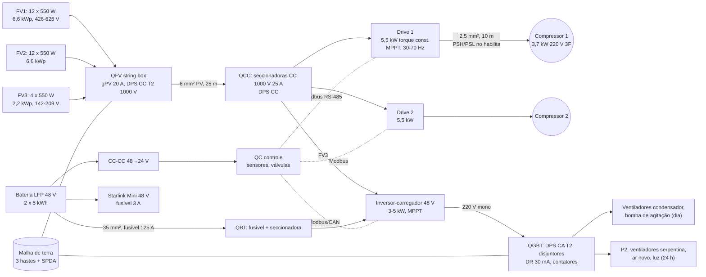
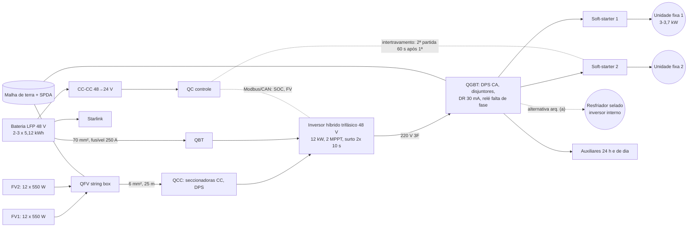

# 02 — Projeto elétrico e solar (ANTEPROJETO, versão 1)

Autor: subagente integrador-solar (sistemas fotovoltaicos fora da rede). Data: 17/11/2026.
Base: `docs/00-premissas.md` (decisões D1 a D6), `docs/01-projeto-termico.md` (anteprojeto aprovado com correções), parecer `docs/_trabalho/revisao-01-termico-r2.md` (achados N1 e N4), `docs/12-financeiro.md` (pedidos IS-1 a IS-10) e `docs/11-importacao.md` (preços e Inmetro).
**Não alterei o doc 01.** Onde a parte elétrica não fecha com ele, o conflito está registrado na seção 13.

Marcação: **[CALCULADO]** conta sobre dado com fonte; **[CALCULADO sobre SUPOSTO]**; **[SUPOSTO]** valor típico sem fonte; **[VALIDAR]** validar com profissional habilitado ou com o fabricante (escrito).

**Situação: anteprojeto.** Não serve para contratar a execução: o projeto executivo elétrico, o SPDA e a estrutura precisam de engenheiro com ART (seção 11). Os fabricantes do drive e do compressor ainda não confirmaram por escrito o uso em compressor.

---

## Aviso sobre a pesquisa na web (17/11/2026)

| Site | Resultado |
|---|---|
| cresesb.cepel.br (SunData), com e sem `www`, por `https` e `http` | **Não abriu.** Sem `www`: o proxy desta sessão recusou (403) e o nome não resolve por `http`. Com `www`: erro de certificado (o mesmo do engenheiro). Não contornei |
| re.jrc.ec.europa.eu (PVGIS) e power.larc.nasa.gov (NASA POWER) | Recusados pelo proxy (403). **Sem série diária de irradiação** |
| static.weg.net, www.invt.com, profilesolar.com, labmet.univasf.edu.br | Nome não resolve nesta sessão (fora da lista de sites liberados). **Não li os manuais em PDF**; uso só os trechos que a busca mostrou |
| Busca na web | Funcionou. Todo número com link abaixo vem do **resumo da busca**, não da leitura da página |

**Consequência:** a irradiação de Petrolina continua [SUPOSTA] (a mesma do doc 01), e não consegui responder ao IS-1 com dado. Para liberar: o dono precisa permitir `cresesb.cepel.br`, `re.jrc.ec.europa.eu`, `static.weg.net` e `www.invt.com` na configuração de rede da sessão, ou um humano baixar as tabelas (seção 14, pendências).

---

## Resumo para o dono

| Item | Decisão deste anteprojeto |
|---|---|
| Módulos | 550 W monocristalino com registro no Inmetro (referência OSDA ODA550-36-MH, R$ 869,99) |
| Arranjo principal (comum às duas rotas) | **2 fileiras (strings) de 12 módulos em série = 24 módulos = 13,2 kWp** [CALCULADO]. Conferido de 10 °C a 70 °C de célula: 426 a 626 V |
| Por que não 10 ou 12 kWp | Com dois drives da classe 380 V cada fileira precisa de 12 módulos em série para não cair abaixo de ~400 V no calor. 11 em série dá 390 V com a célula a 70 °C: no limite do desarme por subtensão (360 V) |
| Subarranjo auxiliar (só Rota B) | 4 módulos em série (2,2 kWp) ligados ao carregador de 48 V: carrega a bateria das cargas de 24 h **mesmo quando o compressor não parte** (resposta ao IS-6) |
| Estrutura | Cobertura metálica elevada sobre o contêiner e o abrigo de máquinas, cerca de 8 × 9,5 m, 28 posições de módulo, 10° para o norte. **Vento e fundação: validação estrutural obrigatória** |
| Auxiliares | Barramento de 48 V com inversor-carregador; consumo noturno ≈ 3,1 kWh (Starlink Mini) a 3,7 kWh (Starlink padrão) |
| Bateria das cargas de 24 h (Rota B) | **2 módulos de 5 kWh (≈ 9,2 kWh úteis)**: aguentam 3 dias nublados seguidos só com os auxiliares. 1 módulo aguenta 1 dia nublado |
| **N1 (Rota B)** | **A bateria de 48 V não alimenta o compressor.** O compressor para à noite e em céu muito fechado; a reserva de frio é o gelo. Alternativas elétricas existem, mas custam R$ 15 a 20 mil a mais para uns 10 kWh de frio: se o dono quer bateria tocando compressor, a escolha coerente é a Rota A |
| **N4 (Rota A)** | Unidade de rotação fixa exige **soft-starter** (ou drive comum) em cada compressor e partidas intertravadas com 60 s de intervalo; inversor híbrido trifásico de 12 kW com surto de 2× por 10 s |
| Custo da parte elétrica e solar, sem compressor | **Rota B ≈ R$ 102 a 172 mil; Rota A ≈ R$ 103 a 183 mil** (seção 14; faixas largas por falta de cotação). Na parte elétrica a Rota A custa R$ 1 a 11 mil a mais; a diferença maior está no compressor/drive x unidades fixas |
| Riscos | Rota B: drive de bomba em compressor sem confirmação escrita; partidas repetidas com nuvem. Rota A: bateria grande no calor (vida útil), surto de partida, mais conversões |

---

## 1. Dados de projeto

### 1.1 O que vem do doc 01 (tabela 15.7, versão atual)

**Atualização recebida do coordenador (ajustes da 2ª revisão do doc 01):** frio de projeto **87,3 kWh/dia**; mínimos que fecham: (b) R513A **11 kWp + 500 kg**; (a) resfriador selado **12 kWp + 700 kg**; o engenheiro recomenda **13 kWp** com as frutas complementares; consumo noturno confirmado em **150 W médios e 300 W de pico**; bateria mínima de 5 kWh mantida (sem ela a referência não atravessa 1 dia nublado); tabela 12.1 por rota: Rota B parte por rampa; Rota A, unidade fixa com partida direta de **~45 a 80 A** [SUPOSTO do engenheiro]. **Os 13,2 kWp deste documento atendem os dois mínimos e coincidem com a recomendação de 13 kWp.** A tabela abaixo é a da versão anterior, mantida para rastreio.

| Dado | Valor |
|---|---|
| Arranjo de referência | 12 kWp (em aberto 10 a 14), em dois grupos; estrutura e cabos para 12 a 14 kWp |
| Rota B | 2 inversores de 5,5 kW; motor de 220 V com inversor da classe 380 V; 30 a 70 Hz; 9,8 A; barramento de 400 V ou mais em operação; um compressor parte com 2,0 kW de geração |
| Rota A | Inversor híbrido de 8 a 10 kW com 10 a 15 kWh; carga de até 7,4 kW |
| Auxiliares de dia | 360 W (arq. b) ou 560 W (arq. a) |
| Auxiliares internos de 24 h | 150 W médios à noite, pico de 300 W |
| Bateria de apoio térmico | 5 kWh úteis (Rota B) — **ver conflito CE-1** |
| Starlink | 25 a 100 W, 24 h |

### 1.2 Clima e irradiação [SUPOSTO — SunData não abriu]

| Grandeza | Valor adotado | Origem |
|---|---|---|
| Irradiação no plano, dia de projeto | 5,8 kWh/m²·dia | doc 01, seção 4 [SUPOSTO] |
| Junho | 4,7 | idem |
| Dia ruim / nublado | 3,0 / 2,0 | idem |
| Desempenho global (PR) | 0,75 | idem [SUPOSTO] |
| Temperatura de célula mínima (madrugada/amanhecer, para tensão máxima) | **10 °C** | [SUPOSTO conservador]. A mínima do ar em Petrolina raramente desce de 15 °C [de memória, VALIDAR com série do INMET]; ao amanhecer sem sol a célula fica próxima do ar |
| Temperatura de célula máxima (para tensão mínima) | **70 °C** | 41 °C de ar + ~29 K de aquecimento de módulo em estrutura aberta e ventilada [SUPOSTO; NOCT típico ≈ 45 °C a 20 °C de ar e 800 W/m²] |
| Vento básico V0 (NBR 6123) | **30 m/s** | [SUPOSTO, de memória, mapa de isopletas para o interior do Nordeste]. A busca não trouxe o valor para o sertão de PE ([UFPB, comparação regional](https://repositorio.ufpb.br/jspui/bitstream/tede/5529/1/arquivototal.pdf)); há proposta de novo mapa ([SciELO](https://www.scielo.br/j/riem/a/ZtLjhFT9DztgcCKzX66D7HD/)). **[VALIDAR com o engenheiro estrutural]** |

---

## 2. Módulos e arranjo

### 2.1 Módulo escolhido

**Referência: OSDA ODA550-36-MH, 550 W**, R$ 869,99 à vista na Pichau (`docs/11-importacao.md` 4.1; [anúncio](https://www.pichau.com.br/painel-solar-fotovoltaico-osda-550w-2279x1134x35mm-oda550-36-mh)), 2.279 × 1.134 × 35 mm. Dados elétricos do anúncio (resumo da busca; ficha oficial do fabricante não encontrada): **Vmp 42,10 V; Imp 13,06 A; Voc 50,10 V; Isc 14,01 A; coeficiente de Voc −0,28 %/°C; de potência −0,35 %/°C**. A Elgin ELG550-M72HOD publica os mesmos valores ([ficha Elgin](https://content.elgin.com.br/assets/arquivos/datasheet-painel-solar-550w-elgin-ELG550-M72HOD_V1.pdf)), o que indica o mesmo projeto de origem; serve qualquer 550 W com valores parecidos e **registro no Inmetro** (Portaria 140/2022; `docs/11` seção 3).

Para Vmp uso o coeficiente de potência (−0,35 %/°C) [SUPOSTO conservador; a ficha costuma não dar o de Vmp].

### 2.2 Conferência da fileira de 12 em série [CALCULADO]

Fórmulas: Voc(T) = n × 50,10 × [1 − 0,0028 × (T − 25)]; Vmp(T) = n × 42,10 × [1 − 0,0035 × (T − 25)].

| Módulos em série | Voc a 10 °C (máx.) | Vmp a 10 °C | Vmp a 25 °C | Vmp a 70 °C (mín.) | Situação com drive classe 380 V (MPPT anunciado 450–750 V; subtensão 360 V) |
|---|---|---|---|---|---|
| 4 | 209 V | 177 V | 168 V | 142 V | Só para o carregador de 48 V (subarranjo auxiliar) |
| 8 | 418 V | 354 V | 337 V | 284 V | Serve só a drive da classe 220 V |
| 11 | 574 V | 487 V | 463 V | **390 V** | No limite: 390 V mal passa dos 363 V que o motor pede a 70 Hz e fica a 30 V do desarme |
| **12** | **626 V** | 532 V | 505 V | **426 V** | **Adotado.** Acima de 400 V (doc 01) em todo o dia quente; Voc bem abaixo de 750–800 V e de 1.000/1.500 V do módulo |
| 13 | 679 V | 576 V | 547 V | 461 V | Também serve, mas leva a 14,3 kWp com dois drives |

Exemplo da conta para 12 a 70 °C: 12 × 42,10 × (1 − 0,0035 × 45) = 505,2 × 0,8425 = **425,6 V**.

Leitura: entre 426 e 450 V (célula acima de ~55 °C) o drive fica **abaixo** da faixa anunciada de 450 a 750 V. Se a faixa real de MPPT do drive escolhido começar em 450 V, ele trabalha fora do ponto ótimo nas horas mais quentes e perde alguns por cento [VALIDAR na ficha do drive; a faixa de 450 a 750 V é de anúncio, `docs/11` 4.3]. O manual WEG do CFW500 Solar dá subtensão a **360 V CC** para a classe 380–480 V ([manual de aplicação, resumo da busca](https://static.weg.net/medias/downloadcenter/h5a/h00/WEG-CFW500-manual-de-aplicacion-solar-pump-drive-10005254285-es.pdf)), e o MPPT é ajustável por parâmetro (na linha CFW11, P1022/P1023 — [ManualsLib](https://www.manualslib.com/manual/3401499/Weg-Cfw11.html?page=19)). 12 em série é o compromisso.

### 2.3 Arranjo adotado

| Grupo | Composição | Potência | Para onde vai |
|---|---|---|---|
| Fileira FV1 | 12 em série | 6,6 kWp | Rota B: drive 1. Rota A: MPPT 1 do híbrido |
| Fileira FV2 | 12 em série | 6,6 kWp | Rota B: drive 2. Rota A: MPPT 2 do híbrido |
| Fileira FV3 (só Rota B) | 4 em série | 2,2 kWp | Carregador MPPT do sistema de 48 V |
| **Total** | 24 (+4) | **13,2 kWp (+2,2)** | Estrutura com 28 posições nas duas rotas |

- Uma fileira por entrada: **não há corrente reversa entre fileiras, e fusível de fileira não é obrigatório** (com até duas fileiras em paralelo a corrente reversa não passa da Isc de uma; a exigência de fusível vale de três em paralelo em diante, segundo leitura secundária da NBR 16690 — [Canal Solar](https://canalsolar.com.br/protecao-contra-sobrecorrente-e-do-atendimento-as-normas-vigentes/)) [VALIDAR com o projetista habilitado]. Mesmo assim, prevejo porta-fusível seccionável, que serve de ponto de abertura.
- Corrente de projeto do cabo CC: 1,25 × Isc = 1,25 × 14,01 = **17,5 A** [CALCULADO].
- Na Rota A, as 4 posições de FV3 ficam livres para ampliação (por exemplo, mais uma fileira se o híbrido tiver terceira entrada).

### 2.4 Energia elétrica diária [CALCULADO sobre SUPOSTO]

E = kWp × H × 0,75.

| Arranjo | kWp | Dia de projeto (5,8) | Junho (4,7) | Dia ruim (3,0) | Nublado (2,0) |
|---|---|---|---|---|---|
| Principal | 13,2 | 57,4 kWh | 46,5 kWh | 29,7 kWh | 19,8 kWh |
| Auxiliar FV3 (Rota B) | 2,2 | 9,6 kWh | 7,8 kWh | 5,0 kWh | 3,3 kWh |

O doc 01 calculou com 12 kWp (52,2 kWh no dia de projeto). Com 13,2 kWp e os auxiliares fora do arranjo principal (Rota B), o compressor recebe mais do que o doc 01 supôs: **folga a favor**, não conflito (CE-2).

---

## 3. Acionamento do compressor direto do sol (Rota B)

### 3.1 O que o drive precisa fazer

| Exigência | Origem | Como atender |
|---|---|---|
| Entrada CC direta dos painéis, com MPPT | doc 01 | Drive solar (inversor de bombeamento) ou conversor de frequência comum com firmware/função solar |
| Carga de **torque constante** (compressor alternativo), não carga de bomba (torque ∝ rotação²) | doc 01; parecer r1 | Escolher o drive pela classe de **torque constante (sobrecarga de 150 % por 60 s)** e não pela classe "bomba/ventilador". Ex.: na INVT GD100-PV, a letra **G** no código indica "constant torque load" ([catálogo GD100-PV V3.0, resumo da busca](https://www.invt.com/uploads/file1/20250604/GD100-PV%20Catalog-V3.0.pdf)) |
| Frequência mínima de 30 Hz (lubrificação do compressor) | doc 01, BITZER ECOLINE 30–70 Hz | Parâmetro de frequência mínima no drive = 30 Hz; abaixo disso o drive **para** em vez de rodar devagar |
| Partida sem pico | doc 01 | Rampa de aceleração de 2 a 5 s até 30 Hz [SUPOSTO; o fabricante do compressor dá o valor] |
| Partida em compressor com pressão equalizada | prática de refrigeração | O frigorista garante equalização (5 min parado) antes da nova partida; o drive não consegue partir contra pressão alta em baixa rotação [VALIDAR com BITZER] |
| Religamento atrasado (anticiclagem) | doc 01 12.3 | 5 min parado, no controlador **e** no drive (dupla proteção) |
| Pressostatos | doc 01 12.2 | Em série no comando "habilita" do drive, sem passar pelo controlador |

### 3.2 O que foi e o que não foi confirmado

| Pergunta | Resposta encontrada | Situação |
|---|---|---|
| WEG CFW500 Solar Drive aceita compressor? | A WEG descreve o produto para bombas centrífugas e submersas ([folheto WEG solar pump drives](https://static.weg.net/medias/downloadcenter/h46/hbb/WEG-solar-pump-drives-50078696-en.pdf), resumo da busca). Nada sobre compressor | **[VALIDAR COM FABRICANTE]** — pedir por escrito |
| WEG CFW11 / CFW700 solar | Manual de aplicação de bombeamento ([CFW700](https://static.weg.net/medias/downloadcenter/h9f/h00/WEG-CFW700-solar-pump-drive-application-manual-10006763201-en.pdf)); nada sobre compressor | [VALIDAR COM FABRICANTE] |
| INVT GD100-PV | Classe de torque constante no código ("G"); entrada CC de 150 a 900 V conforme modelo ([página do produto](https://www.invt.com/products/gd100-pv-series-solar-pump-28)); aplicações divulgadas só de bombeamento | Torque constante: **sim pelo catálogo**. Uso em compressor: [VALIDAR COM FABRICANTE] |
| ABB ACQ80 | A busca não trouxe resultado | Não verificado |
| Fronius | Não fabrica drive de bombeamento [de memória] | — |
| Frequência mínima de 30 Hz | É parâmetro comum de qualquer conversor de frequência | Ajustável [SUPOSTO]; confirmar o comportamento ao cair abaixo dela com pouco sol (parar x insistir) |

**Conclusão:** nenhum fabricante confirma por escrito, em página que eu tenha visto, o uso do drive solar em compressor frigorífico. Fica **[VALIDAR COM FABRICANTE]**, com as perguntas da seção 3.5. Isso é o principal risco da Rota B (doc 01 já dizia).

**Caminho de menor risco dentro da Rota B** [SUPOSTO, a confirmar]: usar um **conversor de frequência de uso geral de torque constante** (por exemplo WEG CFW500 comum ou CFW11), que fabricantes de compressor costumam aprovar para compressor, alimentado **pelos bornes do barramento CC** (DC+/DC−) a partir dos painéis, com a função de MPPT feita pelo próprio firmware solar (quando existir para aquele modelo) ou pelo controlador ajustando a frequência para manter a tensão CC num valor fixo (≈ 480 a 520 V, "tensão constante", que perde 2 a 5 % em relação a um MPPT real [SUPOSTO]). Alimentação pelos bornes CC exige pré-carga do barramento: **[VALIDAR COM FABRICANTE]**.

### 3.3 Dimensionamento do drive

| Item | Valor |
|---|---|
| Motor | 3,7 kW, ligado em 220 V a 60 Hz, alimentado por drive da classe 380 V (doc 01, achado 16) |
| Corrente do motor a 257 V / 70 Hz | 9,8 A (doc 01) |
| Drive | **5,5 kW / 13 A ou mais, classe 380–480 V, torque constante** (1 por compressor = **2 drives**) |
| Entrada CC | 1 fileira de 12 × 550 W: 426 a 626 V, 13,06 A em operação, Isc 14,01 A |
| Potência CC disponível por drive | até ~6,6 kWp × 0,8 ≈ 5,3 kW no pico [CALCULADO sobre SUPOSTO]; o compressor pede até 4,2 kW CC (doc 01): sobra no meio do dia, que vai para gelo (banco) ou é cortada pelo drive |

### 3.4 Nuvem passageira: o que acontece

| Momento | Drive | Compressor | Câmara |
|---|---|---|---|
| Sol pleno | MPPT, frequência até 70 Hz | Faz gelo | Atendida pelo banco (água gelada) |
| Nuvem fina (potência cai 30–60 %) | MPPT reduz a frequência para segurar a tensão CC | Roda mais devagar (≥ 30 Hz) | Nada muda |
| Nuvem densa (potência abaixo da necessária para 30 Hz, ≈ 1,6 kW) | Tensão CC cai; ao atingir a frequência mínima por **20 s** [SUPOSTO] o drive pára por rampa ou pelo comando do controlador | **Pára.** Solenoide fecha, recolhimento (doc 01 12.3) | **Nada muda:** a câmara é servida pelo banco de gelo e pela bomba P2, que estão no sistema de 48 V |
| Volta do sol | Controlador espera **5 min parado** e geração ≥ 2,0 kW por 2 min (doc 01 12.3) | Nova partida | — |
| Nuvens repetidas | Limite de **6 partidas/h por compressor** [VALIDAR com BITZER]; atingido, o controlador bloqueia até a hora seguinte | — | — |

**O efeito de uma nuvem é perder gelo, não frio na câmara.** É a razão do banco de gelo. Os auxiliares da câmara não dependem do compressor porque estão no barramento de 48 V com bateria (seção 5).

Com dois compressores, o controlador parte primeiro um (2,0 kW) e só depois o segundo (4,0 kW), e desliga primeiro o segundo quando a geração cai: assim, sob nuvem fina, um continua rodando em vez de os dois pararem.

### 3.5 Perguntas para pedir por escrito

Ao fabricante do drive (WEG, INVT ou outro): (1) o modelo serve para compressor alternativo semi-hermético de torque constante? (2) frequência mínima ajustável de 30 Hz com parada (não giro lento) quando a potência não basta? (3) tempo de rearme e bloqueio de religamento ajustáveis (5 min)? (4) entrada para pressostato de segurança direto no habilita? (5) faixa real de MPPT e tensão máxima CC? (6) comunicação Modbus RTU com leitura de potência CC, tensão CC e frequência? (7) garantia mantida nessa aplicação? (8) registro no Inmetro (`docs/11` seção 3, item 2)?

Ao fabricante do compressor (BITZER): faixa de frequência aprovada com R513A a −7/+51 °C; partidas por hora; tempo mínimo ligado; rampa; exigência de equalização; corrente de partida em inversor.

---

## 4. Rota A: inversor híbrido e máquinas de rede (resposta ao N4)

### 4.1 Arquitetura

24 módulos (2 fileiras de 12) → inversor híbrido trifásico 48 V com 2 MPPT → banco de baterias de 10 a 15 kWh → quadro CA trifásico 220/127 V ou 380/220 V [conforme a versão brasileira do inversor; VALIDAR] → (a) resfriador selado (Elgin EcoTherm Duo, com inversor próprio: sem pico) **ou** (b) duas unidades condensadoras de rotação fixa (Elgin UCMB/UCM0 ou Danfoss Optyma) **com soft-starter cada**, e os auxiliares.

### 4.2 Conferência do arranjo no híbrido

Referência: Deye SUN-12K-SG04LP3 (trifásico, bateria de 48 V). Faixa típica de entrada FV da família: até 800 V e MPPT de ~200 a 650 V [de memória; VALIDAR na ficha — as fichas em português estão no site da Deye ([SG04LP3 5–12 kW](https://pt.deyeinverter.com/deyeinverter/2025/08/19/【b】datasheet_sun-5-12k-sg04lp3-eu_20250805_pt.pdf)), não abri]. A fileira de 12 (426 a 626 V) cabe nessa faixa e tem Voc a 10 °C (626 V) abaixo de 800 V.

### 4.3 Partida das cargas de rotação fixa [CALCULADO sobre SUPOSTO]

| Grandeza | Valor | Origem |
|---|---|---|
| Potência elétrica de uma unidade condensadora (≈ 5 HP, −7/+51 °C) | ≈ 3,0 a 3,7 kW | doc 01 (7,4 kW para as duas) |
| Corrente nominal em 220 V trifásico | 3,5 kW ÷ (1,73 × 220 × 0,85) = **10,8 A** | [CALCULADO] |
| Corrente de partida direta | **45 a 80 A** (doc 01 tabela 12.1 atualizada; coerente com 5 a 7 × a nominal) | [SUPOSTO; pedir o LRA na ficha da unidade] |
| Potência aparente na partida direta | 1,73 × 220 × 45 a 80 = **17,1 a 30,5 kVA** | [CALCULADO sobre SUPOSTO] |
| Surto do híbrido de 12 kW | **2 × nominal por 10 s = 24 kVA** | Deye informa pico fora da rede de 2× a nominal por 10 s para a família SG04 ([ficha SG04LP1 3–6 kW](https://pt.deyeinverter.com/deyeinverter/2025/09/05/【b】datasheet_sun-3-6k-sg04lp1_20250905_pt.pdf), resumo da busca); para o 12 kW [VALIDAR] |
| Resultado com partida direta | **Não garante:** 17,1 a 30,5 kVA contra 24 kVA, mais os auxiliares ligados | — |
| Com soft-starter (corrente limitada a ~3 × a nominal) | 1,73 × 220 × 32 A = **12,3 kVA** | [CALCULADO sobre SUPOSTO] |
| Com conversor de frequência comum (alternativa) | ≈ 1 × a nominal, sem pico | — |

### 4.4 Interface elétrica da Rota A (tabela que faltava — N4)

| Carga | Qtde | Potência | Tensão / tipo | Partida | Regra |
|---|---|---|---|---|---|
| Unidade condensadora fixa (arq. b) | 2 | 3,0–3,7 kW cada | 220 V trifásico (ou 380 V, conforme a versão do híbrido) | **Soft-starter** de 5,5 kW / 16 A (ex.: WEG SSW05/SSW07 ou Danfoss MCI) [modelo e preço a cotar] | **Intertravamento:** nunca partir as duas juntas; 2ª só 60 s depois da 1ª; só com SOC ≥ 40 % ou FV ≥ 4 kW [SUPOSTO]; anticiclagem de 5 min |
| Resfriador selado (arq. a) | 1 | até ~7,4 kW (ficha não publicada) | conforme ficha | Inversor interno (sem pico) [VALIDAR na ficha] | Comando externo liga/desliga ou de capacidade |
| Bomba P1 (arq. a) | 1 | 260 W | 220 V mono | Direta | Intertravada com o resfriador (fluxo) |
| Auxiliares 24 h (P2, ventiladores, controle, Starlink) | — | 150 W médios à noite, 300 W de pico | 220 V mono e 24/48 V CC | — | Sempre ligados |
| Ventiladores do condensador (dentro da unidade) | 2 | 150 W | com a unidade | — | — |
| **Inversor híbrido** | 1 | **12 kW trifásico, 48 V, surto 2× por 10 s** | — | — | Com só uma unidade fixa de 3,7 kW, um híbrido de 8 kW também partiria com soft-starter (8,3 vs 16 kVA); 12 kW cobre as duas rodando (7,4 kW) mais auxiliares |
| **Bateria** | — | **10 a 15 kWh** (2 a 3 módulos de 5,12 kWh) | 48 V LFP com BMS em CAN para o híbrido | — | Corrente de descarga para 7,8 kW: 7.800 ÷ 48 ÷ 0,93 ≈ **175 A** → mínimo 2 módulos de 100 A em paralelo [CALCULADO] |

Perda adicional na Rota A (achado N9 do revisor): a energia que passa pela bateria perde ida e volta [SUPOSTO 8 a 10 %]; a que vai do painel direto à carga perde só a conversão do inversor (≈ 3 a 6 %). Com o compressor rodando de dia, a maior parte da energia não passa pela bateria: a perda extra fica em ~2 a 3 % do total diário [CALCULADO sobre SUPOSTO: se ~25 % da energia passar pela bateria, 25 % × 10 % = 2,5 %]. O doc 01 já descontou 6 % de inversor na (a).

---

## 5. Subsistema auxiliar de 48 V e bateria das cargas de 24 h

### 5.1 Por que 48 V

As cargas de 24 h somam pouco (150 a 300 W), mas a bateria precisa receber até 2,2 kWp de carga e alimentar ventiladores do condensador e bomba de agitação de dia (360 W): em 48 V as correntes ficam em 5 a 60 A, com cabos curtos e baratos. Em 12 V seriam 4 vezes maiores. Starlink Mini aceita 12 a 48 V CC ([ficha, resumo da busca](https://www.ammonit.com/?p=25908)); o controle usa 24 V por conversor CC-CC.

### 5.2 Equipamento (Rota B)

| Item | Especificação | Referência |
|---|---|---|
| Inversor-carregador fora da rede 48 V | 3 a 5 kW, saída 220 V monofásica senoidal, **MPPT interno com entrada FV até ≥ 250 V** (para 4 × 550 W em série: 142 a 209 V), comunicação com BMS (CAN/RS-485), Modbus para o controlador | Ex.: Deye SUN-5K-SG03LP1, Growatt SPF 5000 ES ou equivalente com Inmetro. Faixa de preço do financeiro: **R$ 3.844 a 8.500** (`docs/12`, fonte F5) |
| Bateria | LiFePO4 48/51,2 V, 100 Ah (≈ 5 kWh) por módulo, BMS com comunicação | **Elgin BAT-48V-5KWH**: 48 V, 100 Ah, 5.000 Wh, LFP, 5 anos de garantia ([ficha Elgin](https://content.elgin.com.br/assets/arquivos/ELGIN-Datasheet-Elgin-BAT-48V-5KWH.pdf)); Intelbras BLL 48-100 T, 5 anos ([ficha](https://backend.intelbras.com/sites/default/files/2025-12/datasheet-bll-48-100-t-pt.pdf)). **Preço no Brasil não encontrado**; custo posto de importado R$ 8.331 (`docs/11` 4.5). Ciclos: não constam nas fichas encontradas |
| Conversor CC-CC 48 → 24 V | 10 A (240 W), isolado | Controle, válvulas, sensores |
| Starlink | Mini: 20 a 40 W de média, ~15 W ocioso ([Starlink, apoio](https://starlink.com/support/article/a7fe6525-5356-a837-48e6-33df176cdbc5)); entrada 12–48 V CC. Padrão: 75 a 100 W (doc 01) | Mini alimentado direto do 48 V por cabo curto e fusível de 3 A; o padrão por fonte própria em 220 V. Escolha: programador (PC-5) |

### 5.3 Balanço diário das cargas auxiliares (Rota B) [CALCULADO sobre SUPOSTO]

| Carga | Potência | Horas | Dia de sol (kWh) | Noite 17h–7h (kWh) | Fonte do valor |
|---|---|---|---|---|---|
| Parte térmica interna (P2, ventiladores da serpentina, ar novo) — noite | 150 W médios | 14 | — | 2,10 | doc 01 15.7 |
| Idem — dia (7h–17h) | 130 W médios | 10 | 1,30 | — | doc 01 tabela 5.4 (81 a 204 W) [SUPOSTO média] |
| Controle, sensores, válvulas, tela | 25 W | 24 | 0,25 | 0,35 | doc 01 diz 15 W; arredondei para cima [SUPOSTO] |
| Starlink Mini (padrão) | 30 W (85 W) | 24 | 0,30 (0,85) | 0,42 (1,19) | Starlink / doc 01 |
| Ventiladores do condensador + bomba de agitação | 360 W | ~8 (com compressor) | 2,90 | — | doc 01 15.7 |
| Resistências de cárter | 2 × 50 W, só 1 h antes do sol e em parada longa | ~2 | 0,10 | 0,10 | [SUPOSTO]; o doc 01 sugere ligar só 1 h antes do sol |
| Luz interna, alarme | 40 W | 2 | 0,08 | — | doc 01 |
| Autoconsumo do inversor-carregador | 30–50 W | 24 | 0,40 | 0,56 | [SUPOSTO] |
| **Total, Starlink Mini** | | | **5,3** | **3,5** | **8,8 kWh/dia** |
| **Total, Starlink padrão** | | | **5,9** | **4,3** | **10,2 kWh/dia** |

Dia de sol: FV3 gera 9,6 kWh (seção 2.4), cobre o dia e recarrega a noite (8,8 kWh) com pequena folga. **Junho (7,8 kWh) fica curto com Starlink padrão** → o controlador usa a sobra do arranjo principal? Não pode na Rota B (está nos drives). Por isso recomendo **Starlink Mini** ou, com padrão, **6 módulos em FV3** (6 em série: Voc 313 V a 10 °C, exige carregador com entrada ≥ 350 V) [CALCULADO].

Noite depois de dia ruim com recepção normal: a parte térmica sobe a 2,6 kWh (doc 01 12.1) → noite de **4,0 kWh** (Mini).

### 5.4 Autonomia em dias nublados (só auxiliares; compressor parado ou rodando pouco) [CALCULADO sobre SUPOSTO]

Dia nublado: FV3 gera 3,3 kWh; consumo diurno sem compressor ≈ 1,30 + 0,25 + 0,30 + 0,40 = 2,25 kWh → **saldo +1,05 kWh**. Noite após dia nublado: 4,0 kWh. Útil por módulo: 5,0 kWh × 0,9 de profundidade de descarga = 4,5 kWh [SUPOSTO 90 %].

| Momento | 1 módulo (4,5 kWh úteis) | 2 módulos (9,0 kWh úteis) |
|---|---|---|
| 17h do último dia de sol (cheia) | 4,5 | 9,0 |
| Fim da 1ª noite (−3,5) | 1,0 | 5,5 |
| Fim do 1º dia nublado (+1,05) | 2,05 | 6,55 |
| Fim da 2ª noite (−4,0) | **−1,95 → falta às ~3h** | 2,55 |
| Fim do 2º dia nublado (+1,05) | — | 3,60 |
| Fim da 3ª noite (−4,0) | — | **−0,40 → falta perto das 6h** |
| Com o Starlink cortado à noite a partir do 2º dia (−0,42/noite) | — | **+0,0 → passa a 3ª noite** |

**Conclusões:**
- **1 módulo (5 kWh): 1 dia nublado.** Na 2ª noite a bomba P2 e os ventiladores param de madrugada e o gelo fica sem como chegar à câmara.
- **2 módulos (10 kWh): 3 dias nublados**, com a regra de corte de carga não essencial (Starlink, luz) quando o SOC cair abaixo de 30 %.
- Isso conversa com o doc 01 (3 dias nublados sem fruta nova o gelo segura): **a bateria das cargas de 24 h é que define quantos dias o gelo consegue ser usado**. Recomendo **2 módulos na Rota B** [CALCULADO sobre SUPOSTO]. Escolha final do dono.
- Na Rota B, além disso, o compressor ainda gera frio em dia nublado: o arranjo principal gera 19,8 kWh (seção 2.4), o bastante para o compressor rodar algumas horas no meio do dia, desde que a geração passe de 2,0 kW.

### 5.5 Rota A

Na Rota A não há FV3: os auxiliares ficam no mesmo barramento do híbrido, e a bateria de 10 a 15 kWh cobre os auxiliares com folga (4 kWh por noite). A regra de prioridade no controlador: reservar sempre **4,5 kWh** (≈ 30 % de 15 kWh) para os auxiliares da noite; abaixo disso, o compressor não parte.

---

## 6. N1: como a bateria de 48 V chegaria ao compressor na Rota B

O drive recebe 426 a 626 V CC; a bateria tem 48 V. Opções estudadas:

| Opção | Como | Custo extra estimado | Frio que entrega | Problemas | Posição |
|---|---|---|---|---|---|
| **N1-a. A bateria só alimenta os auxiliares; o compressor para à noite e com pouco sol** | Seções 5.2 a 5.4 | **R$ 0** | A reserva de frio é o gelo (doc 01: 3 dias nublados sem fruta nova) | A tabela 6.2 do doc 01, nas linhas "bateria de apoio", não vale na Rota B (CE-1) | **Adotada** |
| N1-b. Inversor de 48 V para 220 V CA alimentando a **entrada CA** do drive | Drive com entrada CA + FV e comutação automática (INVT GD100-PV com módulo de comutação por contator, [GD100-PV Solutions](https://www.invt.com/uploads/file1/20210810/GD100-PV-Solutions.pdf); INVT SP100 com divisão de potência CA+FV, [catálogo](https://www.invt.com/uploads/file1/20260814/SP100%20Catalog_EN_V3.0.pdf), resumos da busca) | Inversor 48 V de 5 kW no lugar do de 3 kW (+R$ 2 a 5 mil), contatores e intertravamento (+R$ 1 a 2 mil), **mais 1 a 2 módulos de bateria** para ter o que entregar (+R$ 8,3 a 20 mil) → **+R$ 11 a 27 mil** [SUPOSTO] | 4,5 kWh úteis × 0,9 (inversor) × COP 2,4 ≈ **10 kWh de frio por módulo**, uma vez por sequência | **Incompatível com o drive da classe 380 V:** 220 V CA retificado dá 311 V CC, abaixo do desarme de 360 V. Exige drive da classe 220 V e fileiras de 8 em série (284 a 418 V), refazendo o arranjo e perdendo torque acima de ~55 Hz | Rejeitada para este protótipo |
| N1-c. Conversor CC-CC elevador 48 → ~500 V, 3 a 4 kW, ligado ao barramento CC do drive | Equipamento industrial/sob encomenda | Preço não encontrado; **não achei produto de prateleira no Brasil** | Igual à N1-b | Pré-carga do barramento, isolação, garantia | Rejeitada (desenvolvimento, categoria 3 do doc 01) |

**Resposta ao N1:** na Rota B **a bateria só alimenta as cargas de 24 h** e o compressor para à noite. Se o dono quiser que a bateria toque o compressor, a solução coerente é a **Rota A**, onde isso é natural (o custo da N1-b fica perto do da Rota A, com mais risco).

---

## 7. Estrutura da cobertura sobre o contêiner

> **⚠ VALIDAÇÃO ESTRUTURAL OBRIGATÓRIA.** Tudo abaixo é pré-dimensionamento para orçamento. Perfil, ligações, chumbadores e fundação precisam de projeto de engenheiro civil com ART, com vento pela NBR 6123 e sondagem ou ao menos inspeção do solo.

### 7.1 Geometria [SUPOSTO]

| Item | Valor |
|---|---|
| Posições de módulo | 28 (24 + 4), retrato, 7 por fileira × 4 fileiras |
| Dimensões do plano de módulos | 7 × 1,134 + folgas ≈ **8,0 m** (leste–oeste) × 4 × 2,279 + folgas ≈ **9,3 m** (norte–sul) ≈ 74 m² |
| O que cobre | Contêiner de 20 pés (6,06 × 2,44 m) + abrigo de máquinas de ≈ 4 × 2,5 m (doc 01 15.7) + faixa de serviço |
| Inclinação | **10° para o norte** (latitude de Petrolina ≈ 9,4° S; 10° é o mínimo usual para a chuva lavar o módulo) |
| Altura livre | ≥ 3,5 m na parte baixa (contêiner de 2,59 m + ≥ 0,9 m de ar para ventilar o teto e o condensador) |
| Estrutura | Pórticos de aço galvanizado a fogo, 3 pórticos (6 pilares), terças em perfil U enrijecido ou trilho de alumínio |
| Benefício térmico | A cobertura faz sombra no teto do contêiner. **Não recalculei a carga térmica** (o doc 01 não a considera; ganho a favor da segurança) |

> **⚠ SEGURANÇA.** O condensador das unidades e o resfriador (Rota A) precisam de ar livre: não fechar as laterais da cobertura; ar quente não pode recircular sob os módulos. Na arquitetura (a) com R290 de fábrica, a cobertura **não pode formar bolsão** sobre o resfriador (gás mais pesado que o ar acumula embaixo, não em cima; mas manter as laterais abertas) e não pode haver fonte de ignição a menos de 1 m (doc 01 7.3).

### 7.2 Ordem de grandeza do vento [CALCULADO sobre SUPOSTO]

- Pressão dinâmica: q = 0,613 × V² = 0,613 × 30² = **552 Pa** (V0 = 30 m/s, fatores S1 = S2 = S3 = 1 [SUPOSTO]; S2 a ~4 m em campo aberto é menor que 1, mas fico com 1).
- Coeficiente de força de sucção para cobertura isolada inclinada a 10°: **1,2 a 1,5** [SUPOSTO, de memória; a NBR 6123 tem tabela para coberturas isoladas].
- Arrancamento: 552 × 1,5 × 74 m² ≈ **61 kN** no total.
- Peso próprio: 28 módulos × ~28 kg = 7,7 kN + aço ≈ 6 kN = 13,7 kN.
- Arrancamento líquido ≈ 47 kN; por pilar (6): **≈ 8 kN**. Com fator de segurança 1,5 e concreto a 24 kN/m³: bloco ou sapata de **≈ 0,5 m³ por pilar** (por exemplo 0,8 × 0,8 × 0,8 m) só para segurar o arrancamento [CALCULADO sobre SUPOSTO].
- Fixação dos módulos: grampos com o número e posição da ficha do módulo (normalmente 4 grampos na faixa indicada); **não furar o módulo**.

### 7.3 Alternativa mais barata

Estrutura de solo (mesas fixas a 0,8 m) ao lado do contêiner, com a mesma fundação por estacas ou blocos: dispensa a altura e os pórticos, mas não faz sombra no contêiner e ocupa ≈ 80 m² de terreno. Custo da estrutura de solo [SUPOSTO]: 40 a 60 % do da cobertura.

---

## 8. Quadros, proteções, aterramento e SPDA

### 8.1 Quadros

| Quadro | Local | Conteúdo |
|---|---|---|
| **QFV — caixa de junção CC (string box)** | Na estrutura, sombra, IP65, próximo aos módulos | Por fileira: porta-fusível seccionável 1.000 V CC com fusível gPV de **20 A** (FV1, FV2) e 20 A (FV3) — opcional por norma com 1 fileira por entrada, mantido como ponto de abertura; **DPS CC tipo 2, 1.000 V** (Ucpv ≥ 1,2 × 626 V = 751 V) nas fileiras que vão a mais de 10 m [VALIDAR]; barra de equipotencialização |
| **QCC — quadro CC junto aos drives/híbrido** | Abrigo de máquinas | Seccionadora CC sob carga, **1.000 V CC, 25 A, 2 polos por fileira** (dispositivo de seccionamento exigido para manutenção); DPS CC tipo 2 (tipo 1+2 se houver SPDA com descida próxima); na Rota B, os 2 drives; na Rota A, entrada do híbrido |
| **QBT — quadro da bateria (48 V)** | Abrigo de máquinas, gabinete ventilado e sombreado | Fusível NH ou classe T de **125 A** (Rota B, inversor de 5 kW) / **250 A** por par de módulos (Rota A) junto ao polo positivo da bateria; seccionadora CC 125/250 A; barramento; shunt de medição (se o BMS não informar) |
| **QGBT — quadro geral CA** | Abrigo de máquinas | Saída do inversor; disjuntor geral; DPS CA tipo 2 (275 V, 20 kA); disjuntores por circuito (curva C para motores, D para condensadoras com soft-starter [VALIDAR]); **DR 30 mA** nos circuitos de tomada, iluminação, bomba e ventiladores dentro da câmara (área úmida); contatores comandados pelo controlador; relé de falta de fase (Rota A trifásica) |
| **QC — quadro de controle** | Abrigo de máquinas ou porta do contêiner | Controlador, conversor 48→24 V, relés de interface, bornes (seção 12), botão de emergência |

**DR e conversores de frequência:** drive gera corrente de fuga com componente contínua. Em circuito de drive, ou se usa **DR tipo B** (caro) ou se dispensa o DR naquele circuito garantindo proteção por seccionamento automático no esquema TN [VALIDAR com o projetista; NBR 5410 permite conforme o caso]. Não usar DR tipo AC em circuito de drive.

### 8.2 Proteções e correntes [CALCULADO]

| Circuito | Corrente de projeto | Proteção |
|---|---|---|
| Fileira FV (12 × 550 W) | 1,25 × 14,01 = 17,5 A | gPV 20 A; cabo 6 mm² (capacidade ≥ 40 A em ar livre a 70 °C [SUPOSTO]) |
| Fileira FV3 (4 × 550 W) | 17,5 A | gPV 20 A |
| Drive → compressor (Rota B) | 9,8 A | Proteção eletrônica do drive (ajuste 10,5 A); disjuntor-motor na entrada não se aplica (entrada CC) |
| Bateria → inversor de 5 kW (Rota B) | 5.000 ÷ 48 ÷ 0,93 = 112 A | Fusível 125 A |
| Bateria → híbrido de 12 kW (Rota A, 7,8 kW contínuos) | 175 A | Fusível 250 A, cabo 70 mm² |
| Híbrido → unidade fixa (Rota A) | 10,8 A | Disjuntor-motor 10–16 A + soft-starter |
| Circuitos de 220 V dos auxiliares | ≤ 10 A | Disjuntor 16 A + DR 30 mA |

### 8.3 Aterramento

- **Esquema TN-S** na saída do inversor (neutro aterrado num só ponto, no QGBT), condutor PE separado até todas as cargas [SUPOSTO usual em sistema isolado; VALIDAR com o fabricante do inversor, que define se o neutro é ligado à terra internamente].
- **Malha:** 3 hastes de aço cobreado de 2,4 m em triângulo (≥ 2,4 m entre si), interligadas por cabo de cobre nu de 50 mm² enterrado a 0,5 m, unindo: estrutura da cobertura, contêiner (que é metálico), abrigo, tanque de gelo metálico, QGBT/BEP. Resistência-alvo ≤ 10 Ω [SUPOSTO; a NBR 5419 não fixa valor se o arranjo do eletrodo for o da norma]. **Solo do sertão é seco e de alta resistividade**: prever medição e, se preciso, mais hastes ou anel em volta do contêiner.
- **Molduras dos módulos e estrutura:** equipotencializadas com cabo de cobre de no mínimo **6 mm²** (16 mm² se fizer parte do SPDA) ou pela própria estrutura com arruela dentada certificada [VALIDAR com a NBR 16690].
- O contêiner e a tubulação de cobre do frio ligados à mesma barra (BEP).

### 8.4 SPDA (proteção contra raio)

- A necessidade sai da **análise de risco da NBR 5419-2**, feita pelo projetista. A NBR 16690 manda avaliar o DPS pela NBR 5419 e instalar conforme o risco ([Canal Solar sobre a NBR 16690](https://canalsolar.com.br/stringbox-com-dps-e-necessaria-ou-nao-o-que-diz-a-nbr-16690/)) [VALIDAR].
- Proposta para orçamento: a **cobertura metálica pode ser captor natural** se a espessura e a continuidade atenderem a NBR 5419-3 [VALIDAR]; senão, captores tipo Franklin/haste nas quinas, mantendo a distância de segurança aos módulos (sem sombrear). **Descidas pelos pilares** (≥ 2), ligadas à malha. Mastro da Starlink ligado ao mesmo sistema.
- Com SPDA, os DPS passam a **tipo 1+2** no QCC e QGBT.

> **⚠ SEGURANÇA — TENSÃO CONTÍNUA DOS PAINÉIS.** A fileira de 12 módulos tem até **626 V CC** e não desliga enquanto há luz. Arco em corrente contínua não se apaga sozinho. Regras: abrir a seccionadora CC **sob carga** só com dispositivo próprio para CC; nunca desconectar conector MC4 sob corrente; cobrir os módulos ou trabalhar à noite para mexer nas fileiras; conectores do mesmo fabricante dos dois lados; cabos CC em eletroduto próprio, separados do CA; placas de aviso "tensão contínua — não desliga com a chave geral" no QFV, QCC e na entrada do abrigo. Bateria de lítio: curto direto passa de milhares de ampères — ferramenta isolada, fusível junto ao polo.

---

## 9. Diagramas unifilares

### 9.1 Rota B (compressor direto no sol + 48 V para auxiliares)

### 9.2 Rota A (inversor híbrido + bateria + máquinas de rede)

---

## 10. Cabos e queda de tensão [CALCULADO]

Resistividade do cobre a 70 °C: ρ = 0,0211 Ω·mm²/m [SUPOSTO, 0,0178 a 20 °C × 1,19]. Monofásico/CC: ΔV = 2 × L × I × ρ / S. Trifásico: ΔV = 1,73 × L × I × ρ / S. Comprimentos [SUPOSTOS] para o leiaute do doc 01 14.1 (abrigo encostado ao contêiner, módulos em cima): **conferir no terreno**.

| Trecho | Cabo | Seção | Comprimento (ida) | Corrente | ΔV | Tensão | ΔV % | Limite |
|---|---|---|---|---|---|---|---|---|
| Módulos → QFV (por fileira, +/−) | PV1-F / H1Z2Z2-K 1,8 kV CC | 6 mm² | 15 m | 13,06 A | 1,38 V | 505 V | 0,27 % | ≤ 1 % [boa prática] |
| QFV → QCC (FV1, FV2) | idem | 6 mm² | 25 m | 13,06 A | 2,30 V | 505 V | **0,45 %** | ≤ 1 % |
| QFV → QCC (FV3) | idem | 6 mm² | 25 m | 13,06 A | 2,30 V | 168 V | **1,37 %** | ≤ 2 % (aceito; usar 10 mm² se passar de 35 m) |
| Bateria → inversor 5 kW (Rota B) | flexível classe 5, 1 kV | 35 mm² | 2 m | 112 A | 0,27 V | 51,2 V | **0,53 %** | ≤ 1 % |
| Bateria → híbrido (Rota A) | idem | 70 mm² | 2 m | 175 A | 0,21 V | 51,2 V | **0,41 %** | ≤ 1 % |
| Drive → compressor (Rota B), 3F | PP/EPR blindado para inversor | 2,5 mm² | 10 m | 9,8 A | 1,43 V | 257 V | **0,56 %** | ≤ 4 % (NBR 5410, a partir da fonte) |
| Híbrido → unidade fixa (Rota A), 3F | flexível 0,6/1 kV | 4 mm² | 10 m | 10,8 A (partida 32 A) | 0,99 V (2,9 V na partida) | 220 V | 0,45 % (1,3 %) | ≤ 4 % (≤ 10 % na partida) |
| QGBT → câmara (P2, ventiladores, luz), mono | flexível 750 V | 2,5 mm² | 30 m | 6 A | 3,04 V | 220 V | **1,38 %** | ≤ 4 % |
| QGBT → ventiladores do condensador e agitação | 2,5 mm² | 2,5 mm² | 8 m | 2 A | 0,27 V | 220 V | 0,12 % | ≤ 4 % |
| 48 V → Starlink Mini | 2 × 2,5 mm² | 2,5 mm² | 15 m | 0,8 A (2 A no pico) | 0,20 V (0,51 V) | 48 V | 0,4 % (1,1 %) | ≤ 3 % |
| CC-CC 24 V → sensores/válvulas | 2 × 1,5 mm² | 1,5 mm² | 20 m | 1 A | 0,56 V | 24 V | 2,3 % | ≤ 5 % |
| Equipotencialização módulos/estrutura | cobre verde-amarelo | 6 mm² (16 se SPDA) | 60 m no total | — | — | — | — | — |
| Malha de terra | cobre nu | 50 mm² | 30 m | — | — | — | — | — |
| Descidas do SPDA | cobre nu ou alumínio | 35/70 mm² | 2 × 5 m | — | — | — | — | NBR 5419-3 |
| Dados (Modbus RS-485) | par trançado blindado | 2 × 0,5 mm² | 3 × 10 m | — | — | — | — | — |

Exemplo da conta (QFV → QCC): 2 × 25 × 13,06 × 0,0211 / 6 = 2,30 V; 2,30 / 505 = 0,45 %.

A seção dos cabos é fixada pela **capacidade de corrente e temperatura** (cabos ao sol a 70 °C e em eletroduto no telhado), não pela queda, que fica pequena. Cabos CC: dupla isolação, resistentes a UV, 1,5–1,8 kV CC.

---

## 11. Normas aplicáveis e responsável técnico

| Norma | Edição | O que rege aqui | Verificação |
|---|---|---|---|
| **ABNT NBR 5410** | 2004 (versão corrigida 2008) [de memória] | Instalação de baixa tensão em CA: dimensionamento, DR, quedas de tensão, aterramento | A NBR 16690 deve ser usada junto com a NBR 5410 ([O Setor Elétrico](https://www.osetoreletrico.com.br/?p=169102)) |
| **ABNT NBR 16690** | 2019 | Instalações elétricas de arranjos fotovoltaicos: condutores, proteção, seccionamento, aterramento e equipotencialização; DPS conforme NBR 5419; **proíbe disjuntor da NBR NM 60898 (residencial) no lado CC** | Resumos de [O Setor Elétrico](https://www.osetoreletrico.com.br/?p=169102), [Canal Solar](https://canalsolar.com.br/stringbox-com-dps-e-necessaria-ou-nao-o-que-diz-a-nbr-16690/), [Engehall](https://engehall.com.br/nbr-16690/); há grupo revisando a norma ([O Setor Elétrico](https://www.osetoreletrico.com.br/?p=164196)). **Não li o texto da norma** |
| **ABNT NBR 5419** (partes 1 a 4) | 2015 [de memória; conferir se houve revisão] | Análise de risco (parte 2), SPDA (parte 3), DPS e sistemas internos (parte 4) | Não li o texto |
| **NR-10** | Nova redação pela **Portaria MTE nº 737, de 29/05/2026** | Segurança em eletricidade. Item 10.4.8: **projeto elétrico sob responsabilidade de profissional legalmente habilitado**; 10.4.13: projeto mantido atualizado conforme o executado | [Portaria 737/2026 (normaslegais)](https://www.normaslegais.com.br/legislacao/portaria-mte-737-2026.htm); [TSE](https://sintse.tse.jus.br/documentos/2026/Jun/1/saude/portaria-no-737-de-29-de-maio-de-2026-aprova-a-nova-redacao-da-norma-regulamentadora-no-10-nr-10) (resumos da busca) |
| ABNT NBR 6123 | 1988 (há proposta de novo mapa) | Vento na cobertura | ver 1.2 |
| ABNT NBR 16274 | [de memória] | Comissionamento, ensaios e documentação de sistemas FV | Não verificado |
| ABNT NBR 11704 | [de memória] | Classificação de sistemas FV (isolado) | Não verificado |
| Inmetro, Portaria 140/2022 (alterada pela 515/2023) | — | Registro de módulo, inversor isolado/híbrido, controlador de carga e bateria | `docs/11` seção 3 |
| Lei 6.496/1977 | [de memória] | ART para todo serviço de engenharia | Não verificado nesta rodada |

**O que exige responsável técnico (engenheiro com ART):**

| Serviço | Profissional | Por quê |
|---|---|---|
| Projeto executivo elétrico (CC e CA, quadros, proteções, aterramento) | Engenheiro eletricista | NR-10 10.4.8 (verificado acima) e ART (Lei 6.496/1977) |
| Análise de risco e projeto de SPDA | Engenheiro eletricista | NBR 5419 |
| Estrutura da cobertura e fundação | Engenheiro civil | Vento (NBR 6123); arrancamento de ~47 kN |
| Execução | Eletricista com **NR-10** (curso básico, 40 h) e orientação do engenheiro; é recomendável que o mesmo engenheiro acompanhe e assine a execução | NR-10 |
| ART em sistema fora da rede | Não encontrei regra específica do CREA para sistema isolado (a busca só mostrou dúvida sobre GD) | **[VALIDAR com o CREA-PE]** |

---

## 12. Tabela de interface para o controle

Bornes propostos no quadro QC (régua XT). Nomes de sinal compatíveis com o doc 01 12.2. O programador (doc 03) pode renumerar; o que é obrigatório está em **negrito**.

| Borne | Sinal | De → para | Tipo | Tensão / faixa | Rota | Observação |
|---|---|---|---|---|---|---|
| XT1:1-2 | **EMERG** | Botão de emergência → QC e contatores | DI, contato NF | 24 V CC | A, B | Corta habilita dos drives/soft-starters por fio, não por programa |
| XT1:3-4 | **HAB-D1** | QC (relé) → drive 1, entrada DI1 "habilita" | DO relé em série com **PSH1 e PSL1** | 24 V CC (fonte do drive) | B | Pressostatos ligados direto, sem passar pelo controlador (doc 01) |
| XT1:5-6 | **HAB-D2** | idem drive 2 | DO relé + PSH2/PSL2 | 24 V CC | B | — |
| XT1:7-8 | REF-D1 | QC → drive 1, AI1 | AO | 0–10 V = 30–70 Hz (ou teto de frequência) | B | Opcional se Modbus. Com MPPT no drive, o controlador só limita o teto |
| XT1:9-10 | REF-D2 | idem drive 2 | AO | 0–10 V | B | — |
| XT1:11-12 | FALHA-D1 / D2 | Drive → QC | DI (relé do drive, NA) | 24 V CC | B | — |
| XT1:13-14 | MARCHA-D1 / D2 | Drive → QC | DI | 24 V CC | B | — |
| XT2:1-3 | **RS485-A** (A, B, GND) | QC ↔ drive 1, drive 2, inversor-carregador | Modbus RTU | RS-485, 9.600–19.200 bps | B | Ler: tensão e potência CC, frequência, corrente do motor, falhas; SOC e potência FV3 |
| XT2:1-3 | **RS485-A** | QC ↔ híbrido | Modbus RTU (ou CAN por gateway) | RS-485 | A | Ler: SOC, potência FV, potência de carga, alarmes |
| XT3:1-2 | **HAB-U1** | QC → soft-starter 1, entrada "partida" | DO relé + PSH1/PSL1 | 24 V CC ou 220 V (conforme soft-starter) | A | Intertravamento: 2ª partida ≥ 60 s após a 1ª |
| XT3:3-4 | **HAB-U2** | QC → soft-starter 2 | DO relé + PSH2/PSL2 | idem | A | — |
| XT3:5-6 | FIM-RAMPA U1 / U2 | Soft-starter → QC | DI | 24 V CC | A | Só libera a 2ª depois do fim de rampa da 1ª |
| XT3:7-8 | HAB-CH | QC → resfriador selado | DO relé (contato seco) + FS1 | conforme ficha | A, arq. (a) | Não liga sem fluxo |
| XT4:1-2 | K-VC | QC → contator dos ventiladores do condensador | DO relé | bobina 220 V CA ou 24 V | B | Liga com o compressor (Rota A: dentro da unidade) |
| XT4:3-4 | VC-REF | QC → ventiladores EC do condensador | AO | 0–10 V | A, B | Pela pressão de condensação |
| XT4:5-6 | K-AG | QC → contator da bomba de agitação | DO relé | 220 V CA | A, B | Durante a carga do banco |
| XT4:7-8 | K-CART | QC → contator das resistências de cárter | DO relé | 220 V CA | A, B | 1 h antes do sol; parada longa |
| XT4:9-10 | P2-REF | QC → bomba P2 (eletrônica) | AO | 0–10 V | A, B | 24 h |
| XT4:11-12 | VE-REF | QC → ventiladores EC da serpentina | AO | 0–10 V | A, B | 24 h |
| XT4:13-14 | VAN-REF | QC → ventilador de ar novo | AO | 0–10 V | A, B | Pelo CO2-1 |
| XT4:15-16 | SOL1 / SOL2 | QC → válvulas solenoides de líquido | DO | 24 V CA/CC [conforme bobina] | A, B (arq. b) | Recolhimento |
| XT5:1-2 | K-SL | QC → relé da Starlink | DO | 48 V CC, 3 A | A, B | Corte de carga com SOC < 30 % |
| XT5:3-4 | K-LUZ | QC → luz interna / luz da porta | DO | 220 V CA | A, B | — |
| XT5:5-6 | SIRENE | QC → sirene externa | DO | 24 V CC | A, B | Pessoa presa, CO2, alarme |
| XT6:1-2 | V-BAT | Divisor resistivo 48 V → AI | AI | 0–10 V (≈ 0–60 V) | A, B | Redundância ao BMS |
| XT6:3-4 | DPS-OK | Contatos de sinalização dos DPS (série) | DI | 24 V CC | A, B | Alarme de DPS queimado |
| XT6:5-6 | SEC-CC | Contato auxiliar das seccionadoras CC | DI | 24 V CC | A, B | Aviso de chave aberta |
| XT6:7-8 | TT-ABR | Temperatura do abrigo/gabinete de baterias | AI (PT100/NTC) | — | A, B | Alarme a 40 °C; ventilação |
| XT6:9-10 | K-VBAT | QC → ventilador do gabinete das baterias | DO | 24 V CC | A, B | Liga acima de 30 °C |
| — | Alimentação do QC | CC-CC 48→24 V | — | 24 V CC, 10 A | A, B | Consumo do controle entra na seção 5.3 (25 W) |
| — | Ethernet Starlink | Roteador → controlador | Ethernet | — | A, B | Telemetria |

Setpoints elétricos para o controle [SUPOSTO; ajustar no comissionamento]: partida do 1º compressor com potência CC disponível ≥ 2,0 kW por 2 min (Rota B: lida no drive; Rota A: FV ou SOC ≥ 60 %); 2º compressor com ≥ 4,0 kW; parada do drive em 30 Hz por 20 s; 5 min de anticiclagem; máximo de 6 partidas/h; SOC mínimo para compressor na Rota A = 40 % (reserva da noite); corte de cargas não essenciais com SOC < 30 %; alarme de SOC < 20 %.

---

## 13. Conflitos e divergências (as duas posições; o dono medeia)

| Nº | Assunto | Posição do doc 01 (engenheiro) | Posição deste documento | O que custa/arrisca cada uma |
|---|---|---|---|---|
| **CE-1** | Bateria de apoio que "alimenta o compressor" na Rota B (doc 01 6.2–6.4, 12.1 "5 kWh úteis na Rota B", 12.3 "só alimenta compressor com LT1 em 0 %"; achado N1) | Recomenda **bateria mínima de 5 kWh**, que mantém na versão atualizada: sem ela a referência não atravessa 1 dia nublado; 14 kWp + 5 kWh para 2 dias com recepção normal | **Na Rota B a bateria de 48 V não chega ao compressor** sem drive da classe 220 V e outro arranjo (N1-b, +R$ 11 a 27 mil) ou conversor sob encomenda (N1-c). Adoto N1-a: bateria só para auxiliares (2 × 5 kWh). As linhas da tabela 6.2 com "bateria" valem **só para a Rota A**. Na Rota B, a alternativa equivalente é mais painel ou mais gelo (o próprio doc 01 mostra 14 kWp + 1.000 kg cobrindo 2 dias com recepção normal) | Seguir o doc 01 na Rota B exige hardware que não existe no projeto. Seguir este: a regra "dia nublado, meia carga; 3º dia sem fruta" vira obrigatória na Rota B. **O engenheiro precisa refazer a tabela 6.2 para a Rota B sem bateria no compressor.** Se confirmar que, sem ela, a Rota B não atravessa 1 dia nublado com recepção normal, as saídas são: mais gelo ou mais painel (estrutura de 28 posições já comporta 15,4 kWp), N1-b (+R$ 11 a 27 mil, refaz o arranjo), ou Rota A. O dono escolhe |
| CE-2 | Tamanho do arranjo | Versão atualizada: mínimo 11 kWp (b) e 12 kWp (a); recomenda 13 kWp | **13,2 kWp** (2 × 12 em série) pela janela de tensão do drive da classe 380 V — **concorda com os 13 kWp do engenheiro; não há mais conflito de tamanho**. 10 ou 11 kWp não formam duas fileiras válidas. Mais 2,2 kWp para os auxiliares na Rota B | +2 módulos em relação a 22 (≈ R$ 1.740). A favor do balanço térmico. 10 kWp só com 1 drive (1 fileira de 18? Voc 940 V, excede) ou drives classe 220 V: **não recomendo** |
| CE-3 | Auxiliares de dia | Descontados da geração do arranjo principal (360/560 W) | Na Rota B saem do subarranjo FV3 (2,2 kWp): o compressor recebe todo o arranjo principal | A favor do balanço térmico; custo de 4 módulos e do carregador com MPPT |
| CE-4 | Starlink | 75 a 100 W (padrão) ou 25 a 40 W (Mini), sem escolha | Recomendo **Mini** (fonte Starlink: 20 a 40 W). Com o padrão, FV3 deve ter 6 módulos e a bateria fica curta no 3º dia | Decisão do programador (PC-5) e do dono |

Nenhum conflito com o revisor: N1 e N4 foram respondidos (seções 4 e 6).

---

## 14. Lista de compras (opção brasileira, D5) e especificações para cotação

Preços vistos em 17/11/2026 nos documentos citados; "não encontrado" quando não havia. Totais em faixa.

### 14.1 Parte comum (as duas rotas)

| Item | Qtde | Especificação | Referência / preço | Total (R$) |
|---|---|---|---|---|
| Estrutura de cobertura metálica galvanizada, 28 posições, ≈ 74 m², 10° | 1 | Seção 7 | **Preço não encontrado.** [SUPOSTO R$ 350 a 600/m² montada] | 26.000 a 44.000 |
| Fundação (6 blocos ≈ 0,5 m³) | 1 | Seção 7.2 | [SUPOSTO] | 4.000 a 8.000 |
| Projeto estrutural com ART | 1 | — | [SUPOSTO] | 2.500 a 5.000 |
| String box QFV (3 entradas, gPV, DPS CC T2 1000 V, IP65) | 1 | Seção 8.1 | Preço não encontrado [SUPOSTO] | 1.200 a 2.500 |
| QCC: seccionadoras CC 1000 V 25 A (3), DPS CC | 1 | Seção 8.1 | [SUPOSTO] | 1.500 a 3.000 |
| QBT: fusível classe T/NH 125–250 A, seccionadora CC, barramento | 1 | Seção 8.1 | [SUPOSTO] | 800 a 1.800 |
| QGBT: disjuntores, DR 30 mA (3), DPS CA T2, contatores (5), relé de falta de fase | 1 | Seção 8.1 | [SUPOSTO] | 2.500 a 5.000 |
| Cabo solar 6 mm² 1,8 kV (vermelho e preto) | 250 m | Seção 10 | [SUPOSTO R$ 6 a 9/m] | 1.500 a 2.250 |
| Cabos CA, bateria, controle, conectores MC4 originais, eletrodutos, leitos | lote | Seção 10 | [SUPOSTO] | 2.500 a 5.000 |
| Aterramento: 3 hastes 2,4 m, 30 m de cabo nu 50 mm², solda exotérmica, caixas de inspeção, BEP | 1 | Seção 8.3 | [SUPOSTO] | 1.500 a 3.000 |
| SPDA (captores, descidas, conexões) — se a análise de risco pedir | 1 | Seção 8.4 | [SUPOSTO] | 2.000 a 5.000 |
| Conversor CC-CC 48→24 V 10 A | 1 | Seção 5.2 | Preço não encontrado [SUPOSTO] | 300 a 700 |
| Gabinete ventilado e sombreado para baterias (com ventilador 24 V e termostato) | 1 | IS-5 | [SUPOSTO] | 1.000 a 2.500 |
| Projeto elétrico executivo + SPDA com ART | 1 | Seção 11 | [SUPOSTO] | 3.000 a 8.000 |
| Eletricista NR-10 + ajudante: 10 a 14 diárias | — | IS-8 | [SUPOSTO R$ 400 a 650/dia a dupla] | 4.000 a 9.100 |
| **Subtotal comum** | | | | **≈ 54.000 a 105.000** |

### 14.2 Rota B

| Item | Qtde | Referência / preço | Total (R$) |
|---|---|---|---|
| Módulo 550 W (OSDA ODA550-36-MH ou equivalente com Inmetro) | 28 | R$ 869,99 (Pichau, `docs/11` 4.1) | **24.360** |
| Drive solar 5,5 kW, classe 380 V, torque constante, MPPT, Modbus | 2 | WEG CFW500 Solar: **preço não encontrado**; kits SGV de 5,5 e 7,5 cv a R$ 2.814 e 3.569 (`docs/11` 4.3; conteúdo do kit não informado). [SUPOSTO WEG R$ 4.000 a 7.000 cada] | 5.600 a 14.000 |
| Inversor-carregador 48 V 3–5 kW com MPPT (entrada FV ≥ 250 V) | 1 | R$ 3.844 a 8.500 (`docs/12`, F5) | 3.844 a 8.500 |
| Bateria LFP 48 V 5 kWh (Elgin BAT-48V-5KWH, Intelbras BLL 48-100 T ou equivalente com Inmetro) | 2 | Preço no Brasil não encontrado; R$ 8.331 posto de importado (`docs/11` 4.5) [SUPOSTO R$ 7.000 a 10.000] | 14.000 a 20.000 |
| **Subtotal Rota B** | | | **≈ 48.000 a 67.000** |
| **Total Rota B (comum + B), sem compressor e sem o resto do frio** | | | **≈ 102.000 a 172.000** |

### 14.3 Rota A

| Item | Qtde | Referência / preço | Total (R$) |
|---|---|---|---|
| Módulo 550 W | 24 | R$ 869,99 | **20.880** |
| Inversor híbrido trifásico 48 V, 12 kW, 2 MPPT, surto 2× por 10 s, versão brasileira com Inmetro (ex.: Deye SUN-12K-SG04LP3) | 1 | **Preço no Brasil não encontrado.** Referência europeia de 8 kW monofásico: € 1.207 a 1.750 com IVA ([Obramat](https://www.obramat.es/productos/inv-red-h-deye-sun-8k-sg06lp1-bm3-8kw-25154123.html), [Wattuneed](https://www.wattuneed.com/en/hybrid-inverters/27059-deye-8-kva-single-phase-hybrid-inverter-sun-8k-sg01-lp1-eu-0768563822292.html)). [SUPOSTO R$ 12.000 a 22.000 no Brasil] | 12.000 a 22.000 |
| Bateria LFP 48 V 5 kWh | 2 a 3 | idem Rota B | 14.000 a 30.000 |
| Soft-starter 5,5 kW / 16 A (só arq. b com unidades fixas) | 2 | Preço não encontrado [SUPOSTO R$ 1.200 a 2.500] | 2.400 a 5.000 |
| **Subtotal Rota A** | | | **≈ 49.000 a 78.000** |
| **Total Rota A (comum + A)** | | | **≈ 103.000 a 183.000** |

**Leitura:** com a bateria das cargas de 24 h incluída na Rota B (2 módulos), a diferença elétrica entre as rotas é pequena: **Rota A ≈ R$ 1 a 11 mil a mais** na parte elétrica [CALCULADO sobre SUPOSTO]. A diferença real está no **compressor e no drive** (Rota B: BITZER + 2 drives, preço do compressor não encontrado — ER-14) contra **unidades fixas de R$ 5 a 10 mil cada** (Rota A, `docs/11` 4.2), e no risco. Na Rota A com 3 módulos (15 kWh) o sistema também cobre 3 dias nublados com recepção normal pela tabela 6.2 do doc 01 (14 kWp + 15 kWh).

### 14.4 Especificações para cotação (para o agente de importação)

| Item | Especificação |
|---|---|
| Módulo | Monocristalino 540–560 W, Voc ≤ 51 V, Isc ≤ 14,5 A, coef. Voc ≥ −0,30 %/°C, 1.500 V CC, IEC 61215/61730, **registro Inmetro** |
| Drive solar | 5,5 kW, entrada CC 350–800 V com MPPT, saída 3F 0–380 V 0–70 Hz, **classe torque constante (150 % 60 s)**, frequência mínima ajustável com parada, religamento atrasado, Modbus RTU, IP54 ou em quadro, garantia por escrito para compressor alternativo |
| Inversor-carregador 48 V | 3–5 kW senoidal 220 V 60 Hz, MPPT 120–450 V ≥ 2,5 kW, comunicação BMS CAN/RS-485, Modbus, Inmetro |
| Inversor híbrido | 12 kW 3F 220/127 V ou 380/220 V 60 Hz, 48 V, 2 MPPT 150–650 V / ≤ 800 V, surto 2× 10 s, modo isolado sem rede, Inmetro |
| Bateria | LFP 51,2 V 100 Ah, BMS com CAN compatível com o inversor, ≥ 6.000 ciclos a 80–90 % DoD declarados, operação até 45 °C, garantia ≥ 5 anos, Inmetro |

---

## 15. Respostas aos pedidos IS-1 a IS-10 do financeiro

| Pedido | Resposta | Fonte / marcação |
|---|---|---|
| **IS-1** Irradiação mês a mês, dias abaixo de 2,0 e 3,0 kWh/m², maior sequência | **Não obtido.** SunData (com e sem www, http e https), PVGIS e NASA POWER bloqueados nesta sessão (seção "Aviso"). Continua valendo o [SUPOSTO] do doc 01: 5,8 / 4,7 / 3,0 / 2,0. Média anual > 6 kWh/m²·dia no semiárido (doc 01, CBENS e UFPE) | Para fechar: liberar `cresesb.cepel.br` e `power.larc.nasa.gov` (série diária 2001–2024 permite contar dias < 2 e < 3 e a maior sequência), ou um humano baixar a série da estação automática do INMET em Petrolina |
| **IS-2** 8, 10, 12 kWp: módulos, preço, energia | 15 módulos (8,25 kWp): R$ 13.050; 35,9 kWh (projeto) / 12,4 kWh (nublado). 18 (9,9 kWp): R$ 15.660; 43,1 / 14,9. 22 (12,1 kWp): R$ 19.140; 52,6 / 18,2. **Adotado 24 (13,2 kWp): R$ 20.880; 57,4 / 19,8** — único que forma duas fileiras válidas para o drive da classe 380 V. +4 (2,2 kWp) na Rota B: R$ 3.480; 9,6 / 3,3 | [CALCULADO sobre SUPOSTO]; preço `docs/11` 4.1 |
| **IS-3** Estrutura: tipo, preço por kWp, deixar pronto para 12 | Cobertura sobre contêiner e abrigo, 28 posições (15,4 kWp): **R$ 30 a 52 mil com fundação ≈ R$ 2.000 a 3.400 por kWp** [SUPOSTO]. Solo: 40 a 60 % disso. **Deixar pronto para 28 posições custa ≈ 15 % a mais em aço; ampliar depois exige novo pórtico e nova fundação** [SUPOSTO]: recomendo comprar já com 28 posições | Seção 7; validação estrutural obrigatória |
| **IS-4** Drive: modelo, preço, confirmado para compressor, quantos | **2 drives** de 5,5 kW classe 380 V, torque constante. WEG CFW500 Solar (preço não encontrado) ou INVT GD100-PV classe "G" (preço BR não encontrado; US$ 138 a 328 FOB para genéricos, `docs/11`). Kits SGV R$ 2.814 a 3.569. **Não confirmado por escrito para compressor: [VALIDAR COM FABRICANTE]** | Seção 3 |
| **IS-5** Bateria: modelo com Inmetro, preço, garantia, calor, abrigo | Elgin BAT-48V-5KWH (5 kWh, LFP, **5 anos**), Intelbras BLL 48-100 T (5 anos). **Ciclos não constam nas fichas; preço no Brasil não encontrado; registro Inmetro desses modelos não confirmado.** Calor: vida de LFP cai à medida que a temperatura média passa de 25 °C [SUPOSTO, de memória: cerca de metade da vida a cada 10–15 °C acima]. Recomendo **gabinete ventilado e sombreado no abrigo** (R$ 1.000 a 2.500), meta de 20 a 35 °C; **não** colocar dentro da câmara (umidade de 90 % e condensação). Refrigeração ativa não se paga para 10 kWh [SUPOSTO] | Seção 5.2 |
| **IS-6** Em dia nublado o arranjo carrega a bateria dos auxiliares? | **Sim, na Rota B, pelo subarranjo FV3 de 4 módulos ligado ao inversor-carregador de 48 V**, independente do compressor: 3,3 kWh em dia de 2,0 kWh/m², saldo de +1,05 kWh no dia. Carregador: R$ 3.844 a 8.500. Na Rota A, o híbrido faz isso naturalmente | Seções 5.3 e 5.4 |
| **IS-7** Cabos, proteções, aterramento, SPDA, quadros | **R$ 13.000 a 27.000** (string box, QCC, QBT, QGBT, cabos, MC4, aterramento, SPDA, CC-CC; seção 14.1). Cai dentro da reserva atual do financeiro (R$ 9 a 23 mil), um pouco acima no teto | [SUPOSTO]; lista na seção 14.1 |
| **IS-8** Diárias de eletricista e engenheiro com ART | **10 a 14 diárias** de eletricista NR-10 com ajudante (R$ 4.000 a 9.100) [SUPOSTO]. **Engenheiro eletricista com ART é exigido** para o projeto (NR-10 10.4.8, Portaria MTE 737/2026): R$ 3.000 a 8.000 com SPDA [SUPOSTO]. Estrutura: engenheiro civil, R$ 2.500 a 5.000 [SUPOSTO]. Taxa da ART: tabela do CREA [não verificada] | Seção 11 |
| **IS-9** Vida útil e reposição | Módulos: 25 anos [SUPOSTO, garantia de potência típica de 25–30 anos]. Drives e inversores: 8 a 12 anos [SUPOSTO]; prever 1 troca em 20 anos. Bateria LFP: garantia de 5 anos (Elgin, Intelbras); vida provável 8 a 10 anos em abrigo ventilado [SUPOSTO]; 1 a 2 trocas em 20 anos. DPS: trocar após descarga (sinalização no controle). Estrutura galvanizada: 20+ anos com inspeção [SUPOSTO] | — |
| **IS-10** Rota A: híbrido e bateria; Rota B: confirmação escrita | Rota A: **inversor híbrido trifásico 48 V de 12 kW** (ex.: Deye SUN-12K-SG04LP3; preço BR não encontrado, [SUPOSTO R$ 12 a 22 mil]) + **2 a 3 módulos de 5 kWh** (R$ 14 a 30 mil) + 2 soft-starters (R$ 2,4 a 5 mil). Rota B: **confirmação escrita não obtida**; perguntas prontas na seção 3.5 | Seções 4 e 14.3 |

---

## 16. Fechamento

### 16.1 Decisões tomadas neste documento

1. Módulo de 550 W com Inmetro; fileiras de 12 em série; **13,2 kWp** no arranjo principal, comum às duas rotas.
2. Estrutura com **28 posições** (cobertura sobre contêiner e abrigo), 10° para o norte.
3. Rota B: 2 drives de 5,5 kW classe 380 V de torque constante; subarranjo FV3 de 2,2 kWp para o 48 V; **bateria só para auxiliares (N1-a), 2 × 5 kWh**.
4. Rota A: híbrido trifásico de 12 kW, 10 a 15 kWh, soft-starter por unidade fixa e intertravamento de 60 s (N4).
5. Auxiliares em 48 V; controle em 24 V; Starlink Mini recomendada.
6. TN-S, malha com 3 hastes, DPS CC e CA, DR 30 mA nos circuitos da câmara, DR tipo B ou dispensa justificada nos drives.

### 16.2 O que não consegui verificar

- Irradiação mensal e série diária de Petrolina (SunData, PVGIS e NASA bloqueados).
- Manuais WEG e INVT em PDF (domínios fora da lista liberada): só os trechos da busca.
- Uso de drive solar em compressor (nenhuma confirmação escrita).
- Preços no Brasil de drive WEG, inversor híbrido, bateria, soft-starter, estrutura, quadros.
- V0 do vento para o sertão de PE; textos das normas ABNT (só resumos).
- Regra do CREA para ART em sistema fora da rede.
- Ficha do Deye de 12 kW (faixa de MPPT e surto) e versão brasileira trifásica.

### 16.3 Pendências para humanos

1. Liberar na rede da sessão (ou baixar à mão) `cresesb.cepel.br`, `power.larc.nasa.gov`, `re.jrc.ec.europa.eu`, `static.weg.net`, `www.invt.com` — fecha o IS-1 e confirma faixas dos drives.
2. Pedir por escrito à WEG (ou INVT) e à BITZER as respostas da seção 3.5.
3. Pedir à Elgin/Danfoss o **LRA** das unidades fixas (Rota A) e a ficha do resfriador EcoTherm Duo.
4. Cotação no Brasil: drive, híbrido 12 kW, bateria 48 V 5 kWh com Inmetro, soft-starter, estrutura.
5. Contratar engenheiro eletricista (projeto + SPDA, ART) e engenheiro civil (estrutura, ART); confirmar com o CREA-PE.
6. Medir no terreno: distâncias dos cabos, resistividade do solo.
7. Dono: escolher Rota A x Rota B; Starlink Mini x padrão; 1 ou 2 módulos de bateria na Rota B.
8. Engenheiro de refrigeração: refazer a tabela 6.2 do doc 01 para a Rota B sem bateria no compressor (CE-1).

### 16.4 Dados de interface para as outras disciplinas

| Para quem | Dado |
|---|---|
| Engenheiro (doc 01) | 13,2 kWp no arranjo principal (57,4 kWh no dia de projeto, 19,8 em dia nublado); na Rota B os auxiliares de dia saem do FV3; **a bateria não alimenta o compressor na Rota B** (CE-1); Rota A: soft-starter e intertravamento |
| Programador (doc 03) | Tabela da seção 12 e setpoints elétricos; Modbus RS-485 com drives/inversores; corte de carga por SOC; consumo do controle 25 W em 24 V |
| Logística | Cobertura ≈ 8 × 9,5 m, altura livre ≥ 3,5 m, 6 blocos de fundação ≈ 0,5 m³; abrigo de máquinas com gabinete de baterias ventilado e à sombra |
| Importação | Seção 14.4; tudo com Inmetro; comprar no Brasil (D5) |
| Financeiro | Seção 15 (IS-1 a IS-10) e totais da seção 14 |
